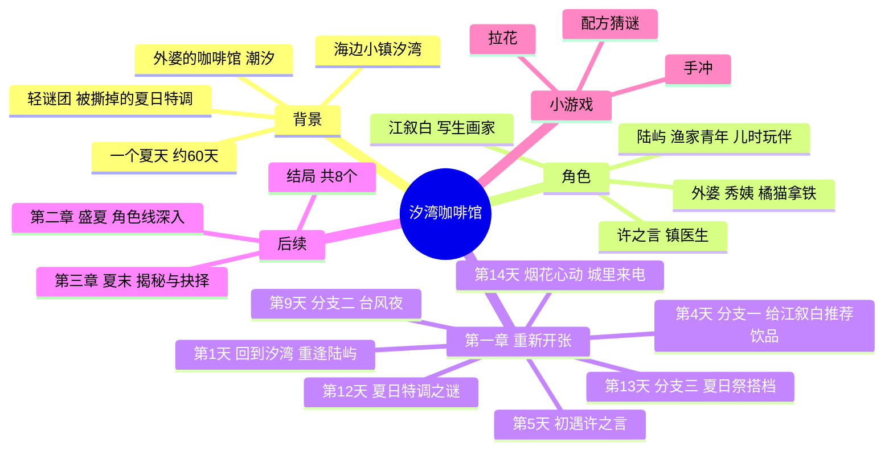

# 《汐湾咖啡馆》剧情大纲（暂定名）

> 状态：**已确认（Grok Bot 审核通过），仅性别方向待定**
> 已确认：网页技术一套代码三端共用；题材为海边咖啡馆；玩法以剧情阅读和选择为主，穿插轻松小游戏；第一版做第一章 14 天 Demo、3 位可攻略角色；暂定名《汐湾咖啡馆》；第一章节奏和三个分支点。

## 一句话故事

你在大城市的工作接连受挫，收到外婆去世的消息后回到海边小镇汐湾，接手她留下的咖啡馆「潮汐」。在一个夏天里，你把小店重新经营起来，也和三位各怀心事的常客走近。夏天结束时，你要决定留在小镇还是回到城市，以及和谁在一起。

## 世界观与背景

- **汐湾镇**：南方海边的小渔镇，有码头、灯塔、礁石滩和一条老街，年轻人大多外出打工，夏天会来一些游客和写生的人。
- **「潮汐」咖啡馆**：外婆在老街尽头开了三十年的小店，二楼能看到海。外婆留下一本手写配方本，最后一页"夏日特调"被撕掉了，这是贯穿全篇的轻谜团。
- **时间跨度**：一个夏天，约 60 天（7 月初到 8 月底）。Demo 为第一章，前 14 天。
- **基调**：治愈、慢节奏，带一点成年人的迷茫和遗憾。
- **主角**：以第二人称"你"叙述，玩家可自定义名字。主角与可攻略角色的性别方向待 Mike 拍板，下表角色设定为暂定。

## 角色

| 角色 | 身份 | 性格 | 心事（伏笔） |
| --- | --- | --- | --- |
| 陆屿 | 隔壁渔家青年，你的儿时玩伴 | 嘴硬心软，干活利落 | 父亲出海失事后放弃了大学，独自撑起家里的渔船 |
| 江叙白 | 夏天来小镇写生的画家 | 温和健谈，总坐在窗边画海 | 一年前起再也画不出满意的作品，来汐湾是最后一搏 |
| 许之言 | 镇卫生所唯一的医生 | 冷静寡言，细心 | 大城市医院一直在请他回去，他迟迟没回信 |
| 外婆（已故） | 「潮汐」原店主 | 通过信件、配方本和镇民回忆出场 | 撕掉的"夏日特调"那一页和她年轻时的往事有关 |
| 秀姨 | 老街杂货铺老板娘 | 热心话多 | 小镇八卦来源，负责引导和串场 |
| 拿铁 | 店里的橘猫 | 爱趴在吧台上 | 吉祥物，彩蛋和小提示 |

## 第一章：重新开张（Demo，第 1 到 14 天）

| 天数 | 剧情 | 分支 / 玩法 |
| --- | --- | --- |
| 第 1 天 | 回到汐湾，读外婆留下的信；店里落满灰，陆屿过来帮忙搬东西，两人久别重逢 | 介绍对话和选项操作 |
| 第 2 到 3 天 | 打扫小店，翻出外婆的配方本，照着做出回来后的第一杯咖啡 | 手冲小游戏教学 |
| 第 4 天 | 试营业，第一位客人江叙白坐在窗边画海 | **分支一**：给他推荐哪款饮品，影响江叙白好感 |
| 第 5 天 | 你在店里中暑晕倒，许之言出诊，第一次见面 | 对话选择影响许之言好感 |
| 第 6 到 8 天 | 日常：白天营业，傍晚自由选择去码头、礁石滩或卫生所 | 自由行动，触发对应角色的小事件；拉花小游戏解锁 |
| 第 9 天 | 台风预警，陆屿来帮忙钉窗 | **分支二**：留陆屿避雨，还是让他回家照顾母亲 |
| 第 10 天 | 台风过后，江叙白的画被吹坏，他第一次说起自己画不出画了 | 伏笔：江叙白线 |
| 第 11 天 | 深夜看到卫生所还亮着灯，许之言在看一封城里医院的来信 | 伏笔：许之言线 |
| 第 12 天 | 发现配方本最后一页"夏日特调"被撕掉，秀姨说外婆年轻时有段往事 | 主线谜团开启；配方猜谜小游戏 |
| 第 13 天 | 小镇夏日祭筹备，「潮汐」受邀摆摊 | **分支三**：邀请谁一起摆摊 |
| 第 14 天 | 夏日祭夜晚，烟花下和摆摊搭档的心动事件；章末接到城里前公司的电话，问你要不要回去 | 章末悬念，播放第二章预告 |

**Demo 收尾方式**：第一章不做完整结局。章末根据好感最高的角色播放不同的心动片段，再接第二章预告。

## 完整版规划（后续章节，仅方向）

- **第二章 盛夏（第 15 到 40 天）**：三条角色线分别深入，各自的心事浮出水面；咖啡馆口碑上升，游客变多。
- **第三章 夏末（第 41 到 60 天）**：揭开"夏日特调"的秘密；城里的工作邀约和角色各自的抉择同时到来。
- **结局**：3 位可攻略角色各有一个好结局和一个普通结局，共 6 个；再加"独自留在汐湾"和"回到城市"两个结局，总共 8 个。

## 轻量数值（剧情为主，数值只做隐藏判定）

- **好感度**：每位角色 0 到 100，隐藏数值，通过关键选项和自由行动变化。
- **口碑**：小游戏表现和饮品推荐会小幅影响口碑，口碑只用来解锁少量额外对话和店面装饰，不卡主线。
- **小游戏**：手冲、拉花、配方猜谜，都可以跳过，跳过按普通表现结算。

## 剧情结构导图

## 确认记录

- 已确认（Grok Bot 审核通过）：第一章 14 天 Demo、3 位可攻略角色；暂定名《汐湾咖啡馆》；第一章节奏和三个分支点。
- 待定（等 Mike 拍板）：主角和可攻略角色的性别方向（男主攻略女角色、女主攻略男角色，或开局让玩家选）。定下来之前角色设定不再细化。
