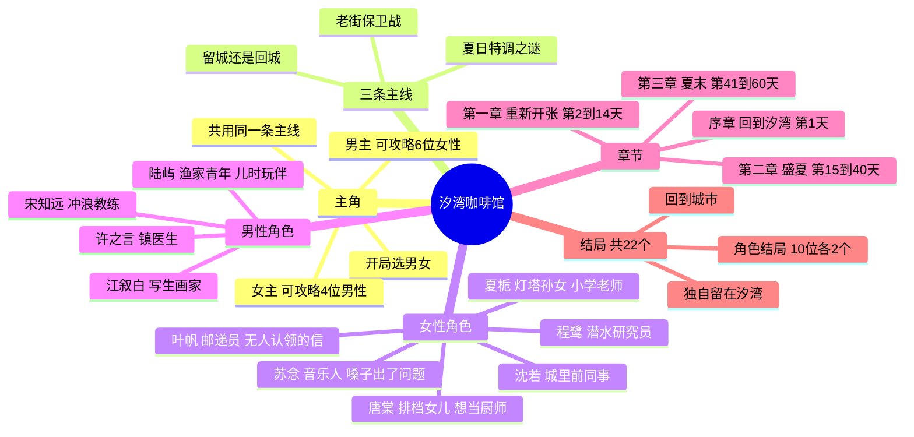

# 《汐湾咖啡馆》整体剧情策划（暂定名）

> 状态：**整体剧情第二稿（已按 Grok Bot 审核意见修改），待 Mike 确认**
> 已确认（Grok Bot 审核通过）：网页技术一套代码三端共用；题材为海边咖啡馆；玩法以剧情阅读和选择为主，穿插轻松小游戏；暂定名《汐湾咖啡馆》。
> 已确认（Mike）：开局选择主角性别；共 10 位可攻略角色，选男主可攻略 6 位女性角色，选女主可攻略 4 位男性角色。
> Demo 范围等整体剧情确认后再定。

## 一句话故事

你在大城市的工作接连受挫，收到外婆去世的消息后回到海边小镇汐湾，接手她留下的咖啡馆「潮汐」。在一个夏天里，你把小店重新经营起来，守住被开发商盯上的老街，揭开外婆留下的"夏日特调"之谜，也和镇上各怀心事的人走近。夏天结束时，你要决定留在小镇还是回到城市，以及和谁在一起。

## 世界观与背景

- **汐湾镇**：南方海边的小渔镇，有码头、灯塔、礁石滩、老街、卫生所、邮局和一家冲浪民宿。年轻人大多外出打工，夏天会来一些游客和写生的人。
- **「潮汐」咖啡馆**：外婆在老街尽头开了三十年的小店，二楼能看到海。
- **主线一：夏日特调之谜**。外婆的手写配方本最后一页"夏日特调"被撕掉了，镇上的人说起它时总是欲言又止。真相是：外婆年轻时和陆屿的爷爷陆远帆有过约定，他出海前说夏天结束就回来，结果船再也没有回来。外婆后来嫁给了外公，但每年夏天都会做一杯特调放在窗边。陆家两代人都折在海上，陆屿的父亲几年前也出海失事，这让陆屿一家和咖啡馆之间有一段没说出口的牵连。
- **主线二：老街保卫战**。度假村开发商想收购整条老街，咖啡馆是最后几家没签字的店之一。小店的口碑和镇民的团结决定老街能不能留下。
- **主线三：留城还是回城**。城里的前公司一直在请你回去，夏天结束前必须给出答复。
- **时间跨度**：一个夏天，共 60 天（7 月初到 8 月底），分序章和三章。
- **基调**：治愈、慢节奏，带一点成年人的迷茫和遗憾。

## 主角

- 开局选择性别，名字可自定义，全程以第二人称"你"叙述。
- 男女主角共用同一条主线（咖啡馆、老街、夏日特调、留城抉择），区别只在可攻略角色和少量对话。
- 选男主时，4 位男性角色作为朋友、邻居出场；选女主时，6 位女性角色同样作为朋友出场，各自的支线小故事仍然可以看到，只是不进入恋爱线。

## 可攻略角色

### 女性角色（男主可攻略，6 位）

| 角色 | 身份 | 性格 | 心事（个人线主题） |
| --- | --- | --- | --- |
| 夏栀 | 灯塔守塔人的孙女，镇小学老师 | 温柔、慢热 | 为了照顾生病的爷爷放弃了去城里读研，灯塔可能被关停 |
| 唐棠 | 码头海鲜排档老板的女儿 | 泼辣元气、嘴快 | 想当厨师，家里却要她接手排档、早点嫁人 |
| 叶帆 | 骑单车送信的邮递员 | 开朗、好奇心强 | 邮局里压着一批几十年没人认领的信，她一直想找到收信人；其中一封和外婆有关 |
| 苏念 | 来小镇采风的独立音乐人 | 安静、骄傲 | 嗓子出了问题，可能再也不能唱歌，每晚在礁石滩弹琴 |
| 程鹭 | 海洋研究站的潜水研究员 | 冷淡、专注 | 研究站经费被砍，珊瑚保护项目要撤，她不想离开这片海 |
| 沈若 | 你在城里的前同事 | 雷厉风行、要强 | 受公司委托来劝你回城，自己其实也被工作压得喘不过气 |

### 男性角色（女主可攻略，4 位）

| 角色 | 身份 | 性格 | 心事（个人线主题） |
| --- | --- | --- | --- |
| 陆屿 | 隔壁渔家青年，你的儿时玩伴 | 嘴硬心软、干活利落 | 父亲出海失事后放弃了大学，独自撑起家里的渔船 |
| 江叙白 | 夏天来小镇写生的画家 | 温和健谈 | 一年前起再也画不出满意的作品，来汐湾是最后一搏 |
| 许之言 | 镇卫生所唯一的医生 | 冷静寡言、细心 | 大城市医院一直在请他回去，他迟迟没回信 |
| 宋知远 | 冲浪民宿老板兼冲浪教练 | 阳光爽朗、爱开玩笑 | 曾是职业冲浪选手，受伤退役后再没站上过比赛的浪 |

### 配角（不可攻略）

| 角色 | 身份 | 作用 |
| --- | --- | --- |
| 外婆（已故） | 「潮汐」原店主 | 通过信件、配方本和镇民回忆出场，夏日特调之谜的核心 |
| 陆远帆（已故） | 陆屿的爷爷，几十年前出海未归 | 外婆年轻时的约定对象，叶帆找到的旧信就是他当年寄出的 |
| 秀姨 | 老街杂货铺老板娘 | 小镇八卦来源，负责引导和串场 |
| 周总 | 度假村开发商代表 | 老街保卫战的对手，不是纯坏人，后期可以和解 |
| 拿铁 | 店里的橘猫 | 吉祥物，彩蛋和小提示 |

## 章节结构

### 序章：回到汐湾（第 1 天）

- 开局选择性别和名字。
- 在城里加班时接到外婆去世的电话，辞职回到汐湾，读外婆留下的信，推开落满灰的咖啡馆。
- 女主：陆屿过来帮忙搬东西，儿时玩伴重逢。男主：唐棠路过送来一箱海鲜，说是"外婆生前订的"。

### 第一章：重新开张（第 2 到 14 天）

| 天数 | 剧情 | 分支 / 玩法 |
| --- | --- | --- |
| 第 2 到 3 天 | 打扫小店，翻出外婆的配方本，做出回来后的第一杯咖啡；第 3 天晚上收到沈若的消息："听说你辞职了？公司还在等你回来。" | 手冲小游戏教学；沈若以消息形式初次出场 |
| 第 4 天 | 试营业，第一批客人上门 | **分支一**：给客人推荐什么饮品。女主线影响江叙白，男主线影响苏念 |
| 第 5 天 | 你在店里中暑晕倒，被送到卫生所 | 女主线初遇许之言，男主线初遇夏栀（她带学生来卫生所打疫苗） |
| 第 6 天 | 沈若打来电话，劝你回城，两人第一次聊起各自的累 | 沈若好感开始计算 |
| 第 7 天 | 傍晚去礁石滩被涨潮困住，宋知远划着冲浪板把你带回岸边 | 宋知远初遇；男主线里他成了教你冲浪的朋友 |
| 第 8 天 | 送外卖咖啡到海洋研究站，程鹭刚潜水上来，冷冷提醒你别踩礁石上的珊瑚 | 程鹭初遇；拉花小游戏解锁 |
| 第 6 到 8 天 | 日常：白天营业，傍晚自由选择去码头、礁石滩、灯塔、邮局 | 自由行动触发已登场角色的小事件 |
| 第 9 天 | 台风预警，有人来帮你钉窗 | **分支二**：台风夜留谁在店里避雨 |
| 第 10 天 | 台风过后，开发商周总第一次上门谈收购 | 主线二开启 |
| 第 11 到 12 天 | 发现配方本最后一页被撕掉；叶帆说邮局有一封写给外婆的旧信 | 主线一开启；配方猜谜小游戏 |
| 第 13 天 | 小镇夏日祭筹备，「潮汐」受邀摆摊 | **分支三**：邀请谁一起摆摊 |
| 第 14 天 | 夏日祭烟花下的心动事件；章末接到城里前公司的电话 | 章末悬念，第二章预告 |

### 第二章：盛夏（第 15 到 40 天）

- **登场情况**：10 位角色在第一章都已初遇（沈若是消息和电话），无论选男主还是女主都会见到全部 10 位，不可攻略的角色作为朋友出场。第二章唯一的登场节点是第 18 天沈若本人来到汐湾。
- **前半章（第 15 到 29 天）个人线深入**：每位角色各有 2 到 3 个个人事件，心事逐渐浮出水面。
- **第 30 天锁定主攻角色**：好感最高且达到门槛的角色进入专属线；都没达标就进入无主攻的通用路线。
- **后半章（第 31 到 40 天）主攻角色专属线**。
- **老街保卫战**：开发商开出高价，邻居们开始动摇。你可以用咖啡馆办活动（海边音乐会、写生展、冲浪节）把人留住，不同角色会帮你办不同的活动。
- **关键事件**：第 18 天沈若来到汐湾，说是休假，其实是公司派来劝你回去的，回城线正式开启；第 25 天开渔节，陆屿第一次说起父亲和爷爷都没能从海上回来；第 38 天老街听证会。
- **章末**：叶帆找到那封几十年没送出的旧信，寄信人是陆远帆，信里写着"等我回来，喝你的夏日特调"。配方页的下落指向灯塔。

### 第三章：夏末（第 41 到 60 天）

- **夏日特调揭秘**：配方页藏在灯塔里，夹在当年守塔人（夏栀的爷爷）替外婆保管的航海日志中。外婆在页尾写道：她等了一辈子，不希望你也困在等待里，留下或离开都可以，只要心里有一家店。陆屿和陆家人由此和外婆的往事和解。
- **个人线高潮**：主攻角色的心事迎来抉择，比如夏栀的灯塔会不会关、苏念能不能再唱歌、陆屿要不要重新读书。
- **老街结局**：根据口碑和之前办过的活动，老街保住、部分保住或被收购。
- **最终抉择（第 60 天）**：留在汐湾还是回到城市，和谁一起。

## 结局

- **角色结局**：10 位角色各有一个好结局和一个普通结局，共 20 个。
- **通用结局**："独自留在汐湾"和"回到城市"，共 2 个。
- **总计 22 个**。单次游玩只能进入当前性别对应的结局（男主 14 个可达，女主 10 个可达，都含两个通用结局）。
- **结局去向**：每位角色好结局的去向由角色自己的故事决定，普通结局（关系停在朋友以上、恋人未满）的去向跟随你在第 60 天的选择。

| 去向 | 角色好结局 |
| --- | --- |
| 留在汐湾 | 夏栀（守住灯塔）、唐棠（一起把排档和咖啡馆合开成海边餐厅）、叶帆（一起送完最后一批旧信）、程鹭（研究站保住，和你一起守这片海）、陆屿（他重新读书，你守着店等他放假回来）、宋知远（他重回赛场，冲浪民宿和咖啡馆联名） |
| 一起回城 | 沈若（两人一起辞职，在城里开第二家「潮汐」）、许之言（他接受城里医院的邀请，你陪他去，咖啡馆交给秀姨打理，每年夏天回来） |
| 一起离开小镇去远方 | 江叙白（陪他去各地写生办展）、苏念（她的嗓子恢复，你跟着她的巡演一起走） |

- **判定**：主攻角色好感达到好结局线，且个人线关键选择正确，进入好结局；好感达标但关键选择不对，进入普通结局；没有主攻角色时，按"留下 / 回城"的选择进入通用结局。老街的结果会作为结局里的附加演出，不单独算结局。

## 轻量数值（剧情为主，数值只做隐藏判定）

- **好感度**：每位角色 0 到 100，隐藏数值，通过关键选项和自由行动变化。
- **口碑**：小游戏表现、饮品推荐和办活动会影响口碑，决定老街保卫战的结果和少量额外剧情。
- **小游戏**：手冲、拉花、配方猜谜，都可以跳过，跳过按普通表现结算。

## 剧情结构导图

## 待确认（需要 Mike 拍板）

1. **老街保卫战**：是否同意加入开发商收购老街这条主线，给夏天一个外部冲突。
2. **男女主共用主线**：两种性别走同一条主线、只换恋爱对象和少量对话，这样开发量最小，是否可以。
3. **10 位角色的人设**：新增的 6 位女性角色和宋知远是否有想调整的。
