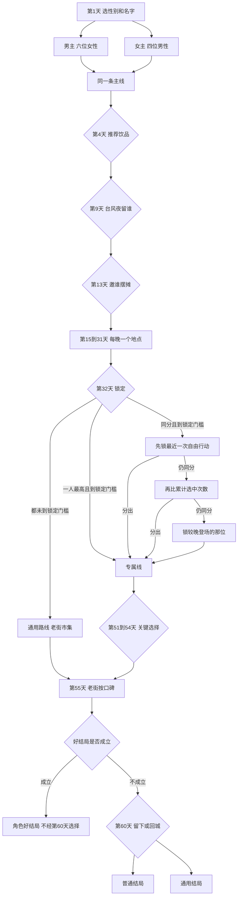
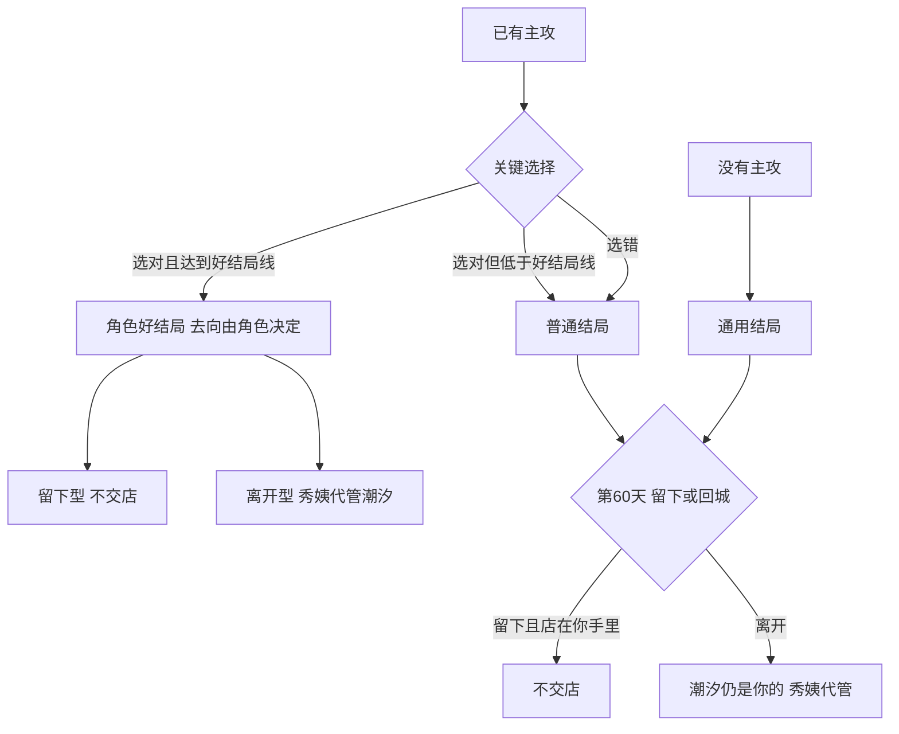

# 《汐湾咖啡馆》分支结构

> 状态：分支结构已按 Grok Bot 审核修订

单周目只走一条性别、一位主攻、一套结局。流程估时约 2 小时 45 分钟，含在 3 小时里。这里不把十条线的场次再抄一遍，节拍见 [`routes/`](routes/README.md)，日子见 [`timeline.md`](timeline.md) 和 [`story-flow.md`](story-flow.md)。

男女主看同一条主线：老街、夏日特调、留城还是回城，以及两个反转。性别只改谁能谈恋爱，不改地图，也不改反转。

## 开局

第 1 天先选性别和名字。序章不出现可攻略角色。

| 性别 | 可攻略 | 单周目可达结局 |
| --- | --- | --- |
| 男主 | 夏栀、唐棠、叶帆、苏念、程鹭、沈若 | 14 个，含两个通用结局 |
| 女主 | 陆屿、江叙白、许之言、宋知远 | 10 个，含两个通用结局 |

不能攻略的人仍以朋友出场。个人事件可以看，只加友情，不加恋爱好感。十人都会见面。

## 好感与第 32 天锁定

好感是隐藏的 0 到 100。玩家看不见数字。苏念、江叙白登场晚，门槛不降，初遇和锁定前的个人场加成更高，自由行动里也更容易遇见。沈若的好感从第 6 天电话起算，只记在男主这边。

路线表里的加减是占位，等原型试玩之后再调。锁定门槛和好结局线是两个数，好结局线更高，两个都是占位。见 [`routes/README.md`](routes/README.md)。

第 32 天只做判定，不另开一场，也不新开地点。

- 当前性别里，好感最高且达到锁定门槛的一位进入专属线。
- 都没达标：通用路线。后半由秀姨牵头办老街市集，大家以朋友来帮忙。
- 两人及以上同时达到锁定门槛且分数相同，按三层解开：先锁傍晚自由行动里最近选过的那一位；仍分不出，就比谁被自由行动选中的次数更多；还分不出，就锁登场更晚的那一位。苏念、江叙白登场晚，这一层和晚登场加成是同一条政策。

第 33 天之后，标「专属」的场只给锁定的那一位。同一天挂在别人线上的专属，这一周目看不到，所以不会叠成第三件大事。

## 傍晚自由行动

白天守「潮汐」。傍晚在固定地图上选一个已经解锁的地点，看一位已经登场的人。规则见 [`world.md`](world.md)。

- 解锁之后，地点每天都在同一张图上。有事件的做标记。没有事件的地点只给一两句日常，不加好感。
- 每天傍晚只选一个地点。同一天列出的几件自由事件，只能看一件。
- 第 6 到 8 天只有码头、灯塔、礁石滩。邮局第 11 天开。研究站第 16 天。 「浪花里」第 20 天。阁楼等江叙白第 21 天登场之后。
- 卫生所台阶上的泡面是第 10 到 14 天，任选一晚。外岛只有第 28 天可以陪诊。县城不进日常傍晚地图。镇政府礼堂不是傍晚地点，只在第 38 天开门。
- 「潮汐」是据点，不是傍晚要解锁的地点。性别不改这张图，只改恋爱和友情的对话。

## 选择点

主线选择男女都有。关键选择只出现在锁定的那一位身上，日子落在第 51 到 54 天。

| 天 | 选择 | 影响到 |
| --- | --- | --- |
| 1 | 性别和名字 | 可攻略名单。主线不变 |
| 4 | 给客人推荐什么饮品 | 口碑，以及陆屿、夏栀的好感。口碑累到第 55 天 |
| 9 | 台风夜留谁：陆屿、夏栀、唐棠、许之言 | 女主的恋爱选项是陆屿、许之言；男主的恋爱选项是夏栀、唐棠。另一边是友情，不加恋爱。写进这场，不另占名额 |
| 13 | 夏日祭邀谁摆摊：上面四位，加上叶帆 | 规则同第 9 天。叶帆对男主是恋爱，对女主是友情 |
| 14 | 不手选。烟花给当前性别里好感最高的可攻略角色。都很低是占位：恋爱好感都低于百分之二十，则改为秀姨和拿铁 | 心动一场。前公司来电是期限，不是选项。这条线和口碑分界一起，等试玩后再调 |
| 15 到 31 | 每晚一个地点 | 看到对应的自由事件，并改好感。同日互斥见下一节 |
| 32 | 自动锁定 | 专属线或通用路线 |
| 51 | 只看锁定的一位：唐棠是否联营；程鹭的研究站留下还是去城里；许之言回城面对还是留下 | 该角色的好结局或普通结局 |
| 52 | 夏栀交不交在职读研的表；沈若为自己辞职还是回公司；宋知远靠自己比赛还是接受赞助 | 同上 |
| 53 | 叶帆是否把剩下的旧信送完；陆屿去不去复学 | 同上 |
| 54 | 苏念唱现在的歌还是按厂牌；江叙白画现在想画的还是先交合同 | 同上。夏栀这天不是选择，是公布「建议秋天撤掉人工值守」 |
| 55 | 不选择 | 口碑按隐藏的 0 到 100，分界是占位：高为百分之七十及以上，老街保住；中为百分之四十到六十九，改建码头尽头的旧冷库和空仓库，不含排档旧址，也不是码头入口那块地；低为不到百分之四十，老街其余铺面被收购。「潮汐」没有店主签字就不能收购，是唯一没被收购的一栋，不是谁留下的。这一天只公布，搬家在秋天的尾声。结果写进结局，不另算一条结局。和喜好感一起等试玩后再调 |
| 60 | 只有普通结局和通用结局才选：留下，还是回城 | 好结局不经过这一选。去向已经由角色自己的故事定了 |

关键选择的对错，各人的原文在对应的 `routes/` 里。选对推动该角色跨过自己的坎：唐棠的菜有自己的名字，程鹭的研究站靠镇民计划留下，许之言回去面对，夏栀交表，沈若辞职、你回绝返聘，宋知远不关「浪花里」，叶帆把旧信送完，陆屿去复学，苏念唱现在的歌，江叙白画现在想画的。选错就停在坎前面。

第 48 天已经揭过程鹭的身份。第 51 天的选项里可以出现父亲出钱，不再揭一次身份。

## 同一天只能看一件

下面这些是玩家当场互斥的。不同角色的专属若落在同一天，单周目只看见锁定的那一位，不算玩家还要再选一次。

| 天 | 只能留一件 |
| --- | --- |
| 6 到 8 | 码头上陆屿修网或唐棠练刀，已经是码头内部的二选一；再和灯塔、礁石滩三处择一 |
| 15 | 唐棠借厨房，或许之言来买咖啡 |
| 19 | 叶帆送信，程鹭看珊瑚，许之言对海难病历 |
| 20 | 宋知远生日烧烤，或唐棠的相亲 |
| 24 | 江叙白的空白画布，沈若低血糖，宋知远的体验课 |
| 26 | 码头广场庆功宴，或苏念摔门。程鹭看见周总就离开，写在庆功宴里 |
| 27 | 陆汀亲自把录取通知带到店里，江叙白阁楼里的速写只在他的线，沈若看日出 |
| 28 | 叶帆的旧地址，许之言去外岛，程鹭的撤并通知 |
| 29 | 清早的文件袋和程鹭再次离开是同一场共通，不占名额。傍晚在夏栀、苏念、宋知远里选一件 |
| 30 | 程鹭浮潜，或江叙白在阁楼撕画 |
| 31 | 苏念弹琴，或沈若的最后期限 |
| 36 | 苏念音乐会、程鹭夜潜、陆屿早市，只办锁定的那一位。夜里街坊会人人都看 |
| 43、47、49、51 到 54 | 只看锁定的一位 |

第 22 天的发病和抢救是一场。第 38 天的听证会发言写进同一场。第 17 天宋知远的涨潮是傍晚共通，陆屿的咖啡在天亮前，是可看可不看的另一件，不和涨潮叠成必看的两场之外再加第三场。

## 选择怎样进结局

有主攻，关键选择正确，并且好感达到好结局线：角色好结局。去向由这个人的故事决定。玩家不在第 60 天再选留下或离开。

已经锁定，关键选择也选对，但好感低于好结局线：普通结局。选错同样是普通结局。这两种才在第 60 天选留下或回城。

| 去向 | 好结局 | 店 |
| --- | --- | --- |
| 留在汐湾 | 夏栀、唐棠、叶帆、程鹭、陆屿、宋知远 | 人留下，店还在你手里，不交由秀姨代管 |
| 一起回城 | 沈若、许之言 | 「潮汐」仍是你的，由秀姨代为经营，每年夏天回来。沈若的好结局在城里开第二家 |
| 一起去远方 | 江叙白、苏念 | 第一家同样仍是你的，由秀姨代为经营 |

几条已经写死的收束：夏栀交了表，灯塔后来留成海洋小课堂；没交表，灯塔就悬在第 54 天那份建议上。唐棠第 47 天是亚军，好结局里这点遗憾收掉。叶帆的无署名明信片只在第 60 天的好结局里。宋知远的好结局里，「浪花里」和「潮汐」联名，你和他一起租下或买下那栋房子，回去比赛也不会丢掉民宿。

没有主攻：通用结局。第 60 天选独自留下，或回到城市。回到城市时店仍是你的，由秀姨代为经营。

只要人离开汐湾，不论哪一种离开，「潮汐」仍是你的，都由秀姨代为经营。陆屿普通结局里的离开，是他开船送到对岸渡口，你再换乘。镇上只有一座车站。

## 已确认（Grok Bot）

- 男主可达结局 14 个，女主 10 个，都含两个通用结局。
- 好结局的去向由角色自己的故事决定。第 60 天的留下或回城只给普通结局和通用结局。好结局不经过这一选。
- 锁定门槛和好结局线是两个数，好结局线更高，都是占位，等原型试玩后再调。已经锁定，关键选择选对，但好感低于好结局线，进普通结局。
- 第 32 天同分按三层：最近一次自由行动，然后是累计选中次数，仍同分就锁登场更晚的那位。
- 宋知远的普通结局里，房子卖掉，「浪花里」在一处更小的地方重新开张。
- 口碑高、中、低和第 14 天「都很低」用上面的百分数占位，和好感数字一起等试玩后再调。
- 「潮汐」归主角。没有主角签字就不能收购，不是周总留下的。人离开时秀姨只代管。口碑中改建码头尽头的旧冷库和空仓库。灯塔小学校舍不在收购里。口碑低时杂货铺被收购，货架、餐厅和代办柜台都写在秋天的尾声。
