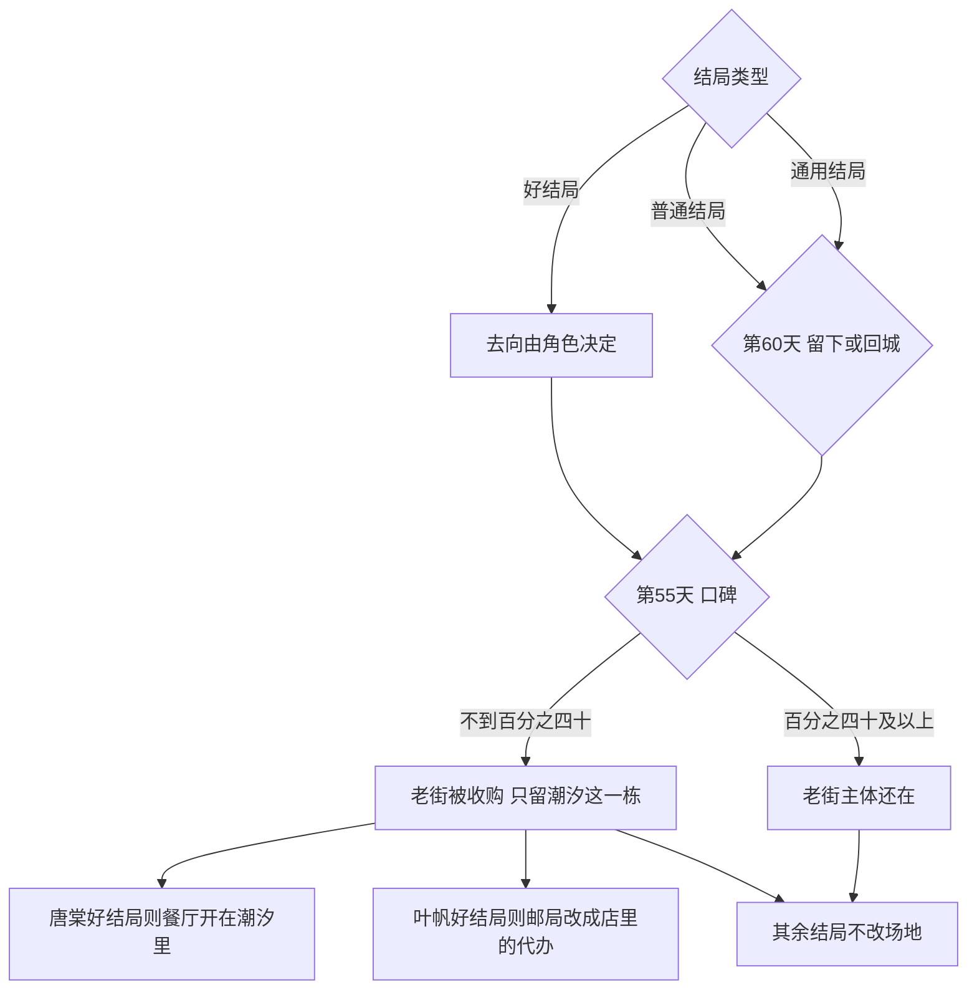

# 《汐湾咖啡馆》结局

> 状态：结局初稿，待 Grok Bot 审核

单周目只进一个结局。男主 14 个可达，女主 10 个可达，都含两个通用结局。全部算上是 10 个好结局、10 个普通结局、2 个通用结局。低口碑只改同一结局里的场景，不算新结局。单周目仍在 3 小时以内。人物去向的原文在 [`characters/`](characters/README.md) 和 [`routes/`](routes/README.md)。

## 怎么判定

- 好结局：已经锁定，关键选择选对，好感达到好结局线。去向由这个人的故事决定。第 60 天不再选留下或离开，只演收束。
- 普通结局：已经锁定，但关键选择选错；或者选对了，好感却低于好结局线。第 60 天才选留下或回城。
- 通用结局：没有主攻。第 60 天选独自留下，或回到城市。
- 锁定门槛低于好结局线。两个数，以及表里的加减，都是占位，等原型试玩后再调。
- 第 55 天的口碑写进结局，不另算一条。口碑按隐藏的 0 到 100，分界也是占位：百分之七十及以上，老街保住；百分之四十到六十九，码头一角改建，老街主体还在；不到百分之四十，老街被收购，周总只留「潮汐」这一栋。
- 人离开汐湾，「潮汐」交给秀姨，每年夏天回来。人留下、店还在你手里，不交店。陆屿普通结局里的离开，是他开船送到对岸渡口，你再换乘。镇上只有一座车站。

## 老街还在不在

十条好结局里，只有两个人的去处建在会被收购的老街上。

| 好结局 | 靠不靠老街 | 口碑低时 |
| --- | --- | --- |
| 唐棠 | 靠。餐厅在排档旧址 | 餐厅改开在「潮汐」里。这一栋是周总留下的。咖啡馆不另起房子 |
| 叶帆 | 靠。邮局留在老街 | 邮局改成「潮汐」里的一个代办柜台，她仍从这里把旧信送出去 |
| 夏栀 | 不靠。灯塔在镇北山嘴，归海事部门。留下的店是「潮汐」 | 不改 |
| 程鹭 | 不靠。研究站在海边，不在收购范围里 | 不改 |
| 陆屿 | 不靠。你守的是「潮汐」，船交给渔民，不是老街店面 | 不改 |
| 宋知远 | 不靠。「浪花里」不在收购范围里。联名用的是留下的「潮汐」 | 不改 |
| 沈若、许之言、江叙白、苏念 | 不靠。人离开。交给秀姨的就是留下的那一栋 | 不改 |

口碑高或中，唐棠仍在排档旧址，叶帆的邮局仍在原处。中口碑会不会碰到排档那一角，见文末。

## 好结局

收束都在第 60 天，没有留下或回城的选项。

| 角色 | 条件 | 第 60 天看见什么 | 你在哪 | 「潮汐」 |
| --- | --- | --- | --- | --- |
| 夏栀 | 男主锁定她。第 52 天交了在职读研的表。好感到好结局线 | 灯塔改成海洋小课堂。傍晚你给灯塔送栀子花拿铁，两人在塔顶看灯亮 | 留在汐湾 | 你守着，不交 |
| 唐棠 | 男主锁定她。第 51 天联营。好感到好结局线。第 47 天她是亚军 | 排档旧址的餐厅和「潮汐」联营，咖啡馆本身不改造。老唐在门口招呼。菜单第一页的菜是她起的名。亚军这点遗憾收在这里：名次不再是她要证明的事 | 留在汐湾 | 你守着，不交。低口碑时餐厅改开在店里 |
| 叶帆 | 男主锁定她。第 53 天把剩下的旧信送完。好感到好结局线 | 邮局因「旧信寻人」留下来。没有署名的明信片只在这个结局送到。最后一封是她写给你的 | 留在汐湾 | 你守着，不交。低口碑时代办柜台设在店里 |
| 苏念 | 男主锁定她。第 54 天唱现在的歌。好感到好结局线 | 嗓子恢复，你跟着巡演走。新专辑最后一首叫《汐湾》 | 离开小镇 | 交给秀姨，每年夏天回来 |
| 程鹭 | 男主锁定她。第 51 天研究站靠镇民计划留下。好感到好结局线。身份已在第 48 天揭过 | 研究站保住。每卖一杯「珊瑚」，一部分进保护基金 | 留在汐湾 | 你守着，不交 |
| 沈若 | 男主锁定她。第 52 天她为自己辞职，你回绝返聘。好感到好结局线 | 两人回城，在当年加班的写字楼楼下开第二家「潮汐」 | 回城 | 第一家交给秀姨，每年夏天一起回来 |
| 陆屿 | 女主锁定他。第 53 天他去复学。好感到好结局线 | 他读书，你守店。「远帆号」交给渔民。假期第一句是「橘子汽水还有吗」 | 留在汐湾 | 你守着，不交 |
| 江叙白 | 女主锁定他。第 54 天画现在想画的。好感到好结局线 | 你陪他去各地写生。巡展第一幅是「潮汐」的窗口 | 离开小镇 | 交给秀姨，每年夏天回来 |
| 许之言 | 女主锁定他。第 51 天回城面对。好感到好结局线 | 他去城里医院，你陪他。下夜班时桌上有一杯六十五度的美式 | 回城 | 交给秀姨，每年夏天回来 |
| 宋知远 | 女主锁定他。第 52 天靠自己比赛，不关民宿。好感到好结局线 | 「浪花里」和「潮汐」联名。你和他一起把房子接下来：能续租就续租，子女坚持卖就一起买下。回去比赛也不会丢掉民宿。你在岸边举着椰子冷萃 | 留在汐湾 | 你守着，不交 |

## 普通结局

关系停在朋友以上、恋人未满。第 60 天由你选留下或回城。回城时「潮汐」交给秀姨。

| 角色 | 怎么掉进来 | 第 60 天留下 | 第 60 天回城 |
| --- | --- | --- | --- |
| 夏栀 | 锁定她，选错，或选对但没到好结局线 | 常一起看日落，谁也不再往前 | 她到镇上车站送你，给你灯塔钥匙的复制件 |
| 唐棠 | 同上 | 她继续两边跑 | 她塞给你一袋鱼干 |
| 叶帆 | 同上。没有那张无署名明信片 | 旧信送完一半，约明年夏天 | 她每月寄一张明信片 |
| 苏念 | 同上 | 她独自巡演，吉他留在店里 | 城里 livehouse 偶遇 |
| 程鹭 | 同上 | 研究站勉强维持 | 她给你一张珊瑚照片 |
| 沈若 | 同上 | 她独自回城 | 你们又成了同事 |
| 陆屿 | 同上 | 他继续出海 | 他开船送到对岸渡口，你再换乘 |
| 江叙白 | 同上 | 他独自去办展，速写本留给你 | 美术馆重逢 |
| 许之言 | 同上 | 他也留下，那叠信寄出拒绝 | 医院附近偶遇 |
| 宋知远 | 同上 | 房子卖掉，「浪花里」在更小的地方重新开张。他仍在那里教课，旧板子还挂着 | 房子同样卖掉，小店重新开张。他送你一块写着你名字的板 |

## 通用结局

没有主攻。角色以朋友收场。

| 结局 | 第 60 天 | 你在哪 | 「潮汐」 |
| --- | --- | --- | --- |
| 独自留下 | 你选留下 | 汐湾 | 你守着，不交 |
| 回到城市 | 你选回城 | 城里 | 交给秀姨，每年夏天回来 |

## 条件一览

行是结局，列是进这个结局要满足的条件。口碑不决定进哪一行，只改唐棠和叶帆好结局里的场地。

| 结局 | 锁定 | 关键选择 | 好结局线 | 第 60 天玩家选择 |
| --- | --- | --- | --- | --- |
| 夏栀好 | 她 | 第 52 天交表 | 达到 | 无 |
| 唐棠好 | 她 | 第 51 天联营 | 达到 | 无 |
| 叶帆好 | 她 | 第 53 天送完旧信 | 达到 | 无 |
| 苏念好 | 她 | 第 54 天唱现在的歌 | 达到 | 无 |
| 程鹭好 | 她 | 第 51 天研究站留下 | 达到 | 无 |
| 沈若好 | 她 | 第 52 天辞职 | 达到 | 无 |
| 陆屿好 | 他 | 第 53 天复学 | 达到 | 无 |
| 江叙白好 | 他 | 第 54 天画现在的 | 达到 | 无 |
| 许之言好 | 他 | 第 51 天回城面对 | 达到 | 无 |
| 宋知远好 | 他 | 第 52 天自己比赛 | 达到 | 无 |
| 任一普通 | 该角色 | 选错，或选对但未到线 | 未到，或选择已错 | 留下或回城 |
| 独自留下 | 无 | 无 | 无 | 留下 |
| 回到城市 | 无 | 无 | 无 | 回城 |

## 待确认

1. 口碑低时周总保留「潮汐」这一栋。人离开时，这一栋的经营交给秀姨。房子算周总的，还是只由秀姨代管，没写。
2. 口碑中时码头一角改建。唐棠的排档旧址算不算这一角，没写，所以中口碑没有另做变体。
3. 灯塔小学在老街尽头。夏栀好结局的课堂在灯塔上，不在校舍里。校舍被收购后还在不在，没写。
4. 秀姨的杂货铺也在老街上。口碑低时铺子还在不在，没写。交给她的是「潮汐」这一栋。
