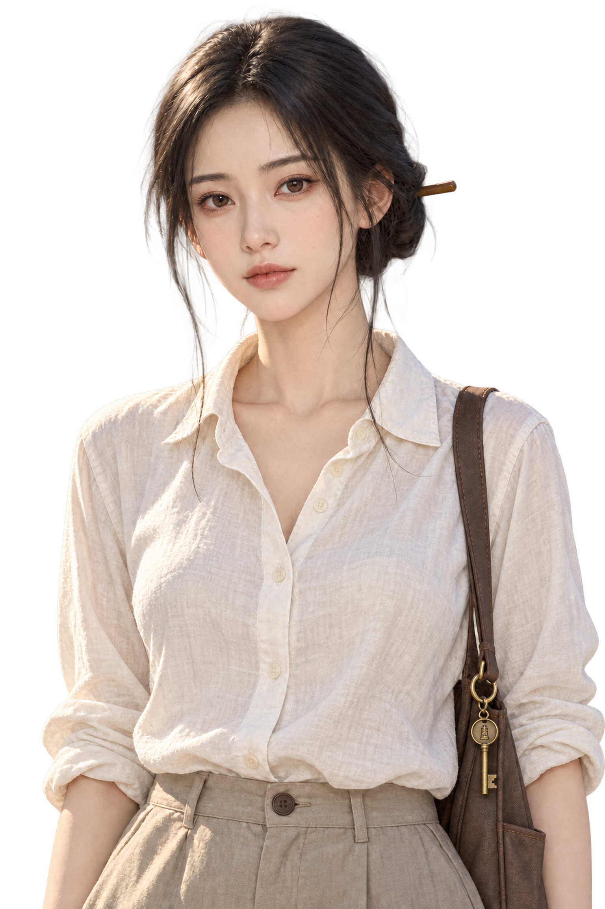
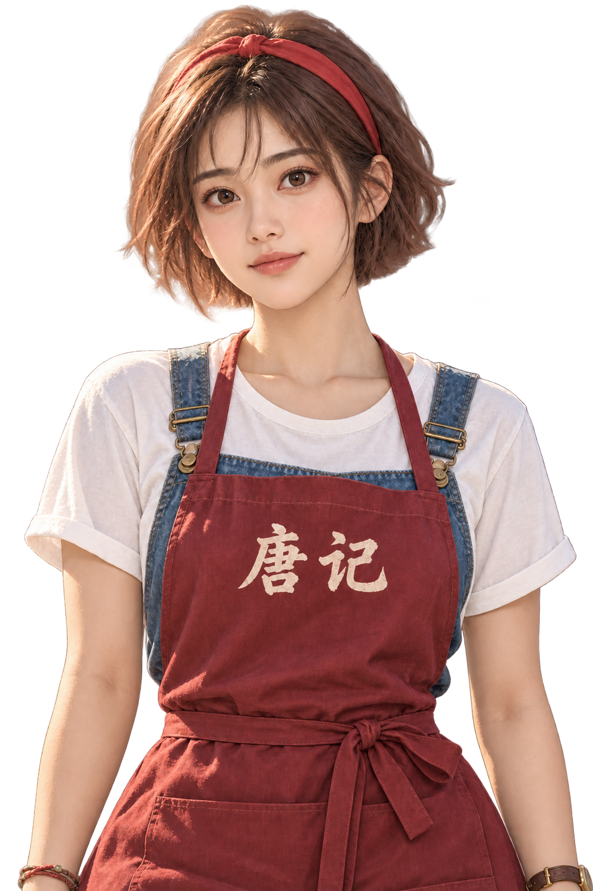
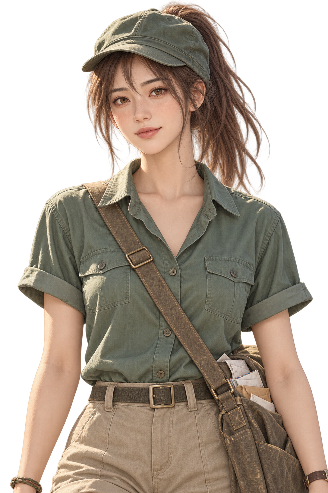
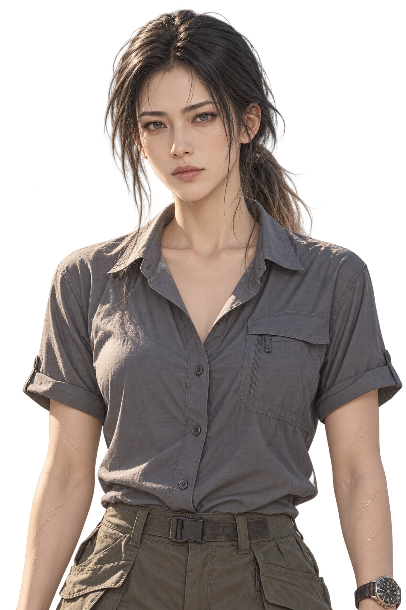
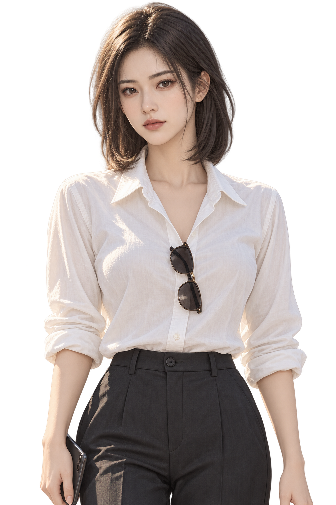
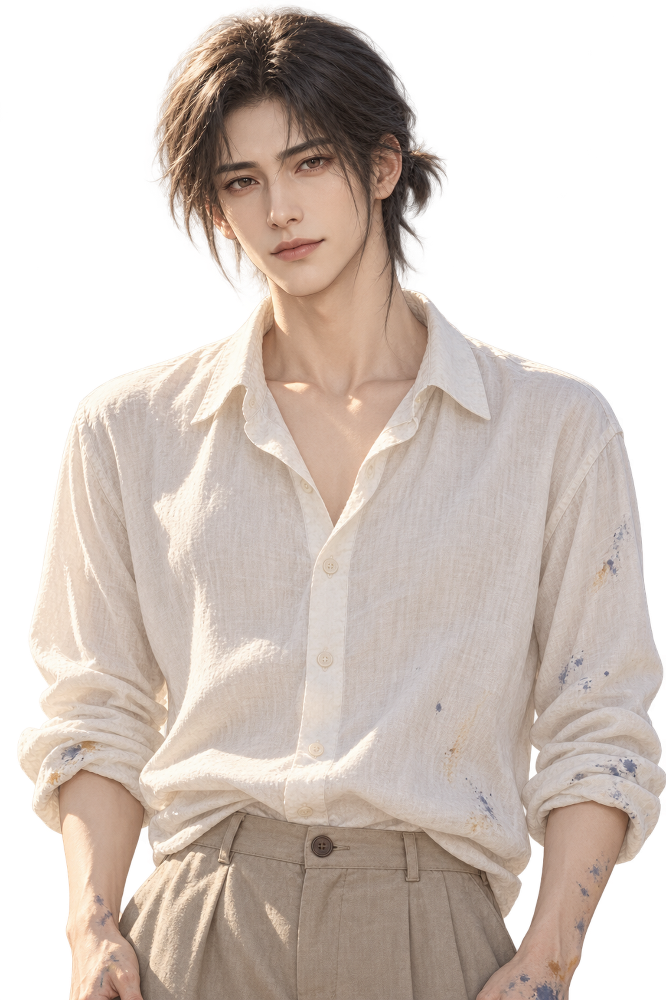

# 《汐湾咖啡馆》人物立绘清单

> 状态：给生成图用的清单。场景图不在这里。
> 外观只引用已有文档。文档没写的，标「待定，建议：…」，不是既定设定。

[总览图](../assets/portraits/_generation/cast-preview.jpg)
[立绘 README](../assets/portraits/README.md)
[提示词记录](../assets/portraits/_generation/portrait-masters.json)
[出图提示词](../02-art-prompts/README.md)

## 规格

- 半身，腰以上。底边露出一截裤腰、裙腰或短裤上半截可以留，不为此重画。再往下不画。透明背景 PNG。建议竖图 1536×2304。
- 同一画风。成年人物，写实比例，海边夏天的自然光，线干净。不要 Q 版。不要每张换一套光。
- 拿铁是猫，用全身小图，仍是透明 PNG，放进自己的文件夹。
- 目录：`projects/seaside-cafe/assets/portraits/<拼音>/`。每个角色一个文件夹。
- 默认服装：`拼音_表情.png`。多一套衣服时，在表情前加英文小写服装名：`拼音_服装_表情.png`。
- 表情用英文小写：`normal` 平常，`smile` 笑，`shy` 害羞，`angry` 生气，`sad` 难过，`surprised` 惊讶，`tired` 累，`worried` 担心，`serious` 沉，`blank` 空。
- 每张图写完整路径，例如 `projects/seaside-cafe/assets/portraits/xia-zhi/xia-zhi_smile.png`。
- 优先级：P0 是序章和第一章要用。P1 是第二、三章才用。
- 汇总表里的表情数是表情种类。总张数是文件数。两套衣服的表情不完全一样时，总张数不是套数乘表情数。

## 基准立绘

先出 10 位可攻略角色的基准图。默认服装，平常表情，一人一张，共 10 张。这 10 张就是后面各角色的 `<拼音>_normal.png`，已经算在总张数里，不另加。

统一规格：腰以上半身，正面稍侧，双手自然垂下。底边一截裤腰可以留。透明背景 PNG，1536×2304。写实比例，海边夏日自然光，线条干净。不要 Q 版。

夏栀。[`projects/seaside-cafe/assets/portraits/xia-zhi/xia-zhi_normal.png`](../assets/portraits/xia-zhi/xia-zhi_normal.png)。25 岁女性。163 cm，纤细偏瘦，肩膀薄，站得端正。黑色中长直发，一根木簪松松挽在脑后，有几缕垂下来。深棕色瞳，圆而偏垂的杏眼。平常神情慢，有距离，不笑。浅色棉麻衬衫。包上挂一把灯塔铜钥匙。旧铁皮糖盒不画。

唐棠。[`projects/seaside-cafe/assets/portraits/tang-tang/tang-tang_normal.png`](../assets/portraits/tang-tang/tang-tang_normal.png)。23 岁女性。158 cm，娇小但结实，手臂有力，皮肤小麦色。棕红色短发，齐耳略翘，一条红色发带扎住刘海。深棕色瞳，大而亮的圆眼，眼神直。平常不瞪人，也不笑。白 T 恤，牛仔背带，外面系一条印着「唐记」的防水围裙。用旧报纸包着的日式厨刀不画。

叶帆。[`projects/seaside-cafe/assets/portraits/ye-fan/ye-fan_normal.png`](../assets/portraits/ye-fan/ye-fan_normal.png)。22 岁女性。166 cm，高挑匀称，鼻梁上有一点晒出来的雀斑。栗色长发扎成高马尾，碎刘海，戴一顶褪色的绿色邮差帽。琥珀色瞳，眼睛睁得大。平常是看着人的神情，不是大笑。绿色短袖邮政制服，袖子卷起。斜挎一只鼓鼓的帆布邮包。

陆屿。[`projects/seaside-cafe/assets/portraits/lu-yu/lu-yu_normal.png`](../assets/portraits/lu-yu/lu-yu_normal.png)。24 岁男性。183 cm，高大结实，肩宽，手臂和后颈晒得黝黑，手上有缆绳磨出的老茧和一道旧疤。黑色短发有点乱，额前一撮翘着。这一张不出海，不戴旧棒球帽。深黑色瞳，狭长单眼皮。平常眯着眼，带着不耐烦，不笑。洗到发白的灰色背心，外面敞开一件格子衬衫。旧 T 恤是同一套的另一种，这一张用背心。脖子上挂一枚旧铜哨。

许之言。[`projects/seaside-cafe/assets/portraits/xu-zhiyan/xu-zhiyan_normal.png`](../assets/portraits/xu-zhiyan/xu-zhiyan_normal.png)。31 岁男性。181 cm，高而清瘦，肩背挺直，手指干净修长。黑色短发修剪整齐，刘海略长。头平视，不用刘海把眼睛挡住。偏浅的灰褐瞳，内双，一副细金属框眼镜。平常不笑，神情冷静。白大褂套在白衬衫外，衬衫袖口挽到小臂。旧皮质出诊箱不画。

苏念。[`projects/seaside-cafe/assets/portraits/su-nian/su-nian_normal.png`](../assets/portraits/su-nian/su-nian_normal.png)。27 岁女性。168 cm，高瘦，手指修长，指尖有弹琴磨出的薄茧。黑色长卷发及腰，披着，不盘起来。灰黑色瞳，细长凤眼。平常微微抬下巴，脸冷，不笑。宽松的黑色亚麻衬衫。深蓝色是同一件衬衫的另一种，这一张用黑色。不穿夜里那件男款旧牛仔外套。脖子上一条灰色薄丝巾。旧木吉他不画。

程鹭。[`projects/seaside-cafe/assets/portraits/cheng-lu/cheng-lu_normal.png`](../assets/portraits/cheng-lu/cheng-lu_normal.png)。29 岁女性。170 cm，高挑修长，肩背结实，手臂上有珊瑚划过的浅色细疤。黑色长发扎成低马尾，头发是湿的，发尾有点褐。深灰色瞳，细长单眼皮，看人很直，不太眨眼。平常神情冷，不笑。上岸的衣服：速干衬衫。不穿潜水服。手腕上一块老式潜水表。

沈若。[`projects/seaside-cafe/assets/portraits/shen-ruo/shen-ruo_normal.png`](../assets/portraits/shen-ruo/shen-ruo_normal.png)。28 岁女性。167 cm，匀称偏瘦，站得笔直。深栗色齐肩直发，发尾内扣，一丝不乱，不扎低丸子。黑色瞳，上挑的丹凤眼，化着精致的眼线。平常看人带审视，不笑。剪裁利落的白衬衫。墨镜是这套的配饰，架在头顶，不挡眼睛。

江叙白。[`projects/seaside-cafe/assets/portraits/jiang-xubai/jiang-xubai_normal.png`](../assets/portraits/jiang-xubai/jiang-xubai_normal.png)。30 岁男性。178 cm，修长偏瘦，手腕细，手指上有洗不掉的颜料。深棕色微长发，过耳，脑后扎一个小揪，碎发落在颈侧。深褐色瞳，温和的桃花眼。平常神情温和，像在听人说话，不笑，眼神也不空。宽松的亚麻衬衫，袖口有颜料渍，草帽。草帽不要挡住脸。厚速写本不画。油画笔不画。

宋知远。[`projects/seaside-cafe/assets/portraits/song-zhiyuan/song-zhiyuan_normal.png`](../assets/portraits/song-zhiyuan/song-zhiyuan_normal.png)。28 岁男性。185 cm，高大，宽肩窄腰，肌肉线条明显，皮肤古铜色。浅棕微卷短发，被海水和阳光漂过，有点乱。浅褐色瞳，圆而带笑的下垂眼。平常不是开玩笑的大笑，眼角细纹留到笑的那一张。花衬衫敞着扣子。不穿防寒泳衣。手腕上一串褪色的比赛号码手环。墙上那块旧比赛冲浪板不画进这张。

基准图定稿后，其余表情和服装都用它做参考图。唐棠、叶帆、陆屿、江叙白先按 [基准立绘审核](../assets/portraits/_reviews/portrait-masters-review.md) 的「修正提示词」做局部修改，改完再派生。提示词在 [02-art-prompts](../02-art-prompts/README.md)。

## 不画

陆远帆、外公、陆父、叶帆的父亲、叶帆的母亲、江叙白的爷爷、唐棠的母亲、程鹭的母亲、程鹭的导师、夏栀的父母、浪花里的房东、灯塔小学的学生、外岛渔民、老渔民、县里和镇里的官员。人不在场，或文档写明不上场、不起名。不单独立绘。

## 主角

男女主。开局选性别，名字可自定义。全程是第二人称「你」。

文档没有年龄以外的外貌。陆屿的人设写他与你同龄，二十四岁。没有发型、瞳色、身高、服装。

序章和三章都不露脸。不需要立绘，不画手，不画背影。

首次登场：第 1 天。优先级：不画。张数：0。

## 夏栀

文件名：`xia-zhi`。目录：[`projects/seaside-cafe/assets/portraits/xia-zhi/`](../assets/portraits/xia-zhi/)。

身份：灯塔守塔人的孙女，灯塔小学老师。男主可攻略。

年龄感、体型：25 岁。163 cm。纤细偏瘦，肩膀有点薄，站姿端正。

发型发色：黑色中长直发。木簪松松挽在脑后，上课时有几缕垂下来。

瞳色：深棕色。圆而偏垂的杏眼，笑起来眼尾弯下去。

标志：旧铁皮糖盒，包上的灯塔铜钥匙。

性格气质：温柔，慢，耐心。嘴上说没关系，心里固执。

外观依据：`characters/xia-zhi.md`。「浅色棉麻衬衫配长裙或九分裤，帆布鞋；去灯塔时套一件爷爷的旧藏青工作外套，袖子挽两道。」

首次登场：第 3 天，送来旧咖啡壶。优先级：P0。出图提示词：[xia-zhi.md](../02-art-prompts/characters/xia-zhi.md)。

服装两套。

1. 默认，日常。浅色棉麻。店里、烟花、听证会用这套。
2. `coat`。灯塔上的旧藏青工作外套。第 6 到 8 天读报，以及后来上塔的场。

表情三种，两套都要。平常是慢、有距离。笑是眼尾弯下去。难过用于第 16 天看作文沉默、第 22 天爷爷发病、第 29 天一个人坐在塔顶、第 38 天发言发抖。

- [`projects/seaside-cafe/assets/portraits/xia-zhi/xia-zhi_normal.png`](../assets/portraits/xia-zhi/xia-zhi_normal.png)
- `projects/seaside-cafe/assets/portraits/xia-zhi/xia-zhi_smile.png` 未生成
- `projects/seaside-cafe/assets/portraits/xia-zhi/xia-zhi_sad.png` 未生成
- `projects/seaside-cafe/assets/portraits/xia-zhi/xia-zhi_coat_normal.png` 未生成
- `projects/seaside-cafe/assets/portraits/xia-zhi/xia-zhi_coat_smile.png` 未生成
- `projects/seaside-cafe/assets/portraits/xia-zhi/xia-zhi_coat_sad.png` 未生成

## 唐棠

文件名：`tang-tang`。目录：[`projects/seaside-cafe/assets/portraits/tang-tang/`](../assets/portraits/tang-tang/)。

身份：码头海鲜排档「唐记」老板的女儿，排档帮工。男主可攻略。

年龄感、体型：23 岁。158 cm。娇小但结实，手臂有力，小麦色。

发型发色：棕红色短发，齐耳略翘。干活时用红色发带扎住刘海。

瞳色：文档没写颜色。眼睛大而亮，圆眼，生气时瞪人。瞳色待定，建议：深棕。

标志：旧报纸包着的日式厨刀。围裙上印「唐记」。

性格气质：泼辣，嘴快，干活风风火火。一认真声音就小。

外观依据：`characters/tang-tang.md`。「白 T 恤配牛仔背带短裤，外面系一条印着『唐记』的防水围裙，脚上是雨靴。」第 5 天剧本写头发用皮筋随便扎着，额上有一缕。画短发和红发带，皮筋是干活时的扎法。

首次登场：第 5 天，送海鲜。优先级：P0。出图提示词：[tang-tang.md](../02-art-prompts/characters/tang-tang.md)。

服装一套。烟花那晚围裙还在。餐厅结局没有另写制服，不另画。

表情六种。笑是元气。生气是瞪人、顶嘴。害羞是别过脸，说「还……凑合吧」。担心是第 5 天看见你中暑，声音低下去。难过是在你面前哭过的那一次，以及第 37 天和父亲吵到欠债。

- [`projects/seaside-cafe/assets/portraits/tang-tang/tang-tang_normal.png`](../assets/portraits/tang-tang/tang-tang_normal.png)
- `projects/seaside-cafe/assets/portraits/tang-tang/tang-tang_smile.png` 未生成
- `projects/seaside-cafe/assets/portraits/tang-tang/tang-tang_angry.png` 未生成
- `projects/seaside-cafe/assets/portraits/tang-tang/tang-tang_shy.png` 未生成
- `projects/seaside-cafe/assets/portraits/tang-tang/tang-tang_worried.png` 未生成
- `projects/seaside-cafe/assets/portraits/tang-tang/tang-tang_sad.png` 未生成

## 叶帆

文件名：`ye-fan`。目录：[`projects/seaside-cafe/assets/portraits/ye-fan/`](../assets/portraits/ye-fan/)。

身份：汐湾邮局邮递员，骑单车送信。男主可攻略。

年龄感、体型：22 岁。166 cm。高挑匀称，小腿结实。鼻梁上有晒出来的雀斑。

发型发色：栗色长发，高马尾。碎刘海。褪色的绿色邮差帽。

瞳色：琥珀色。眼睛睁得大。

标志：绿色老式单车，车筐里有信，车把上有铜铃。斜挎鼓鼓的帆布邮包。

性格气质：开朗，爱问，地址和日期很准。自己的话常常说不出口。

外观依据：`characters/ye-fan.md`。「绿色短袖邮政制服，袖子卷起，配卡其短裤和运动鞋。」

首次登场：第 11 天，送来积压的信。优先级：P0。出图提示词：[ye-fan.md](../02-art-prompts/characters/ye-fan.md)。

服装一套。烟花、推车、翻仓库都是这套制服。

表情五种。笑是送信时的亮。惊讶是「诶？」。害羞是话到嘴边又留下。难过用于撤并通知、母亲的旧地址、没寄出的明信片。

- [`projects/seaside-cafe/assets/portraits/ye-fan/ye-fan_normal.png`](../assets/portraits/ye-fan/ye-fan_normal.png)
- `projects/seaside-cafe/assets/portraits/ye-fan/ye-fan_smile.png` 未生成
- `projects/seaside-cafe/assets/portraits/ye-fan/ye-fan_surprised.png` 未生成
- `projects/seaside-cafe/assets/portraits/ye-fan/ye-fan_shy.png` 未生成
- `projects/seaside-cafe/assets/portraits/ye-fan/ye-fan_sad.png` 未生成

## 陆屿

文件名：`lu-yu`。目录：[`projects/seaside-cafe/assets/portraits/lu-yu/`](../assets/portraits/lu-yu/)。

身份：隔壁渔家青年，独自经营家里的渔船。你的儿时玩伴。女主可攻略。

年龄感、体型：24 岁。183 cm。高大结实，肩宽。手臂和后颈晒得黝黑。手上有缆绳磨出的茧和一道旧疤。

发型发色：黑色短发，海风吹得有点乱，额前一撮总翘着。出海时戴旧棒球帽。帽子是配饰，不另做一套。

瞳色：深黑色。狭长单眼皮。平时眯着，认真时很亮。

标志：脖子上父亲留下的旧铜哨。

性格气质：嘴硬，干活利落，说话直。不说谢谢。

外观依据：`characters/lu-yu.md`。「洗到发白的灰色背心或旧 T 恤，外搭一件敞开的格子衬衫，工装短裤，人字拖或防水靴。」

首次登场：第 2 天，来搬东西、修水管。优先级：P0。出图提示词：[lu-yu.md](../02-art-prompts/characters/lu-yu.md)。

服装一套。烟花那晚仍是这身，袖口有绳子的味道。复学结局没有另写校服。

表情四种。平常就是眯眼、不耐烦。笑很少，留到后期叫出外号。害羞是第 14 天「别回头」。难过是第 25 天说起父亲和爷爷都没回来。

- [`projects/seaside-cafe/assets/portraits/lu-yu/lu-yu_normal.png`](../assets/portraits/lu-yu/lu-yu_normal.png)
- `projects/seaside-cafe/assets/portraits/lu-yu/lu-yu_smile.png` 未生成
- `projects/seaside-cafe/assets/portraits/lu-yu/lu-yu_shy.png` 未生成
- `projects/seaside-cafe/assets/portraits/lu-yu/lu-yu_sad.png` 未生成

## 许之言

文件名：`xu-zhiyan`。目录：[`projects/seaside-cafe/assets/portraits/xu-zhiyan/`](../assets/portraits/xu-zhiyan/)。

身份：镇卫生所唯一的医生。女主可攻略。

年龄感、体型：31 岁。181 cm。高而清瘦，肩背挺直。手指干净修长。

发型发色：黑色短发，修剪整齐。刘海略长，低头时遮住眼睛。

瞳色：偏浅的灰褐。内双。细金属框眼镜。

标志：旧皮质出诊箱。笔帽上刻着「言」。

性格气质：冷静，寡言，像下医嘱。冷幽默，自己不笑。

外观依据：`characters/xu-zhiyan.md`。「白衬衫袖口挽到小臂，深色休闲裤；出诊时套白大褂。」「下班后换成浅灰针织衫。」第 14 天剧本写白大褂没穿，衬衫袖子挽着，烟花打在脸上，他不笑。

首次登场：第 9 天。第 5 天他人在外岛，只有字条，不画。优先级：P0。出图提示词：[xu-zhiyan.md](../02-art-prompts/characters/xu-zhiyan.md)。

服装两套。浅灰针织衫文档有，这一版并进衬衫，不另画。

1. 默认，白大褂。第 9 天台风夜、第 12 天台阶泡面、出诊用这套。
2. `shirt`。挽袖白衬衫，深色休闲裤。第 14 天烟花，以及下午来店里买咖啡。

表情三种。不画笑。平常是不笑的冷静。累用于台风夜和泡面。难过用于没拆的城里来信，以及没救回的病人。衬衫那套没有单独的累，累留在白大褂。

- [`projects/seaside-cafe/assets/portraits/xu-zhiyan/xu-zhiyan_normal.png`](../assets/portraits/xu-zhiyan/xu-zhiyan_normal.png)
- `projects/seaside-cafe/assets/portraits/xu-zhiyan/xu-zhiyan_tired.png` 未生成
- `projects/seaside-cafe/assets/portraits/xu-zhiyan/xu-zhiyan_sad.png` 未生成
- `projects/seaside-cafe/assets/portraits/xu-zhiyan/xu-zhiyan_shirt_normal.png` 未生成
- `projects/seaside-cafe/assets/portraits/xu-zhiyan/xu-zhiyan_shirt_sad.png` 未生成

## 秀姨

文件名：`xiu-yi`。目录：`projects/seaside-cafe/assets/portraits/xiu-yi/` 未生成。

身份：老街杂货铺老板娘。不可攻略。

年龄感、体型：文档没写岁数和身高。第 1 天剧本写她比你记忆里矮一点。年龄感待定，建议：五十多岁，个子不高。

发型发色、瞳色：文档没写。待定，建议：黑发里夹银丝，盘在脑后。瞳色待定，建议：深棕。

标志：第 1 天手里一串钥匙，钥匙圈上有旧红绳。红绳随后交给你，不是她一直戴着的配饰。

性格气质：爱闲聊，一句里带半个消息。看过这镇上的人长大。

外观依据：`supporting-cast.md` 只写了身份和说话。服装待定，建议：家常短袖，外面一条杂货铺围裙。

首次登场：第 1 天，车站接你。优先级：P0。

服装一套。

表情四种。笑是接站、说开张。沉是周总提起码头时，她的手停住。难过是第 37 天写生展上哭了，只在江叙白的线里。

- `projects/seaside-cafe/assets/portraits/xiu-yi/xiu-yi_normal.png` 未生成
- `projects/seaside-cafe/assets/portraits/xiu-yi/xiu-yi_smile.png` 未生成
- `projects/seaside-cafe/assets/portraits/xiu-yi/xiu-yi_serious.png` 未生成
- `projects/seaside-cafe/assets/portraits/xiu-yi/xiu-yi_sad.png` 未生成

## 拿铁

文件名：`na-tie`。目录：`projects/seaside-cafe/assets/portraits/na-tie/` 未生成。

身份：「潮汐」的橘猫。不是一杯饮品。没有台词。

年龄感、体型：文档没写年龄。橘猫。体型待定，建议：普通家猫，不画成巨型。

外观依据：`supporting-cast.md`。「潮汐」的橘猫。第 1 天从柜台后面出来。

首次登场：第 1 天。优先级：P0。

服装没有。表情一种，坐着看人。烟花那场只是尾巴收紧，不另画。

- `projects/seaside-cafe/assets/portraits/na-tie/na-tie_normal.png` 未生成

## 老唐

文件名：`lao-tang`。目录：`projects/seaside-cafe/assets/portraits/lao-tang/` 未生成。

身份：唐棠的父亲，「唐记」老板。不可攻略。

年龄感、体型：文档没写岁数和身高。女儿二十三岁。年龄感待定，建议：五十岁上下。体型待定，建议：晒黑，肩宽，比女儿壮。

发型发色、瞳色：文档没写。待定，建议：短碎的花白发。瞳色待定，建议：深棕。

性格气质：嘴硬，催人，不当面服软。

外观依据：`supporting-cast.md`。第 5 天他把海鲜箱放下就走，剧本没有写他的衣服。服装待定，建议：深色短袖，排档工装。不要和唐棠穿同一条围裙。

首次登场：第 5 天，「潮汐」门口。优先级：P0。

服装一套。

表情四种。平常是放下箱子就走。生气是催人、第 37 天后厨争吵。沉是第 38 天当众撕掉意向书。笑只给好结局，他在排档旧址门口招呼熟客，笑很短。

- `projects/seaside-cafe/assets/portraits/lao-tang/lao-tang_normal.png` 未生成
- `projects/seaside-cafe/assets/portraits/lao-tang/lao-tang_angry.png` 未生成
- `projects/seaside-cafe/assets/portraits/lao-tang/lao-tang_serious.png` 未生成
- `projects/seaside-cafe/assets/portraits/lao-tang/lao-tang_smile.png` 未生成

## 周总

文件名：`zhou-zong`。目录：`projects/seaside-cafe/assets/portraits/zhou-zong/` 未生成。

身份：度假村的代表。文档没有他的名字，文件夹用这个称呼。不可攻略。

年龄感、体型：文档没写岁数和身高。程鹭二十九岁，他是她的父亲。年龄感待定，建议：五十岁上下，身板端正。

发型发色、瞳色：文档没写。待定，建议：短发梳齐，两鬓略白。瞳色待定，建议：深棕。

性格气质：先谈价钱，临走才漏一句私事。不是满脸凶相。

外观依据：第 10 天剧本。「西装没有皱。鞋是干的，像是在车上换过。」臂弯里有一只封面空白的文件夹。

首次登场：第 10 天，上门谈收购。优先级：P0。

服装一套。第 48 天夜里来店，没有另写衣服，仍用这套西装。

表情四种。平常是谈价钱。笑很淡，点头就算。沉是听数据、收回文件夹。难过是第 38 天失神叫出「小鹭」，以及第 48 天承认自己是父亲。

- `projects/seaside-cafe/assets/portraits/zhou-zong/zhou-zong_normal.png` 未生成
- `projects/seaside-cafe/assets/portraits/zhou-zong/zhou-zong_smile.png` 未生成
- `projects/seaside-cafe/assets/portraits/zhou-zong/zhou-zong_serious.png` 未生成
- `projects/seaside-cafe/assets/portraits/zhou-zong/zhou-zong_sad.png` 未生成

## 老护士

文件名：`lao-hushi`。目录：`projects/seaside-cafe/assets/portraits/lao-hushi/` 未生成。

身份：卫生所的护士。只有她和许之言。文档写明不起名。不可攻略。

年龄感、体型：文档没写。年龄感待定，建议：六十岁上下，不高。

发型发色、瞳色：文档没写。待定，建议：灰发盘起。瞳色待定，建议：深棕。

性格气质：话少。不自我介绍。倒了水，不多问。

外观依据：第 5 天剧本。她让你坐到风扇下面，递字条，续水。衣服没写。服装待定，建议：卫生所白制服。

首次登场：第 5 天。优先级：P0。

服装一套。

表情两种。平常是递水。沉是第 19 天翻出旧病历。

- `projects/seaside-cafe/assets/portraits/lao-hushi/lao-hushi_normal.png` 未生成
- `projects/seaside-cafe/assets/portraits/lao-hushi/lao-hushi_serious.png` 未生成

## 老夏

文件名：`lao-xia`。目录：`projects/seaside-cafe/assets/portraits/lao-xia/` 未生成。

身份：夏栀的爷爷，灯塔守塔人。信里称老夏。不可攻略。

年龄感、体型：文档没写岁数和身高。记性差，慢性心肺病。第 6 天剧本里他坐在轮椅上，膝上一条薄毯。年龄感待定，建议：七十五岁上下，瘦。

发型发色、瞳色：文档没写。待定，建议：白发，稀疏。瞳色待定，建议：深棕，眼皮松。

性格气质：话少。别的都淡了，托他的那一句记得死。

外观依据：第 6 天剧本。「夏栀给轮椅上的老人读报。」「膝上盖着一条薄毯。」夏栀去灯塔时套的是他的旧藏青工作外套，所以他的工作服是藏青。

首次登场：第 6 到 8 天，选灯塔才看见本人。第 3 天只被提起。优先级：P0。

服装一套。坐在轮椅上，半身仍按腰以上画，轮椅的扶手可以进画。

表情三种。平常是点头、闭上眼。难过是第 22 天发病。笑是第 35 天坐在轮椅上看灯亮起，只在夏栀的线里，笑很轻。

- `projects/seaside-cafe/assets/portraits/lao-xia/lao-xia_normal.png` 未生成
- `projects/seaside-cafe/assets/portraits/lao-xia/lao-xia_sad.png` 未生成
- `projects/seaside-cafe/assets/portraits/lao-xia/lao-xia_smile.png` 未生成

## 苏念

文件名：`su-nian`。目录：[`projects/seaside-cafe/assets/portraits/su-nian/`](../assets/portraits/su-nian/)。

身份：来汐湾采风的独立音乐人。男主可攻略。

年龄感、体型：27 岁。168 cm。高瘦。手指修长，指尖有薄茧。

发型发色：黑色长卷发，及腰。偶尔用铅笔盘起。画披着的长发。

瞳色：灰黑色。细长凤眼。看人时微微抬下巴。

标志：旧木吉他，贴满车票。脖子上一条灰色薄丝巾。

性格气质：安静，骄傲，敏感。话少。

外观依据：`characters/su-nian.md`。「宽松的黑色或深蓝色亚麻衬衫配阔腿裤，夜里加一件男款旧牛仔外套；常赤脚走在沙滩上。」

首次登场：第 23 天夜里，礁石滩。本人要到第二章。优先级：P1。出图提示词：[su-nian.md](../02-art-prompts/characters/su-nian.md)。

服装两套。

1. 默认，亚麻衬衫和阔腿裤。第 24 天进店、第 26 天在店里摔门，用这套。
2. `night`。加上男款旧牛仔外套。礁石滩弹琴、海边音乐会用这套。丝巾两套都围着。

表情：默认要平常、难过、生气。平常是冷，抬一点下巴。难过是看见诊断书。生气是破音后摔门。`night` 要平常、难过、笑。难过是弹了一夜。笑很少，留到嗓子好转、唱现在的歌。

- [`projects/seaside-cafe/assets/portraits/su-nian/su-nian_normal.png`](../assets/portraits/su-nian/su-nian_normal.png)
- `projects/seaside-cafe/assets/portraits/su-nian/su-nian_sad.png` 未生成
- `projects/seaside-cafe/assets/portraits/su-nian/su-nian_angry.png` 未生成
- `projects/seaside-cafe/assets/portraits/su-nian/su-nian_night_normal.png` 未生成
- `projects/seaside-cafe/assets/portraits/su-nian/su-nian_night_sad.png` 未生成
- `projects/seaside-cafe/assets/portraits/su-nian/su-nian_night_smile.png` 未生成

## 程鹭

文件名：`cheng-lu`。目录：[`projects/seaside-cafe/assets/portraits/cheng-lu/`](../assets/portraits/cheng-lu/)。

身份：海洋研究站的潜水研究员。男主可攻略。

年龄感、体型：29 岁。170 cm。高挑修长，肩背结实。手臂上有珊瑚划过的浅色细疤。

发型发色：黑色长发，低马尾，几乎总是湿的。发尾被海水泡得有点褐。

瞳色：深灰色。细长单眼皮。看人很直，不太眨眼。

标志：手腕上导师留下的老式潜水表。

性格气质：冷淡，专注，说话直接。说起珊瑚才多。

外观依据：`characters/cheng-lu.md`。「下水穿黑色潜水服（拉链拉到腰，上身套一件研究站的灰色 T 恤）；上岸后是速干衬衫配工装裤和潜水凉鞋。」

首次登场：第 16 天，刚潜水上来。优先级：P1。出图提示词：[cheng-lu.md](../02-art-prompts/characters/cheng-lu.md)。

服装两套。

1. 默认，上岸。速干衬衫，工装裤，潜水凉鞋。研究站说话、码头、听证会用这套。
2. `wetsuit`。黑色潜水服，拉链拉到腰，上身灰色研究站 T 恤。第 16 天登场、第 30 天浮潜、第 36 天夜潜用这套。

表情：默认要平常、笑、难过、沉。平常是冷。笑很小，只在说珊瑚的时候。难过是撤并通知、第 50 天和父亲谈开。沉是看见周总就离开，脸上没有大动作。`wetsuit` 要平常和生气。生气是「别踩」。

- [`projects/seaside-cafe/assets/portraits/cheng-lu/cheng-lu_normal.png`](../assets/portraits/cheng-lu/cheng-lu_normal.png)
- `projects/seaside-cafe/assets/portraits/cheng-lu/cheng-lu_smile.png` 未生成
- `projects/seaside-cafe/assets/portraits/cheng-lu/cheng-lu_sad.png` 未生成
- `projects/seaside-cafe/assets/portraits/cheng-lu/cheng-lu_serious.png` 未生成
- `projects/seaside-cafe/assets/portraits/cheng-lu/cheng-lu_wetsuit_normal.png` 未生成
- `projects/seaside-cafe/assets/portraits/cheng-lu/cheng-lu_wetsuit_angry.png` 未生成

## 沈若

文件名：`shen-ruo`。目录：[`projects/seaside-cafe/assets/portraits/shen-ruo/`](../assets/portraits/shen-ruo/)。

身份：你在城里的前同事。男主可攻略。

年龄感、体型：28 岁。167 cm。匀称偏瘦。站姿笔直，走路很快。

发型发色：深栗色齐肩直发，发尾内扣。在汐湾待久了会扎低丸子。默认画齐肩直发。低丸子不另做一套。

瞳色：黑色。上挑的丹凤眼，精致眼线，看人时带审视。

标志：一直在震的手机。皮面日程本。

性格气质：要强，说话快，讽刺里有关心。

外观依据：`characters/shen-ruo.md`。「刚来时是剪裁利落的白衬衫、西装裤、细高跟和墨镜；后来换上在秀姨杂货铺买的碎花裙和人字拖，自己都觉得别扭。」

首次登场：第 3 天只有消息，第 6 天和第 14 天只有电话，不画脸。本人第 18 天拖着行李箱到「潮汐」门口。优先级：P1。出图提示词：[shen-ruo.md](../02-art-prompts/characters/shen-ruo.md)。

服装两套。墨镜是刚来时的配饰，夹在西装那套的平常脸上，不另做文件。

1. 默认，城里那套。白衬衫，西装裤，细高跟。第 18 天到达、晕倒、听证会的计划书，用这套。
2. `floral`。碎花裙，人字拖。住下之后的场：关掉手机看日出，以及后来承认自己想逃。

表情：默认要平常、生气、累、难过。平常是审视。生气是催你说重点、劝你回城。累是低血糖还在回邮件，「让我坐一会儿」。难过是看见自己在优化名单上。`floral` 要平常、害羞、笑。害羞是穿上碎花裙自己觉得别扭。笑很少，留到她为自己辞职的那一头。

- [`projects/seaside-cafe/assets/portraits/shen-ruo/shen-ruo_normal.png`](../assets/portraits/shen-ruo/shen-ruo_normal.png)
- `projects/seaside-cafe/assets/portraits/shen-ruo/shen-ruo_angry.png` 未生成
- `projects/seaside-cafe/assets/portraits/shen-ruo/shen-ruo_tired.png` 未生成
- `projects/seaside-cafe/assets/portraits/shen-ruo/shen-ruo_sad.png` 未生成
- `projects/seaside-cafe/assets/portraits/shen-ruo/shen-ruo_floral_normal.png` 未生成
- `projects/seaside-cafe/assets/portraits/shen-ruo/shen-ruo_floral_shy.png` 未生成
- `projects/seaside-cafe/assets/portraits/shen-ruo/shen-ruo_floral_smile.png` 未生成

## 江叙白

文件名：`jiang-xubai`。目录：[`projects/seaside-cafe/assets/portraits/jiang-xubai/`](../assets/portraits/jiang-xubai/)。

身份：夏天来汐湾写生的画家。女主可攻略。

年龄感、体型：30 岁。178 cm。修长偏瘦。手腕细。手指上总有洗不掉的颜料。

发型发色：深棕色微长发，过耳。脑后一个小揪，碎发落在颈侧。

瞳色：深褐色。温和的桃花眼。笑起来好看。发呆时眼神空。

标志：厚速写本。爷爷留下的扁头油画笔。草帽和画架是配饰，不另做一套。

性格气质：温和，会聊天，把自己的事岔开。

外观依据：`characters/jiang-xubai.md`。「宽松的亚麻衬衫（袖口有颜料渍）配卷边棉裤，草帽，帆布鞋。」

首次登场：第 21 天，背着画架进店。优先级：P1。出图提示词：[jiang-xubai.md](../02-art-prompts/characters/jiang-xubai.md)。

服装一套。

表情四种。平常是温和地听。笑是夸光线。空是画了一整天、画布仍是空白，眼神空着。难过是第 30 天当着你把画撕了。

- [`projects/seaside-cafe/assets/portraits/jiang-xubai/jiang-xubai_normal.png`](../assets/portraits/jiang-xubai/jiang-xubai_normal.png)
- `projects/seaside-cafe/assets/portraits/jiang-xubai/jiang-xubai_smile.png` 未生成
- `projects/seaside-cafe/assets/portraits/jiang-xubai/jiang-xubai_blank.png` 未生成
- `projects/seaside-cafe/assets/portraits/jiang-xubai/jiang-xubai_sad.png` 未生成

## 宋知远

文件名：`song-zhiyuan`。目录：[`projects/seaside-cafe/assets/portraits/song-zhiyuan/`](../assets/portraits/song-zhiyuan/)。

身份：冲浪民宿「浪花里」老板，冲浪教练。前职业冲浪选手。女主可攻略。

年龄感、体型：28 岁。185 cm。高大，宽肩窄腰，肌肉明显，皮肤古铜色。左膝有一道长手术疤。疤在半身里不一定看见，人设保留。

发型发色：浅棕微卷短发，海水和阳光漂过。常乱。湿的时候往后捋。

瞳色：浅褐色。圆而带笑的下垂眼。笑起来眼角有细纹。

标志：手腕上一串褪色的比赛号码手环。墙上那块从不下水的旧比赛板是场景道具，不画进立绘。

性格气质：爱开玩笑，三分钟能变熟。认真的时候把笑话放下。

外观依据：`characters/song-zhiyuan.md`。「花衬衫敞着扣子配沙滩短裤，或者半褪到腰间的防寒泳衣；常年赤脚或人字拖。」

首次登场：第 17 天，涨潮时用冲浪板把你送回岸。优先级：P1。出图提示词：[song-zhiyuan.md](../02-art-prompts/characters/song-zhiyuan.md)。

服装两套。

1. 默认，花衬衫敞着扣，沙滩短裤。烧烤、岸边看浪、听证会用这套。
2. `wetsuit`。防寒泳衣半褪到腰间。第 17 天救援、第 24 天体验课、第 37 天冲浪节用这套。

表情：默认要平常、笑、沉、难过。笑是他最常见的脸。沉是第 29 天大浪，他站在岸边没有下水，以及第 33 天给你看膝盖上的疤，不开玩笑。难过留在疤和退役那一场，不另做哭。`wetsuit` 只要平常和笑。

- [`projects/seaside-cafe/assets/portraits/song-zhiyuan/song-zhiyuan_normal.png`](../assets/portraits/song-zhiyuan/song-zhiyuan_normal.png)
- `projects/seaside-cafe/assets/portraits/song-zhiyuan/song-zhiyuan_smile.png` 未生成
- `projects/seaside-cafe/assets/portraits/song-zhiyuan/song-zhiyuan_serious.png` 未生成
- `projects/seaside-cafe/assets/portraits/song-zhiyuan/song-zhiyuan_sad.png` 未生成
- `projects/seaside-cafe/assets/portraits/song-zhiyuan/song-zhiyuan_wetsuit_normal.png` 未生成
- `projects/seaside-cafe/assets/portraits/song-zhiyuan/song-zhiyuan_wetsuit_smile.png` 未生成

## 外婆

文件名：`wai-po`。目录：`projects/seaside-cafe/assets/portraits/wai-po/` 未生成。

身份：「潮汐」原店主。第 1 天之前已经去世。不可攻略。

年龄感、体型：这一张画年轻时。岁数、身高文档没写。约三十年前在这栋房子里开店。宋知远的人设另写她七十多岁上过浅水课，那场没有单独画面，不画晚年。

发型发色、瞳色：文档没写。待定，建议：黑发在脑后挽低，有海风吹松的碎发。瞳色待定，建议：深棕。

性格气质：只在信和页上。想开就开，不想开也没关系。

外观依据：`routes/song-zhiyuan.md`。第 34 天旧照片：「年轻的外婆站在写着『远帆』的渔船旁。」只在宋知远的线里。衣服没写。待定，建议：旧时的浅色衫裙。船是照片里的背景，立绘不画船。

首次露面：第 1 天的信，人不在，不画脸。要脸的是第 34 天那张照片。优先级：P1。

服装一套。表情一种，看着镜头，平静。

- `projects/seaside-cafe/assets/portraits/wai-po/wai-po_normal.png` 未生成

## 陆汀

文件名：`lu-ting`。目录：`projects/seaside-cafe/assets/portraits/lu-ting/` 未生成。

身份：陆屿的妹妹。刚考完，人还在家里。不可攻略。选到陆屿才看见。

年龄感、体型：文档没写岁数和身高。刚考完。年龄感待定，建议：十八岁上下，比陆屿瘦小。

发型发色、瞳色：文档没写。待定，建议：黑发，低马尾，和哥哥一样晒过。瞳色待定，建议：深黑。

性格气质：文档没有原句。这场是她把录取通知书亲自带到店里。气质待定，建议：紧张，但压着笑。

外观依据：`supporting-cast.md` 只写了身份和这场。服装待定，建议：学生夏装，没有邮差或渔装。

首次登场：第 27 天。优先级：P1。

服装一套。

表情两种。平常是把通知书递过来。笑是通知书已经拿到。

- `projects/seaside-cafe/assets/portraits/lu-ting/lu-ting_normal.png` 未生成
- `projects/seaside-cafe/assets/portraits/lu-ting/lu-ting_smile.png` 未生成

## 郑恪

文件名：`zheng-ke`。目录：`projects/seaside-cafe/assets/portraits/zheng-ke/` 未生成。

身份：周总的助理。姓郑，单名恪。不是周家的人。不可攻略。

年龄感、体型：文档没写。待定，建议：三十岁上下，清瘦，比周总年轻一截。

发型发色、瞳色：文档没写。待定，建议：黑色短发，梳得很齐。瞳色待定，建议：深棕。

性格气质：文档没有他的台词。第 26 天和老唐低声说话。气质待定，建议：客气，声音低，不抢话。

外观依据：`supporting-cast.md`。衣服没写。待定，建议：浅色衬衫，深色长裤。不要画成第二套西装。

首次登场：第 26 天，庆功宴。要选这场才看见。优先级：P1。

服装一套。他只这一场。

表情两种。平常是低声说话。沉是话不能让旁边听见。

- `projects/seaside-cafe/assets/portraits/zheng-ke/zheng-ke_normal.png` 未生成
- `projects/seaside-cafe/assets/portraits/zheng-ke/zheng-ke_serious.png` 未生成

## 陆母

文件名：`lu-mu`。目录：`projects/seaside-cafe/assets/portraits/lu-mu/` 未生成。

身份：陆屿的母亲。文档没有她的名字，文件夹用这个称呼。不可攻略。

年龄感、体型：文档没写岁数和身高。儿子二十四岁。年龄感待定，建议：四十五到五十岁，不高，肩窄。

发型发色、瞳色：文档没写。待定，建议：黑发里有白，拢在耳后。瞳色待定，建议：深黑。

性格气质：话少。不对着窗口讲。只说已经写好的两句。

外观依据：`supporting-cast.md`。衣服没写。待定，建议：深色家常衫。第 38 天坐在礼堂最后一排。第 41 天关上房门。第 46 天第一次走进「潮汐」。

首次登场：第 38 天，只在陆屿的线里。第 41 天人人看见她关门。优先级：P1。

服装一套。

表情三种。平常是坐在最后一排，不看人。沉是第 41 天关门。难过是第 46 天把那两句说完，没有大哭。

- `projects/seaside-cafe/assets/portraits/lu-mu/lu-mu_normal.png` 未生成
- `projects/seaside-cafe/assets/portraits/lu-mu/lu-mu_serious.png` 未生成
- `projects/seaside-cafe/assets/portraits/lu-mu/lu-mu_sad.png` 未生成

## 汇总

表情数是用到的表情种类。总张数是文件数。

| 角色 | 服装套数 | 表情数 | 总张数 | 优先级 |
| --- | --- | --- | --- | --- |
| 男主 / 女主 | 0 | 0 | 0 | 不画 |
| 夏栀 | 2 | 3 | 6 | P0 |
| 唐棠 | 1 | 6 | 6 | P0 |
| 叶帆 | 1 | 5 | 5 | P0 |
| 陆屿 | 1 | 4 | 4 | P0 |
| 许之言 | 2 | 3 | 5 | P0 |
| 秀姨 | 1 | 4 | 4 | P0 |
| 拿铁 | 1 | 1 | 1 | P0 |
| 老唐 | 1 | 4 | 4 | P0 |
| 周总 | 1 | 4 | 4 | P0 |
| 老护士 | 1 | 2 | 2 | P0 |
| 老夏 | 1 | 3 | 3 | P0 |
| 苏念 | 2 | 4 | 6 | P1 |
| 程鹭 | 2 | 5 | 6 | P1 |
| 沈若 | 2 | 6 | 7 | P1 |
| 江叙白 | 1 | 4 | 4 | P1 |
| 宋知远 | 2 | 4 | 6 | P1 |
| 外婆 | 1 | 1 | 1 | P1 |
| 陆汀 | 1 | 2 | 2 | P1 |
| 郑恪 | 1 | 2 | 2 | P1 |
| 陆母 | 1 | 3 | 3 | P1 |

P0 总张数：44。全部总张数：81。
