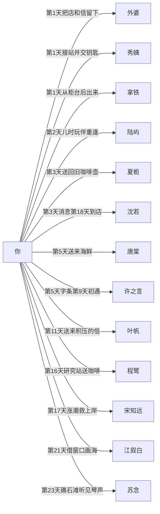
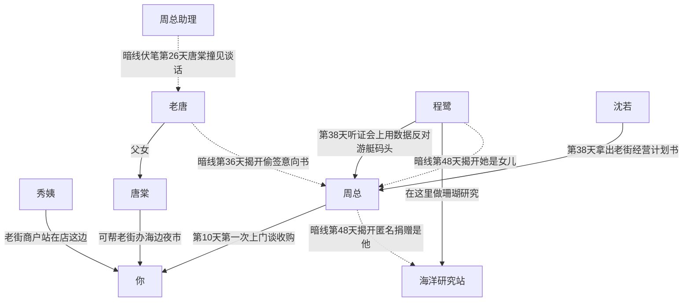
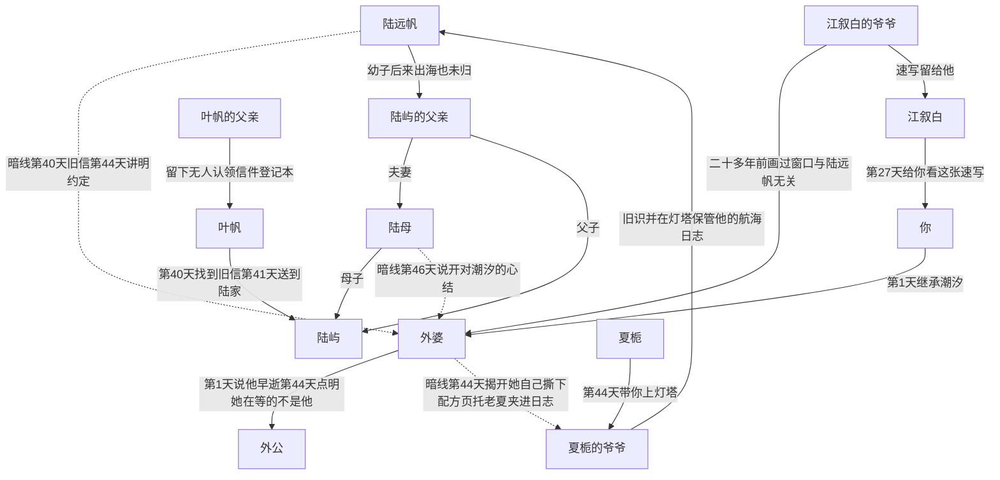

# 《汐湾咖啡馆》人物关系图

> 状态：人物关系图初稿，待 Grok Bot 审核

依据同目录的 [`story-outline.md`](story-outline.md)、[`story-flow.md`](story-flow.md) 和 [`characters/`](characters/README.md)。只整理文档里已经写明的关系，不另加主线事实。

图里的实线是玩家在对应日子就能知道的关系。虚线是暗线，标注揭开的日子；揭开日以 `story-flow.md` 为准。节点文字里不用括号。

## 图一：当下的主要关系

以「你」为中心，连到序章和前两章会见面的人。10 位可攻略角色的登场日男女主相同；谁能谈恋爱见文末，不画进这张图。

外婆已经去世，只通过信、配方本和别人的回忆出场。拿铁是店里的橘猫；好感都很低时，第 14 天改成和秀姨、拿铁一起看烟花。

## 图二：老街与周总一侧

两条男女主都会走到的暗线都在这张图上：老唐偷签收购意向书，第 36 天夜里街坊会揭开；程鹭是周总的女儿，第 48 天揭开。研究站墙上的「匿名捐赠」也在第 48 天对上是周总出的钱。

第 36 天之前的伏笔是：第 5 天你第一次见到老唐，第 10 天周总说码头已经有人松口，第 20 天秀姨说老唐忽然不急着还钱，第 29 天周总的车停在「唐记」门口。第 26 天那条在码头广场的庆功宴上，只在当天选了这场时能看见。意向书在第 36 天夜里、「潮汐」的街坊会上揭开。之后第 37 天在「唐记」后厨父女谈开欠债，第 38 天在镇政府礼堂老唐当众撕掉意向书，第 42 天周总同意定金分期。

程鹭这边的伏笔按顺序是：第 10 天周总问「研究站那边，还有人在潜水吗」，她尚未登场，不在这场；第 16 天看见匿名捐赠铜牌；第 26 天码头广场的庆功宴上周总一露面她就离开；第 29 天码头上她又离开一次；第 38 天镇政府礼堂上他失神叫出「小鹭」；第 42 天他说自己也有个女儿。她本人早就知道父亲是谁，只是不肯让别人知道。第 50 天两人在码头谈开，周总撤回游艇码头方案。老街最后保住多少，仍看第 55 天的口碑。

## 图三：上一代和外婆的旧约

夏日特调这条线的暗线是外婆和陆远帆的约定。玩家第 40 天在县城退件仓库读到旧信。信上是外婆的小名，对不上户口，所以早就送不出去；旧门牌渔民巷 3 号就是现在的「潮汐」。不走叶帆线的人，当天听她用一两句补上第 37 天档案室的结果。第 44 天在灯塔得知：日志是陆远帆的，外婆自己撕下配方页，托老夏夹进去。夏爷爷同时点明，她真正在等的是陆远帆，不是外公。第 1 天秀姨已经随口说过外公走得早。第 46 天陆母走进「潮汐」把心结说开，只补了两句：孩子是亲戚带大的，葬礼她没去。画窗口的是江叙白的爷爷，不是外婆后来嫁的外公。

约定的内容以大纲和流程里的真相说明为准：陆远帆年轻丧妻，独自带着年幼的儿子，出海前说这趟回来就娶外婆、夏天结束就回来，船再也没有回来。外婆后来另有丈夫，每年夏天仍在窗边放一杯特调。江叙白的爷爷只是过客，速写可以旁证窗边那杯饮料，和他与陆远帆没有关系。

## 关系对照

「玩家何时知道」只写文档里能对上的日子。人设关系网里有、没有单独揭晓日的，表里仍写未写入流程。已经排进某一天的，见文末「已在 routes/ 排期」。

| 角色 A | 角色 B | 关系 | 玩家何时知道 | 来源文件 |
| --- | --- | --- | --- | --- |
| 你 | 外婆 | 她把「潮汐」和一封信留给你 | 第 1 天 | story-flow.md |
| 你 | 秀姨 | 杂货铺老板娘，车站接你并交出钥匙。只要你离开汐湾（好结局、普通结局里回城、通用结局「回到城市」），「潮汐」交给她，你每年夏天回来 | 第 1 天交钥匙；交店是离开汐湾的结局规则 | story-flow.md、story-outline.md |
| 你 | 拿铁 | 店里的橘猫 | 第 1 天；第 14 天低好感时一起看烟花 | story-flow.md、story-outline.md |
| 你 | 陆屿 | 隔壁渔家、儿时玩伴，同龄 | 第 2 天 | characters/lu-yu.md、story-flow.md |
| 你 | 夏栀 | 外婆家的孩子，小时候一起在店里喝汽水；她来送还旧咖啡壶 | 第 3 天 | characters/xia-zhi.md |
| 你 | 沈若 | 城里前同事，曾是你的直属前辈 | 第 3 天消息，第 6 天电话，第 18 天本人到店 | characters/shen-ruo.md、story-flow.md |
| 你 | 唐棠 | 「唐记」老板的女儿，送来外婆生前订的海鲜 | 第 5 天 | characters/tang-tang.md |
| 你 | 许之言 | 镇卫生所唯一的医生 | 第 5 天只见到字条，第 9 天初遇 | characters/xu-zhiyan.md、story-flow.md |
| 你 | 叶帆 | 骑车送信的邮递员 | 第 11 天 | characters/ye-fan.md |
| 你 | 程鹭 | 海洋研究站的潜水研究员 | 第 16 天 | characters/cheng-lu.md |
| 你 | 宋知远 | 冲浪民宿老板，涨潮时把你救上岸 | 第 17 天 | characters/song-zhiyuan.md |
| 你 | 江叙白 | 来写生的画家，借二楼窗口 | 第 21 天 | characters/jiang-xubai.md |
| 你 | 苏念 | 来采风的音乐人，住在冲浪民宿顶楼 | 第 23 天在礁石滩听见琴；住哪里在人设中写明，流程未单列揭晓日 | characters/su-nian.md、story-flow.md |
| 你 | 周总 | 度假村开发商代表，来谈收购老街 | 第 10 天 | story-flow.md、story-outline.md |
| 你 | 前公司 | 催你八月底前答复是否回城 | 第 3 天沈若已经提到公司在等；第 14 天公司来电 | story-flow.md |
| 你 | 老唐 | 唐棠的父亲，「唐记」老板。第 5 天第一次见面，也是反转一的伏笔 | 第 5 天当面；第 20 天秀姨再说到他；第 29 天看见文件袋；第 36 天街坊会 | story-flow.md、characters/tang-tang.md |
| 你 | 陆母 | 陆屿的母亲 | 第 41 天她关上房门；第 46 天走进「潮汐」 | story-flow.md、characters/lu-yu.md |
| 你 | 陆远帆 | 陆屿的爷爷，旧信的寄信人，渔船「远帆号」以他命名 | 第 25 天陆屿说起爷爷也没从海上回来；第 40 天看见署名 | characters/lu-yu.md、story-flow.md |
| 你 | 夏栀的爷爷 | 灯塔守塔人，信里称老夏 | 第 3 天被提到；第 22 天发病；第 44 天带你看航海日志 | characters/xia-zhi.md、story-flow.md |
| 你 | 卫生所老护士 | 许之言出诊时由她转交字条 | 第 5 天 | characters/xu-zhiyan.md、characters/tang-tang.md |
| 外婆 | 陆远帆 | 暗线。年轻丧妻的他出海前约定回来就娶她，船没有回来。夏爷爷点明，她真正在等的是他，不是外公 | 第 40 天读到旧信；第 44 天爷爷讲明 | story-outline.md、story-flow.md、characters/lu-yu.md |
| 外婆 | 外公 | 陆远帆未归之后嫁给他。他在你出生前就走了。他不是江叙白的爷爷，也不是外婆窗边在等的那个人 | 第 1 天秀姨随口说他走得早；出生前就走了写在年表。第 44 天夏爷爷点明她在等的是陆远帆 | story-outline.md、timeline.md、story-flow.md |
| 外婆 | 夏栀的爷爷 | 她自己撕下配方页，托老夏夹进陆远帆的航海日志，收在灯塔 | 第 40 天信里指向灯塔老夏；第 44 天讲明是她撕的、日志是陆远帆的 | story-flow.md、characters/xia-zhi.md |
| 外婆 | 陆母 | 陆母对「潮汐」有心结，外婆的葬礼她没去 | 第 46 天说开心结，并只补一句葬礼没去 | characters/lu-yu.md、story-flow.md |
| 外婆 | 陆屿的父亲 | 陆远帆的幼子，由亲戚带大；生前会对着「潮汐」窗口发呆，这句只在陆屿个人线 | 第 25 天知道他也出海未归；第 43 天陆屿讲窗口发呆；第 46 天陆母说他从小没有父亲，并补一句是亲戚带大的。窗口发呆不进第 46 天 | story-outline.md、characters/lu-yu.md、story-flow.md、routes/lu-yu.md |
| 陆远帆 | 陆屿的父亲 | 父子。父亲出海失事后再也没回来 | 第 25 天 | characters/lu-yu.md、story-flow.md |
| 陆屿的父亲 | 陆母 | 夫妻 | 随陆家线呈现；第 46 天她以妻子的身份说起丈夫 | characters/lu-yu.md、story-flow.md |
| 陆母 | 陆屿 | 母子。他退学回家后照顾母亲和妹妹 | 第 2 天起知道他撑着这个家；妹妹的录取通知在第 27 天 | characters/lu-yu.md |
| 陆屿 | 陆屿的妹妹 | 兄妹。她还在读高中，第 27 天收到大学录取通知 | 第 27 天，需选到陆屿当天的事件 | characters/lu-yu.md |
| 陆远帆 | 夏栀的爷爷 | 旧识。他的航海日志放在老夏的灯塔 | 第 44 天讲明；信在第 40 天已指向灯塔老夏 | characters/xia-zhi.md、story-outline.md、story-flow.md |
| 陆远帆 | 叶帆 | 她靠登记簿和旧信认识这个人，两人没有见过面 | 第 12 天登记簿写明那封 1970 年代的无人认领信是他的，当天没有信纸；第 40 天找到实物 | characters/ye-fan.md、story-flow.md |
| 叶帆的父亲 | 叶帆 | 上一任邮递员，三年前调去县城，把无人认领的信交给她 | 第 12 天看他留下的登记本 | characters/ye-fan.md、story-flow.md |
| 叶帆的母亲 | 叶帆 | 离家后说会写信，一封也没有 | 第 28 天她翻出旧地址，需选到叶帆当天的事件 | characters/ye-fan.md |
| 江叙白的爷爷 | 外婆 | 二十多年前路过写生，画下窗边那杯没人喝的饮料；与陆远帆无关 | 第 27 天，需选到江叙白当天的事件；非攻略时友情支线也能看到 | characters/jiang-xubai.md、story-flow.md |
| 江叙白的爷爷 | 江叙白 | 退休美术老师，把速写和一支油画笔留给他 | 第 27 天看到速写 | characters/jiang-xubai.md |
| 老唐 | 唐棠 | 父女，母亲早逝，由他一手带大。又爱又怕，都嘴硬 | 父女关系随唐棠登场可知；欠债在第 37 天谈开 | characters/tang-tang.md、story-flow.md |
| 老唐 | 周总 | 暗线。欠债后偷签收购意向书，定金是周总垫的 | 伏笔第 10、20、29 天；第 26 天为额外伏笔；第 36 天揭开；第 38 天撕毁；第 42 天定金分期 | story-flow.md、characters/tang-tang.md |
| 老唐 | 周总助理 | 庆功宴上两人低声谈价钱 | 第 26 天，唐棠线或友情支线选到该事件才看见 | story-flow.md、characters/tang-tang.md |
| 老唐 | 秀姨 | 托秀姨给女儿物色相亲对象 | 第 20 天秀姨安排相亲，需选到唐棠当天的事件 | characters/tang-tang.md、story-flow.md |
| 程鹭 | 周总 | 暗线。父母在她十五岁时离婚，她随母姓，多年不认父亲；对外仍是环评上的对手 | 第 10 天只有周总的问话，她不在场；第 16 天铜牌；第 26 天庆功宴他一露面她就离开；第 29 天码头再次离开；第 38 天「小鹭」；第 42 天「我也有个女儿」。玩家在第 48 天从周总口中得知父女关系；第 50 天码头谈开 | characters/cheng-lu.md、story-flow.md |
| 程鹭 | 程鹭的母亲 | 随母姓；母亲希望她回城找稳定工作 | 人设背景，流程未写玩家何时听到 | characters/cheng-lu.md |
| 程鹭 | 海洋研究站的导师 | 导师去年退休，潜水表是他留下的；项目现在由她一个人扛 | 人设背景，流程未写揭晓日 | characters/cheng-lu.md |
| 周总 | 海洋研究站 | 暗线。启动经费里的匿名捐赠是他出的，想把女儿留在身边 | 第 16 天看见铜牌；第 48 天他自己说明 | story-flow.md、characters/cheng-lu.md |
| 周总 | 沈若 | 谈判桌上的对手，互相看不顺眼，也互相尊重 | 第 38 天计划书对上；更早有没有私下见面未写 | characters/shen-ruo.md、story-flow.md |
| 周总 | 陆屿 | 想收陆家老屋做码头，被他当面请出去 | 第 47 天由陆屿讲述。事情在你回镇之前，不当场再演 | characters/lu-yu.md、routes/lu-yu.md |
| 周总 | 许之言 | 视察时中暑，被他抢救过，之后只保持客气 | 第 43 天由许之言讲述。事情在你回镇之前，不当场再抢救 | characters/xu-zhiyan.md、routes/xu-zhiyan.md |
| 周总 | 苏念 | 想请她为度假村写主题曲，被拒绝 | 第 43 天，只在苏念的线 | characters/su-nian.md、routes/su-nian.md |
| 周总 | 宋知远 | 民宿不在老街收购范围内，没有直接往来；听证会上宋知远站老街 | 立场写在人设里；第 38 天拿出游客数据只在宋知远专属线 | characters/song-zhiyuan.md、story-flow.md |
| 周总 | 叶帆 | 公司文件经她的手送出 | 人设关系网有，流程未写日子 | characters/ye-fan.md |
| 周总 | 夏栀 | 灯塔关停归海事部门，与度假村无关；老街的事上她站你这边，对周总保持距离 | 灯塔归属已确认与周总无关；当面关系未写日子 | characters/xia-zhi.md、story-outline.md |
| 沈若 | 前公司 | 上司委托她把你劝回去，并暗示关系到她的升职 | 第 18 天玩家知道她是公司派来的；公司其实想让你接替她，是她个人线第三章的危机，与周总无关 | characters/shen-ruo.md、story-outline.md |
| 秀姨 | 外婆 | 送来外婆的旧拉花缸，讲她给客人拉叶子的事 | 第 7 天 | story-flow.md |
| 秀姨 | 夏栀 | 总想给她介绍对象，她笑着躲开 | 人设关系网有，流程未写日子 | characters/xia-zhi.md |
| 秀姨 | 陆屿 | 看着他长大，说他太倔 | 人设关系网有，流程未写日子 | characters/lu-yu.md |
| 秀姨 | 叶帆 | 一个知道八卦，一个知道地址 | 人设关系网有，流程未写日子 | characters/ye-fan.md |
| 秀姨 | 苏念 | 以为她是失恋来散心的，常塞水果 | 人设关系网有，流程未写日子 | characters/su-nian.md |
| 秀姨 | 程鹭 | 觉得她怪，但是好姑娘，托你给她带点心 | 人设关系网有，流程未写日子 | characters/cheng-lu.md |
| 秀姨 | 沈若 | 起初当成城里来抢人的，后来教她织毛线 | 人设关系网有，流程未写日子 | characters/shen-ruo.md |
| 秀姨 | 江叙白 | 喜欢让他画肖像，要求画瘦一点 | 人设关系网有；第 37 天写生展上她哭了，只在江叙白专属线 | characters/jiang-xubai.md、story-flow.md |
| 秀姨 | 许之言 | 常去卫生所量血压，其实是打听消息 | 人设关系网有，流程未写日子 | characters/xu-zhiyan.md |
| 秀姨 | 宋知远 | 把他当镇上受欢迎的外地人，帮他拉客 | 人设关系网有，流程未写日子 | characters/song-zhiyuan.md |
| 外婆 | 夏栀 | 从小喝店里的汽水，外婆常给灯塔送咖啡；她知道窗边有特调，不知道原因 | 第 3 天认出你；特调的原因要到第 44 天 | characters/xia-zhi.md |
| 外婆 | 唐棠 | 夸过她手巧；每周向唐家订海鲜，也订过一种特别的海盐 | 第 5 天以「外婆生前订的海鲜」出现；海盐线索写在人设里，未单列日子 | characters/tang-tang.md |
| 外婆 | 叶帆 | 每年把生日卡寄到邮局，由她投递给自己 | 人设关系网有，流程未写日子 | characters/ye-fan.md |
| 外婆 | 程鹭 | 每周给研究站送一次咖啡，是程鹭在汐湾唯一会主动打招呼的人 | 第 16 天前后由「你来了店才又有咖啡」带出，未写死是哪一句台词 | characters/cheng-lu.md |
| 外婆 | 许之言 | 他在汐湾的第一个常客病人，最后的病程是他陪着走完的 | 人设关系网有，流程未写日子 | characters/xu-zhiyan.md |
| 外婆 | 陆屿 | 他把外婆当半个奶奶；外婆留点心给他。他不知道外婆和爷爷的约定 | 约定对他隐到第 40 到 46 天；小时候的亲近未写揭晓日 | characters/lu-yu.md |
| 外婆 | 宋知远 | 刚来镇上时，她去上过他的浅水冲浪课 | 人设关系网有，流程未写日子 | characters/song-zhiyuan.md |
| 外婆 | 苏念 | 没见过面；苏念被店里墙上外婆和渔民合唱的老照片吸引 | 人设关系网有，流程未写日子 | characters/su-nian.md |
| 外婆 | 江叙白 | 没见过面，靠爷爷的速写认识二十多年前的她 | 第 27 天 | characters/jiang-xubai.md |
| 外婆 | 沈若 | 没见过面；沈若读到配方本里「慢慢煮，别着急」会愣住 | 写在人设里，未指定是哪一次整理配方本 | characters/shen-ruo.md |
| 宋知远 | 外婆 | 翻修民宿时找到旧码头照片：年轻的外婆站在写着「远帆」的渔船旁 | 第 34 天，只在他的线。第 30 天之后、第 44 天之前 | characters/song-zhiyuan.md、routes/song-zhiyuan.md |
| 夏栀 | 唐棠 | 小学同学，关系好，互相嫌对方太温吞或太急 | 人设关系网有，流程未写揭晓日 | characters/xia-zhi.md、characters/tang-tang.md |
| 夏栀 | 陆屿 | 一起长大；他出海靠夏家灯塔认方向 | 人设关系网有，流程未写揭晓日 | characters/xia-zhi.md、characters/lu-yu.md |
| 夏栀 | 叶帆 | 叶帆每周在灯塔歇脚，替爷爷读远方寄来的明信片 | 人设关系网有，流程未写揭晓日 | characters/xia-zhi.md、characters/ye-fan.md |
| 夏栀 | 许之言 | 爷爷的主治医生，她信任他 | 第 22 天同一场发病和抢救里能看见 | characters/xia-zhi.md、characters/xu-zhiyan.md、story-flow.md |
| 夏栀 | 程鹭 | 程鹭在灯塔小学上过海洋科普课，学生叫她珊瑚姐姐 | 人设关系网有，流程未写揭晓日 | characters/cheng-lu.md |
| 唐棠 | 陆屿 | 「唐记」收他的渔获，两人从小拌嘴 | 人设关系网有，流程未写揭晓日 | characters/tang-tang.md、characters/lu-yu.md |
| 唐棠 | 宋知远 | 民宿的海鲜由「唐记」供货；他起哄要给她开冲浪厨房 | 人设关系网有，流程未写揭晓日 | characters/tang-tang.md、characters/song-zhiyuan.md |
| 唐棠 | 江叙白 | 他爱画码头，她嫌他画完也不买鱼 | 人设关系网有，流程未写揭晓日 | characters/tang-tang.md、characters/jiang-xubai.md |
| 唐棠 | 沈若 | 互相嫌对方不会讲话或没有规划；后来菜单价格是沈若帮着定的 | 人设关系网有，流程未写揭晓日 | characters/shen-ruo.md |
| 叶帆 | 陆屿 | 第 41 天和你一起把陆远帆的信交到陆家，这是她最紧张的场面之一 | 第 41 天 | characters/ye-fan.md、story-flow.md、characters/lu-yu.md |
| 叶帆 | 苏念 | 帮她收寄乐谱和医院复查单，是少数知道嗓子问题的人 | 人设关系网有；苏念第 29 天要求保密，未写叶帆从哪一天知道 | characters/ye-fan.md、characters/su-nian.md |
| 叶帆 | 许之言 | 城里医院的信由她送到，她数过一共七封 | 第 15 天能看到信还没拆；「七封」这个数字未写进流程 | characters/ye-fan.md、characters/xu-zhiyan.md、story-flow.md |
| 叶帆 | 江叙白 | 帮他把画寄回画廊，也帮他查爷爷当年住过的地方 | 人设关系网有，流程未写揭晓日 | characters/jiang-xubai.md |
| 苏念 | 宋知远 | 房客和房东，都是从巅峰摔下来的人，彼此像战友 | 人设关系网有；第 29 天你去民宿送丝巾。哪一天说破这层关系未写 | characters/su-nian.md、characters/song-zhiyuan.md |
| 苏念 | 许之言 | 由他跟进嗓子复查，替她保密 | 人设关系网有；第 29 天她对你说不准告诉别人 | characters/su-nian.md、characters/xu-zhiyan.md |
| 苏念 | 江叙白 | 同为外来的创作者，偶尔在礁石滩各干各的 | 人设关系网有，流程未写揭晓日 | characters/su-nian.md、characters/jiang-xubai.md |
| 苏念 | 沈若 | 两个骄傲的人，一开始看不惯，后来在礁石滩一起喝过酒 | 人设关系网有，流程未写揭晓日 | characters/shen-ruo.md |
| 程鹭 | 陆屿 | 他的渔船帮她运设备，话少，合作默契 | 人设关系网有，流程未写揭晓日 | characters/cheng-lu.md |
| 程鹭 | 宋知远 | 她提醒他的冲浪区别靠近珊瑚，斗嘴斗出交情 | 人设关系网有，流程未写揭晓日 | characters/cheng-lu.md、characters/song-zhiyuan.md |
| 程鹭 | 许之言 | 潜水后的耳压常去卫生所；两个话少的人可以干坐着 | 人设关系网有，流程未写揭晓日 | characters/cheng-lu.md |
| 陆屿 | 许之言 | 陆母的高血压由他照看 | 人设关系网有，流程未写揭晓日 | characters/lu-yu.md、characters/xu-zhiyan.md |
| 陆屿 | 宋知远 | 陆屿看不惯他把海当玩具，后来互相认可 | 人设关系网有，流程未写揭晓日 | characters/song-zhiyuan.md |
| 陆屿 | 江叙白 | 江叙白想画他出海的背影，先被拒绝，后来默许 | 人设关系网有，流程未写揭晓日 | characters/jiang-xubai.md |
| 许之言 | 宋知远 | 指导旧伤复健，常为能不能下水争执 | 人设关系网有，流程未写揭晓日 | characters/xu-zhiyan.md、characters/song-zhiyuan.md |
| 许之言 | 沈若 | 她低血糖晕倒后，他勒令三餐定时 | 第 24 天，需选到沈若当天的事件 | characters/shen-ruo.md、story-flow.md |
| 宋知远 | 房东一家 | 民宿房子是向已搬去城里的老人租的，租约夏末到期；老人的子女要卖掉 | 第 52 天和他的关键选择一起压过来，与周总无关。好结局里你和他一起租下或买下这栋房子 | characters/song-zhiyuan.md、story-outline.md、routes/song-zhiyuan.md |

## 可攻略角色之间

文档没有写这 10 个人互相争同一个恋爱对象，也没有写他们彼此有恋爱关系。第 32 天只在当前性别能攻略的人里锁定一位；另一性别的人仍以朋友出场，支线小故事照常可以看。

能对上的同辈关系，都是朋友、主顾或工作上的搭档，外加几对互相嫌嘴快、后期仍处得来的组合：

- 一起长大或同学：夏栀和唐棠是小学同学；夏栀和陆屿是玩伴；陆屿和唐棠因为收渔获从小拌嘴。
- 信和病：叶帆给许之言送城里医院的信，给苏念寄乐谱和复查单，也给江叙白往画廊寄画。许之言同时是夏栀爷爷的主治、陆母的医生、苏念的复查医生、宋知远的复健医生，第 24 天还收治过低血糖的沈若。
- 海上的搭档：陆屿的船给程鹭运设备，「唐记」收陆屿的渔获，也给宋知远的民宿供海鲜。程鹭会把宋知远从珊瑚礁边赶开。苏念租他的顶楼。
- 创作上的点头之交：苏念和江叙白在礁石滩各干各的。江叙白想画陆屿，先吃了闭门羹。
- 后来才熟的：沈若嫌唐棠没有规划，后来却帮她定菜单价格；沈若和苏念起初互看不顺，后来一起喝过酒。

这里面没有血缘。真正的家人都在可攻略名单外面：唐棠和老唐，陆屿和陆母、妹妹、父亲、爷爷陆远帆，程鹭和周总、程鹭的母亲，夏栀和她的爷爷。

## 男女主差在哪里

主线相同：序章、三条主线、两个反转、听证会、灯塔揭秘、第 60 天留下还是离开。登场日也相同。差别只在谁能进入恋爱演出，以及少量对话。

| 节点 | 男主 | 女主 |
| --- | --- | --- |
| 可攻略范围 | 夏栀、唐棠、叶帆、苏念、程鹭、沈若 | 陆屿、江叙白、许之言、宋知远 |
| 第 2 天陆屿 | 好哥们重逢 | 儿时玩伴，恋爱线从这里开始 |
| 第 5 天唐棠 | 心动初遇 | 码头上的好姐妹 |
| 第 9 天台风夜留谁 | 四个人都能留。恋爱选项夏栀、唐棠；友情选项陆屿、许之言 | 四个人都能留。恋爱选项陆屿、许之言；友情选项夏栀、唐棠，不加恋爱好感 |
| 第 13 天摆摊搭档 | 五个人里，恋爱选项是夏栀、唐棠、叶帆；友情选项是陆屿、许之言 | 五个人里，恋爱选项是陆屿、许之言；友情选项是夏栀、唐棠和叶帆，不加恋爱好感 |
| 第 14 天烟花 | 好感最高的女性角色；都很低则改为秀姨和拿铁 | 好感最高的男性角色；都很低则同样是秀姨和拿铁 |
| 第 17 天宋知远 | 教你冲浪的朋友 | 恋爱线初遇 |
| 第 25 天开渔节 | 陆屿说起父亲和爷爷，是两个男生的友情戏 | 同一段往事，对话偏恋爱 |
| 第 32 天锁定 | 在 6 位女性里判定。两位同时达标且分数相同，锁定自由行动里最近选过的那一位 | 在 4 位男性里判定。同分规则相同 |
| 单周目可达结局 | 14 个，含两个通用结局 | 10 个，含两个通用结局 |

第 6 天沈若的电话两边都打。好感从这天起算，写在流程里时注明了她归男主攻略。女主线里她仍是前同事和闺蜜，回城主线照样开启。

## 已确认（本轮补进流程）

- 第 1 天秀姨随口说外公走得早。第 44 天夏爷爷讲旧事，点明外婆真正在等的是陆远帆，不是外公。外公不是江叙白的爷爷。
- 第 46 天陆母只用两句补完：陆父是亲戚带大的；外婆的葬礼她没去。不把这场戏写成说明会。
- 第 5 天唐棠登场时老唐短短露面，是你和他第一次见面，也是反转一的伏笔。
- 沈若睡不够的两个月包含你辞职前的交接。陆父窗口发呆只在陆屿个人线，不进第 46 天。第 12 天登记簿上的 1970 年代无人认领信就是陆远帆的，信纸第 40 天找到。外公在你出生前就走了。反转二不在第 10 天安排程鹭离场。（Grok Bot）
- 沈若住在「浪花里」。江叙白住秀姨家杂货铺楼上的阁楼，秀姨是房东。外婆信上的旧门牌是渔民巷 3 号改成老街 17 号，即「潮汐」；没送到是因为小名对不上户口，信在县城退件仓库。第 37 天档案室只有叶帆线，第 40 天找信人人都有。（Grok Bot）

## 已在 routes/ 排期

日子以 [`routes/`](routes/README.md) 和 [`timeline.md`](timeline.md) 为准。同一天的专属只看锁定的一位。

- 陆屿第 43 天讲父亲对着窗口发呆，不放进第 46 天。第 47 天讲述回镇前把周总请出老屋。
- 关键选择：第 51 天唐棠、程鹭、许之言；第 52 天夏栀、沈若、宋知远；第 53 天叶帆、陆屿；第 54 天苏念、江叙白。
- 灯塔建议撤掉人工值守：第 54 天，夏栀的线。
- 唐棠的比赛：第 47 天，亚军。遗憾在好结局里收掉，记入 `endings.md`。叶帆的无署名明信片：第 60 天好结局里。苏念的复查：第 49 天。沈若的人事邮件：第 49 天。
- 许之言第 43 天讲述回镇前给周总看过中暑。苏念第 43 天拒绝主题曲。
- 宋知远第 34 天才给你看外婆和「远帆」的旧照片，只在他的线。
- 阁楼：第 27、30、43 天。秀姨是房东。
- 秀姨的闲话不另开场，仍用第 4、7、20、36 天已有的戏。夏栀、唐棠、陆屿的旧交挂在第 9 天台风夜的同场；叶帆第 11 天才登场，和第 13 天的摆摊名单同一天可以被选中，不另加一场两人戏。其余可攻略角色之间的搭档，仍只在已经写过的同场里见面，不新开重大事件。
