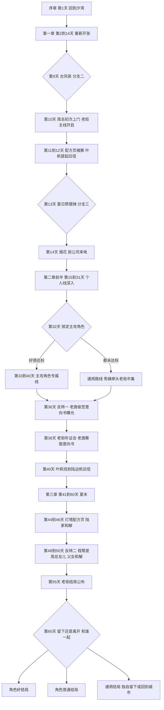

# 《汐湾咖啡馆》完整故事流程

> 状态：完整故事流程初稿，待 Grok Bot 审核
> 依据：`story-outline.md`（第三稿）和 `characters/` 下 10 份已审核的人设。所有角色均为成年人（22 到 31 岁）。

## 阅读说明

- **【共通】**：男女主都会看到的主线剧情，当天完整演出。
- **【自由】**：傍晚自由行动，选一个地点触发一位已登场角色的个人事件；同一天列出多个事件时只能看其中一个。
- **【分支】**：影响好感或口碑的选择。
- **【伏笔】/【揭开】**：两个主线反转的铺垫和揭晓。
- **快进**：没有剧情节点的日子用"一周快进"一屏带过（营业额、口碑变化、一两句镇上小事）。
- 不可攻略的角色作为朋友出场，个人事件照常可看，只是没有恋爱演出。

## 时长估算（单周目，正常阅读速度）

| 章节 | 天数 | 完整演出的日子 | 预计时长 |
| --- | --- | --- | --- |
| 序章 | 第 1 天 | 1 天 | 约 10 分钟 |
| 第一章 | 第 2 到 14 天 | 约 11 天 + 1 段快进 | 约 50 分钟 |
| 第二章 | 第 15 到 40 天 | 共通节点约 10 天 + 个人事件约 8 个 + 3 段快进 | 约 60 分钟 |
| 第三章 | 第 41 到 60 天 | 共通节点约 8 天 + 个人线高潮 + 结局 | 约 45 分钟 |
| 合计 | | | 约 2 小时 45 分钟（3 小时以内） |

小游戏（手冲、拉花、配方猜谜）每局约 1 分钟，都可以跳过。

## 流程总图

## 序章：回到汐湾（第 1 天，约 10 分钟）

- 开局选择性别和名字。
- 城里写字楼，深夜加班，接到外婆去世的电话。你递了辞职信，第二天坐上回汐湾的车。
- 秀姨在车站接你，一路念叨镇上的变化，随口说起外公走得早，把「潮汐」的钥匙交给你。
- 读外婆留下的信："店交给你了，想开就开，不想开也没关系。"推开落满灰的咖啡馆，橘猫拿铁从柜台后面钻出来。
- 序章不出现任何可攻略角色，男女主内容完全相同。

## 第一章：重新开张（第 2 到 14 天，约 50 分钟）

| 天数 | 共通剧情 | 登场 / 分支 / 玩法 | 男女主差异 |
| --- | --- | --- | --- |
| 第 2 天 | 打扫小店；隔壁陆屿扛着工具过来帮忙搬东西、修水管，儿时玩伴重逢 | 陆屿登场 | 女主：重逢带一点心动；男主：两人互损，像回到小时候 |
| 第 3 天 | 夏栀替爷爷送回外婆借给灯塔的旧咖啡壶，留下帮你擦窗；你翻出外婆的配方本，做出回来后的第一杯咖啡；晚上收到沈若的消息："听说你辞职了？公司还在等你回来。" | 夏栀登场；手冲小游戏教学；沈若以消息出场 | 无 |
| 第 4 天 | 试营业，秀姨和老街街坊成了第一批客人 | 【分支一】给客人推荐什么饮品：影响口碑，以及陆屿、夏栀的好感 | 无 |
| 第 5 天 | 你在店里中暑晕倒，唐棠来送"外婆生前订的"海鲜，把你背上三轮车送去卫生所；医生许之言在外岛出诊，只留下一张写满注意事项的字条 | 唐棠登场。老唐在门口帮她放下海鲜，催她回排档，说了两句就走，这是你和他第一次见面 | 男主：唐棠线的心动初遇；女主：码头好姐妹的初遇 |
| 第 6 天 | 沈若打来电话劝你回城，两人第一次聊起各自的累 | 沈若好感开始计算（男主可攻略） | 无 |
| 第 7 天 | 秀姨送来外婆的旧拉花缸，讲外婆给每位客人拉一片叶子的往事 | 拉花小游戏解锁 | 无 |
| 第 6 到 8 天 | 白天营业，傍晚自由行动：码头（陆屿修网 / 唐棠练刀工）、灯塔（夏栀给爷爷读报）、礁石滩（看海，无事件） | 【自由】邮局第 11 天才开放 | 无 |
| 第 9 天 | 台风预警。许之言出诊回来顺路复查"字条上的病人"，接过锤子帮你钉窗；陆屿、夏栀、唐棠也先后赶来 | 许之言登场；【分支二】台风夜留谁在店里避雨：陆屿、夏栀、唐棠、许之言四选一 | 女主：恋爱选项陆屿、许之言；友情选项夏栀、唐棠，不加恋爱好感。男主：恋爱选项夏栀、唐棠；友情选项陆屿、许之言。恋爱选项加好感并有独处小剧情，友情选项是友情小剧情 |
| 第 10 天 | 台风过后，开发商周总第一次上门谈收购，开价很高，你没答应。临走时他对秀姨说："码头那边，已经有人松口了。"又望着海的方向问："研究站那边，还有人在潜水吗？" | 老街主线开启；【伏笔】反转一 ①、反转二 ① | 无 |
| 第 11 天 | 收拾台风后的店，发现配方本最后一页"夏日特调"被撕掉了；叶帆骑车送来外婆积压的信，看到你在找配方页，脱口说"邮局好像有一封写给外婆的旧信" | 夏日特调主线开启；叶帆登场，邮局开放 | 无 |
| 第 12 天 | 跟叶帆去邮局，看她父亲留下的"无人认领信件登记本"：写给外婆的旧信有记录，实物却不在原箱里 | 配方猜谜小游戏（第一轮） | 无 |
| 第 13 天 | 小镇夏日祭筹备，「潮汐」受邀摆摊 | 【分支三】邀请谁一起摆摊：陆屿、夏栀、唐棠、许之言、叶帆五选一 | 女主：恋爱选项仍是陆屿、许之言；友情选项为夏栀、唐棠，叶帆同样是友情选项，都不加恋爱好感。男主：恋爱选项为夏栀、唐棠、叶帆；友情选项为陆屿、许之言 |
| 第 14 天 | 夏日祭烟花下的心动事件（好感最高的可攻略角色）；回家路上接到城里前公司的电话："位置给你留着，八月底前答复。" | 章末悬念 | 心动对象按性别从可攻略角色中选；都很低时改为和秀姨、拿铁看烟花 |

## 第二章：盛夏（第 15 到 40 天，约 60 分钟）

### 前半章：个人线深入（第 15 到 31 天）

| 天数 | 共通剧情 | 【自由】可选个人事件（见各人设） |
| --- | --- | --- |
| 第 15 天 | 快进开场：夏日祭后客人变多 | 唐棠①借厨房试菜；许之言①每天三点来买咖啡，信一封没拆 |
| 第 16 天 | 你送外卖咖啡到海洋研究站，程鹭刚潜水上来，冷冷提醒你别踩珊瑚；研究站墙上挂着"启动经费：匿名捐赠"的铜牌 | 程鹭登场，【伏笔】反转二 ②；夏栀①放学后来店里批作业 |
| 第 17 天 | 傍晚你在礁石滩被涨潮困住，宋知远划着冲浪板把你带回岸边 | 宋知远登场；陆屿①天亮前给出海的他送咖啡 |
| 第 18 天 | 沈若拖着行李箱出现在「潮汐」门口，说是休假，其实是公司派来劝你回去的 | 沈若登场，回城线正式开启 |
| 第 19 天 | 快进 | 叶帆①送出第一封旧信；程鹭①对着白化的珊瑚发呆 |
| 第 20 天 | 秀姨在店里闲聊：老唐去年冬天为换冷库借了钱，"最近倒一点不着急还了，怪事" | 【伏笔】反转一 ②；宋知远①生日烧烤；唐棠②被安排相亲 |
| 第 21 天 | 江叙白背着画架进店，想借二楼窗口画海 | 江叙白登场（推荐饮品影响初始好感，原分支一的作用） |
| 第 22 天 | 深夜夏栀敲门，爷爷发病，你陪她送去卫生所，许之言连夜抢救 | 夏栀②、许之言②（同一事件，共通演出，按好感侧重不同对话） |
| 第 23 天 | 你收店后去礁石滩散步，听见琴声，苏念立刻停下："你听了多久？" | 苏念登场（第 24 天来店里，推荐饮品影响初始好感）；叶帆②邮局撤并通知 |
| 第 24 天 | 快进 | 江叙白①空白的画布；沈若①低血糖晕倒；宋知远②冲浪体验课 |
| 第 25 天 | 开渔节。船队出海仪式后，陆屿第一次说起父亲和爷爷都没能从海上回来 | 陆屿②（共通演出，女主线有恋爱向对话） |
| 第 26 天 | 快进 | 唐棠③庆功宴上撞见老唐和周总助理低声说话（反转一的额外伏笔，唐棠线和友情支线可见）；苏念①破音后摔门离开 |
| 第 27 天 | 快进 | 陆屿③妹妹的录取通知书；江叙白②爷爷的旧速写；沈若②关掉手机看日出 |
| 第 28 天 | 快进 | 叶帆③母亲的旧地址；许之言③坐船去外岛出诊；程鹭②研究站撤并通知 |
| 第 29 天 | 清早你去码头送咖啡，看见周总的车停在「唐记」门口，老唐把一个文件袋匆匆塞进抽屉 | 【伏笔】反转一 ③；夏栀③灯塔关停通知草案；苏念②诊断书；宋知远③大浪天 |
| 第 30 天 | 快进 | 程鹭③第一次浮潜；江叙白③画廊催稿、撕画 |
| 第 31 天 | 快进 | 苏念③厂牌来电，礁石滩弹了一夜琴；沈若③公司下最后期限 |

- 苏念、江叙白登场晚，门槛不降，但他们的初遇和前半事件好感加成更高，自由行动里遇到他们的概率也更高。

### 第 32 天：锁定主攻角色

- 好感最高且达到门槛的可攻略角色进入专属线（男主从 6 位女性中判定，女主从 4 位男性中判定）。
- 都没达标进入**通用路线**：后半章由秀姨牵头办"老街市集"，角色们以朋友身份轮流帮忙。

### 后半章：专属线与老街危机（第 33 到 40 天）

| 天数 | 共通剧情 | 专属线（只看当前主攻角色） |
| --- | --- | --- |
| 第 33 到 35 天 | 开发商开出更高的价，邻居们开始动摇；你决定用「潮汐」办活动把人留住 | 各角色专属线 ①②，并筹备自己负责的老街活动 |
| 第 36 天 | 老街活动日；活动散场后的深夜，秀姨召集街坊会，周总当众拿出「唐记」老唐签过字的收购意向书：码头入口那块地已经签了，老街第一道防线破了 | **【揭开】反转一**；苏念海边音乐会、程鹭珊瑚夜潜、陆屿码头早市安排在这天，街坊会在活动散场后的深夜 |
| 第 37 天 | 街坊人心浮动，唐棠和老唐在排档后厨吵到深夜，终于说出欠债的事；你和秀姨挨家挨户收集联名信 | 唐棠线有完整父女戏；江叙白写生展、宋知远冲浪节、叶帆雨夜档案室在这天 |
| 第 38 天 | 老街听证会。老唐站起来，当众撕掉意向书："定金我慢慢还，地不卖了。"程鹭上台用数据揭开游艇码头的环境代价，周总在她发言时失神，脱口叫出"小鹭"。县里决定补充材料后在八月底公布结果 | 【伏笔】反转二 ③；主攻角色在听证会上各有一段发言或戏份（夏栀、许之言、宋知远、江叙白、沈若等；陆屿线里陆母坐在最后一排） |
| 第 39 天 | 快进：听证会的视频在网上传开，「潮汐」排起长队 | 苏念专属线 ③ |
| 第 40 天 | 叶帆在县城退件仓库找到那封几十年没送出的旧信：寄信人陆远帆，信封上是外婆少女时的旧名和已拆除的旧门牌，信里写着"等我回来，喝你的夏日特调"；信里提到"日志放在灯塔老夏那里" | 叶帆专属线 ③；章末，配方页的下落指向灯塔 |

## 第三章：夏末（第 41 到 60 天，约 45 分钟）

| 天数 | 共通剧情 | 备注 |
| --- | --- | --- |
| 第 41 天 | 你和叶帆把旧信送到陆家。陆屿接过信，陆母关上了房门 | 陆家和外婆的牵连浮出水面 |
| 第 42 天 | 周总找老唐谈定金，没有逼他马上还，答应分期；走时自言自语："我也有个女儿，不想让她看不起我。" | 【伏笔】反转二 ④，周总"不是纯坏人"的第一次显露 |
| 第 43 天 | 快进 | 个人线推进 |
| 第 44 天 | 夏栀带你上灯塔。这本航海日志是陆远帆的，收在老夏（夏栀的爷爷，陆远帆的旧识）的灯塔里。当年外婆自己撕下配方页，托老夏夹进日志保管。爷爷翻出日志，配方页就在里面，并讲出旧事：外婆后来嫁的是外公，她窗边真正在等的是另一个人，陆远帆。外婆在页尾写道：她等了一辈子，不希望你也困在等待里，留下或离开都可以，只要心里有一家店 | **夏日特调揭秘** |
| 第 45 天 | 你照着配方做出夏日特调 | 配方猜谜小游戏（终局） |
| 第 46 天 | 陆母第一次走进「潮汐」，喝下那杯特调，说起丈夫从小没有父亲的委屈和对「潮汐」的心结。她只补了两句：孩子是亲戚带大的；外婆的葬礼，她没去。陆屿和陆家人由此和外婆的往事和解 | 陆远帆与外婆的约定收束 |
| 第 47 天 | 快进 | 个人线推进 |
| 第 48 天 | 周总深夜独自来到「潮汐」，要了一杯夏日特调，承认自己是程鹭的父亲：离婚后女儿随母姓、不认他，研究站的匿名捐款是他出的，想开发汐湾，一半是想用度假村的海洋馆把女儿留在身边 | **【揭开】反转二** |
| 第 49 天 | 快进 | 个人线推进 |
| 第 50 天 | 程鹭和周总在码头谈开；周总撤回游艇码头方案，向县里提交修改后的方案 | 和周总和解；老街最终结果仍取决于口碑 |
| 第 51 到 54 天 | 快进 + 个人线高潮 | 主攻角色的关键选择（见各人设"第三章高潮"） |
| 第 55 天 | 县里公布老街结果：口碑高→老街保住；口碑中→部分保住（码头一角改建，老街主体保留）；口碑低→老街被收购，周总保留「潮汐」这一栋 | **老街结局** |
| 第 56 到 58 天 | 个人线高潮收尾；第 58 天前公司打来最后一通电话 | |
| 第 59 天 | 秀姨在「潮汐」办"送夏会"，已登场的角色都来了，窗边第一次放了两杯特调 | 全员谢幕 |
| 第 60 天 | 前公司答复期限。你决定：留在汐湾还是回到城市，和谁一起 | **最终抉择** |

### 第 60 天的结局判定

- 有主攻角色，好感达到好结局线且关键选择正确 → **角色好结局**（去向见下表）。
- 好感达标但关键选择不对 → **角色普通结局**（朋友以上、恋人未满），去向跟随你选"留下"还是"回城"。你选择回城时，「潮汐」交给秀姨打理，你每年夏天回来。
- 没有主攻角色 → **通用结局**："独自留在汐湾"或"回到城市"。通用结局「回到城市」同样把「潮汐」交给秀姨，你每年夏天回来。
- 只要你离开汐湾，不论角色好结局、普通结局里选择回城，还是通用结局「回到城市」，「潮汐」都交给秀姨打理，你每年夏天回来。人留下、店还在你手里的结局不交店。老街结果作为结局里的附加演出。

| 去向 | 角色好结局 |
| --- | --- |
| 留在汐湾 | 夏栀、唐棠、叶帆、程鹭、陆屿、宋知远 |
| 一起回城 | 沈若、许之言 |
| 一起离开小镇去远方 | 江叙白、苏念 |

## 两个主线反转：伏笔与揭开

| 反转 | 伏笔（共通） | 额外伏笔（个人线） | 揭开 | 收束 |
| --- | --- | --- | --- | --- |
| 一：老唐偷签了收购意向书 | 第 5 天你第一次见到老唐；第 10 天周总"码头那边已经有人松口了"；第 20 天秀姨说老唐"不着急还钱了"；第 29 天周总的车停在「唐记」门口 | 第 26 天唐棠撞见老唐和周总助理说话 | 第 36 天夜里街坊会 | 第 37 天父女谈开，第 38 天听证会上老唐撕毁意向书；第 42 天周总同意定金分期 |
| 二：程鹭是周总的女儿 | 第 10 天周总问"研究站还有人在潜水吗"；第 16 天研究站"匿名捐赠"铜牌；第 38 天听证会上周总叫出"小鹭"；第 42 天"我也有个女儿" | 程鹭线中她每次见到周总都提前离场 | 第 48 天周总深夜来「潮汐」 | 第 50 天父女码头谈开，周总撤回游艇码头方案 |

江叙白的画廊合同、沈若的岗位危机、宋知远的民宿租约都只是各自个人线的危机，与周总无关。

## 三条主线一览

- **老街保卫战**：第 10 天周总上门 → 第二章开高价，邻居动摇 → 第 33 到 37 天用活动留人 → 第 36 天反转一曝光，老街最危险的一夜 → 第 37 天联名信 → 第 38 天听证会，老唐撕毁意向书 → 第 48 到 50 天反转二，周总和解并修改方案 → 第 55 天按口碑公布结果。
- **夏日特调之谜**：第 3 天配方本 → 第 11 天发现最后一页被撕，叶帆提起旧信 → 第 12 天旧信只有记录没有实物 → 第 25 天开渔节，陆家往事露出一角 → 第 40 天找到陆远帆的旧信 → 第 41 天送到陆家 → 第 44 天在老夏灯塔里的陆远帆航海日志中找到配方页 → 第 45 天做出特调 → 第 46 天陆家和外婆的往事和解。外婆的约定：陆远帆年轻丧妻、独自带着幼子，出海前说"这趟回来就娶你"，船再没回来；外婆后来嫁给外公，「潮汐」开张后每年夏天在窗边放一杯特调。配方页是外婆当年自己撕下的，托老夏夹进陆远帆的航海日志。这里只记这一笔，完整铺陈以后写入 `twists-and-foreshadowing.md`。画下「潮汐」窗口的是江叙白的爷爷，用词与 `characters/jiang-xubai.md` 一致，不是外婆后来嫁的外公。
- **留城还是回城**：第 3 天沈若的消息 → 第 6 天电话 → 第 14 天前公司来电，限期八月底 → 第 18 天沈若来到汐湾 → 第 44 天外婆页尾的话 → 第 58 天最后一通电话 → 第 60 天抉择。

## 个人线：从哪里分出去、在哪里回到主线

- **夏栀**（[xia-zhi.md](characters/xia-zhi.md)）：第 3 天登场，第 22 天爷爷发病、第 29 天海事部门的关停通知把她的遗憾推到台前。专属线里她办灯塔开放夜，第 38 天在听证会上发言；第 44 天灯塔揭秘是她的线和主线的交汇点，之后由她决定是否交出在职读研报名表。
- **唐棠**（[tang-tang.md](characters/tang-tang.md)）：第 5 天登场。她的线与反转一绑在一起：第 26 天的额外伏笔、第 35 天海边夜市、第 36 到 38 天的曝光与撕毁都在主线上发生，唐棠线多出完整的父女戏；第三章的关键选择决定能否在排档旧址开海边餐厅、与「潮汐」联营。
- **叶帆**（[ye-fan.md](characters/ye-fan.md)）：第 11 天登场，第 12 天给出旧信记录，整个第二章都在找信；专属线的旧信展和第 37 天档案室直通第 40 天的章末找信，第 41 天送信回到主线；结局落在"送完最后一批旧信"。
- **苏念**（[su-nian.md](characters/su-nian.md)）：第 23 天登场，登场晚但事件加成高。前半三个事件揭开嗓子的问题；专属线第 36 天海边音乐会是老街活动的高潮，第 39 天视频走红；第三章在厂牌和"现在的声音"之间抉择。
- **程鹭**（[cheng-lu.md](characters/cheng-lu.md)）：第 16 天登场。她的研究站危机和反转二交织：第 38 天听证会作证、第 48 天身份揭开、第 50 天父女和解都是共通剧情；程鹭线的关键选择决定研究站靠镇民计划留下，还是她去城里。
- **沈若**（[shen-ruo.md](characters/shen-ruo.md)）：第 3 天消息、第 6 天电话、第 18 天到来，是留城主线的化身。专属线里她为听证会写计划书；第三章她发现公司请你回去是为了让你接替她，选择辞职，你回绝返聘，两人回城开第二家「潮汐」。
- **陆屿**（[lu-yu.md](characters/lu-yu.md)）：第 2 天登场。第 25 天开渔节是主线和他个人线的第一个交点；第 41 天收到旧信、第 46 天陆母和解是第二个交点；第三章由你决定是否送他回学校。
- **江叙白**（[jiang-xubai.md](characters/jiang-xubai.md)）：第 21 天登场，登场晚但事件加成高。第 27 天爷爷二十多年前画的「潮汐」窗口是夏日特调的旁证；专属线第 37 天写生展、第 38 天听证会；第三章在画廊合同和"现在想画的"之间抉择。
- **许之言**（[xu-zhiyan.md](characters/xu-zhiyan.md)）：第 5 天只留字条，第 9 天登场。第 22 天夏栀爷爷发病是共通交点；专属线办夏日义诊、在听证会上为老人发言；他的期限和你一样在夏末，是留城抉择的镜像。
- **宋知远**（[song-zhiyuan.md](characters/song-zhiyuan.md)）：第 17 天登场（礁石滩涨潮救人）。前半事件揭开退役伤痛；专属线第 37 天冲浪节、第 38 天拿出游客数据；第三章民宿租约到期和城里品牌的赞助同时压来。

## 男女主差异汇总

| 节点 | 男主 | 女主 |
| --- | --- | --- |
| 第 2 天陆屿 | 好哥们重逢 | 儿时玩伴重逢，恋爱线起点 |
| 第 5 天唐棠 | 唐棠线心动初遇 | 码头好姐妹 |
| 第 9 天、第 13 天分支 | 恋爱选项：夏栀、唐棠（第 13 天加叶帆）。友情选项：陆屿、许之言，不加恋爱好感 | 恋爱选项：陆屿、许之言。友情选项：夏栀、唐棠，不加恋爱好感（第 13 天叶帆同样是友情选项） |
| 第 14 天烟花 | 好感最高的女性角色 | 好感最高的男性角色 |
| 第 17 天宋知远 | 教你冲浪的朋友 | 恋爱线初遇 |
| 第 32 天锁定 | 6 位女性中判定 | 4 位男性中判定 |
| 可达结局 | 14 个（6×2 + 2 个通用） | 10 个（4×2 + 2 个通用） |

其余剧情（序章、三条主线、两个反转、听证会、灯塔揭秘、第 60 天抉择）男女主完全相同。
