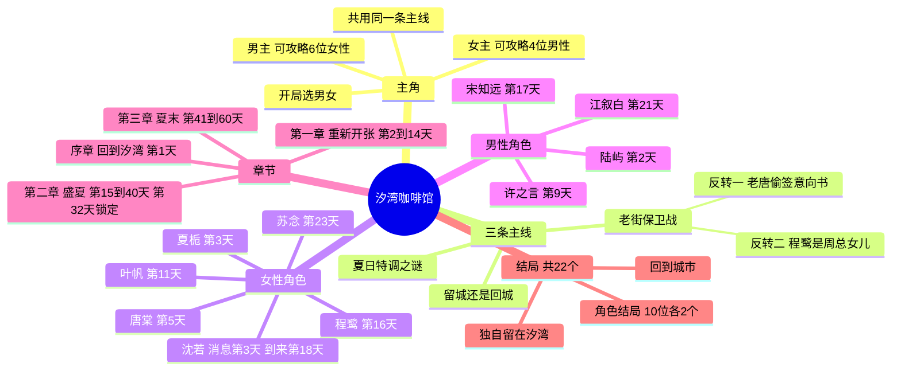

# 《汐湾咖啡馆》整体剧情策划（暂定名）

> 状态：**整体剧情第三稿，已与 Grok Bot 审核通过的 10 份角色人设同步**（人设见 `characters/`，完整故事流程见 `story-flow.md`）
> 已确认（Grok Bot 审核通过）：网页技术一套代码三端共用；题材为海边咖啡馆；玩法以剧情阅读和选择为主，穿插轻松小游戏；暂定名《汐湾咖啡馆》。
> 已确认（Mike）：开局选择主角性别；共 10 位可攻略角色，选男主可攻略 6 位女性角色，选女主可攻略 4 位男性角色；角色分批登场，第 32 天锁定主攻角色。
> Demo 范围等整体剧情确认后再定。

## 一句话故事

你在大城市的工作接连受挫，收到外婆去世的消息后回到海边小镇汐湾，接手她留下的咖啡馆「潮汐」。在一个夏天里，你把小店重新经营起来，守住被开发商盯上的老街，揭开外婆留下的"夏日特调"之谜，也和镇上各怀心事的人走近。夏天结束时，你要决定留在小镇还是回到城市，以及和谁在一起。

## 世界观与背景

- **汐湾镇**：南方海边的小渔镇，有码头、灯塔、礁石滩、老街、卫生所、邮局和一家冲浪民宿。年轻人大多外出打工，夏天会来一些游客和写生的人。
- **「潮汐」咖啡馆**：外婆在老街 17 号开了三十年的小店，二楼能看到海。这栋房子原来是渔民巷 3 号，她的娘家老屋。老街尽头是灯塔小学。
- **主线一：夏日特调之谜**。外婆的手写配方本最后一页"夏日特调"被撕掉了，镇上的人说起它时总是欲言又止。那一页是外婆自己撕下的，托陆远帆的旧识老夏（夏栀的爷爷）夹进陆远帆的航海日志，收在灯塔。真相是：外婆年轻时和陆屿的爷爷陆远帆有过约定。陆远帆年轻丧妻，独自带着年幼的儿子（陆屿的父亲），他出海前对外婆说"这趟回来就娶你，夏天结束就回来"，结果船再也没有回来。外婆后来嫁给了外公，但每年夏天都会做一杯特调放在窗边。陆家两代人都折在海上，陆屿的父亲几年前也出海失事，这让陆屿一家和咖啡馆之间有一段没说出口的牵连。
- **主线二：老街保卫战**。度假村开发商想收购整条老街。「潮汐」是外婆的娘家老屋，现在归你，没有你的签字就不能收购。小店的口碑和镇民的团结决定老街能不能留下。主线里有两个男女主共通的反转：唐棠的父亲老唐早已偷偷签了收购意向书（第二章末曝光）；程鹭是周总的女儿（第三章揭开，是和周总和解的关键）。
- **主线三：留城还是回城**。城里的前公司一直在请你回去，夏天结束前必须给出答复。
- **时间跨度**：一个夏天，共 60 天（7 月初到 8 月底），分序章和三章。
- **基调**：治愈、慢节奏，带一点成年人的迷茫和遗憾。

## 主角

- 开局选择性别，名字可自定义，全程以第二人称"你"叙述。
- 男女主角共用同一条主线（咖啡馆、老街、夏日特调、留城抉择），区别只在可攻略角色和少量对话。
- 选男主时，4 位男性角色作为朋友、邻居出场；选女主时，6 位女性角色同样作为朋友出场，各自的支线小故事仍然可以看到，只是不进入恋爱线。
- 角色**分批登场**：第一章 5 位（另有沈若的消息和电话），第二章再登场 4 位，沈若第 18 天本人到来。不论选哪个性别，10 位角色的登场日期相同。

## 可攻略角色

### 女性角色（男主可攻略，6 位）

| 角色 | 身份 | 性格 | 心事（个人线主题） |
| --- | --- | --- | --- |
| 夏栀 | 灯塔守塔人的孙女，灯塔小学老师 | 温柔、慢热 | 为了照顾生病的爷爷放弃了去城里读研，灯塔可能被关停 |
| 唐棠 | 码头海鲜排档老板的女儿 | 泼辣元气、嘴快 | 想当厨师，家里却要她接手排档、早点嫁人 |
| 叶帆 | 骑单车送信的邮递员 | 开朗、好奇心强 | 邮局里压着一批几十年没人认领的信，她一直想找到收信人；其中一封和外婆有关 |
| 苏念 | 来小镇采风的独立音乐人 | 安静、骄傲 | 嗓子出了问题，可能再也不能唱歌，每晚在礁石滩弹琴 |
| 程鹭 | 海洋研究站的潜水研究员 | 冷淡、专注 | 研究站经费被砍，珊瑚保护项目要撤，她不想离开这片海 |
| 沈若 | 你在城里的前同事 | 雷厉风行、要强 | 受公司委托来劝你回城，自己其实也被工作压得喘不过气 |

### 男性角色（女主可攻略，4 位）

| 角色 | 身份 | 性格 | 心事（个人线主题） |
| --- | --- | --- | --- |
| 陆屿 | 隔壁渔家青年，你的儿时玩伴 | 嘴硬心软、干活利落 | 父亲出海失事后放弃了大学，独自撑起家里的渔船 |
| 江叙白 | 夏天来小镇写生的画家 | 温和健谈 | 一年前起再也画不出满意的作品，来汐湾是最后一搏 |
| 许之言 | 镇卫生所唯一的医生 | 冷静寡言、细心 | 大城市医院一直在请他回去，他迟迟没回信 |
| 宋知远 | 冲浪民宿老板兼冲浪教练 | 阳光爽朗、爱开玩笑 | 曾是职业冲浪选手，受伤退役后再没站上过比赛的浪 |

### 配角（不可攻略）

| 角色 | 身份 | 作用 |
| --- | --- | --- |
| 外婆（已故） | 「潮汐」原店主 | 通过信件、配方本和镇民回忆出场，夏日特调之谜的核心 |
| 老唐 | 唐棠的父亲，码头「唐记」排档老板 | 因欠债偷签度假村意向书，第二章末曝光，听证会上撕毁 |
| 陆远帆（已故） | 陆屿的爷爷，年轻丧妻、独自带大幼子，几十年前出海未归 | 外婆年轻时的约定对象，叶帆找到的旧信就是他当年寄出的 |
| 秀姨 | 老街杂货铺老板娘 | 小镇八卦来源，负责引导和串场；只要你离开汐湾，「潮汐」仍是你的，由她代为经营，你每年夏天回来。口碑低时杂货铺被收购，秋天在「潮汐」留一格货架 |
| 周总 | 度假村开发商代表 | 老街保卫战的对手，不是纯坏人；程鹭多年不来往的父亲，第三章揭开后可以和解 |
| 拿铁 | 店里的橘猫 | 吉祥物，彩蛋和小提示 |

## 游戏时长

- 已确认（Mike）：共三章（另有一个很短的序章），单周目流程控制在 3 小时以内。
- 时长分配（单周目，中文游戏正文按每分钟 300 字）：序章约 10 分钟，第一章约 50 分钟，第二章约 60 分钟，第三章约 40 分钟，阅读合计约 2 小时 40 分钟。小游戏约 4 分钟，余量约 16 分钟，仍在 3 小时以内。字数见 `writing-style.md`。
- 为了控制时长，60 天里只有剧情节点和角色事件当天会完整演出，其余日常用"一周快进"的形式一屏带过；小游戏每局控制在 1 分钟左右，并且可以跳过。

## 章节结构

### 登场时间表（男女主相同）

| 章节 | 天数 | 角色 | 初遇方式 |
| --- | --- | --- | --- |
| 第一章 | 第 2 天 | 陆屿 | 过来帮你搬东西、修水管，儿时玩伴重逢 |
| 第一章 | 第 3 天 | 夏栀 | 替爷爷送回外婆借给灯塔的旧咖啡壶 |
| 第一章 | 第 3 天、第 6 天 | 沈若 | 第 3 天晚上发消息，第 6 天打电话，人不到场 |
| 第一章 | 第 5 天 | 唐棠 | 送来"外婆生前订的"海鲜，撞见你中暑，把你送去卫生所 |
| 第一章 | 第 9 天 | 许之言 | 台风预警，出诊回来顺路复查，帮你钉窗 |
| 第一章 | 第 11 天 | 叶帆 | 台风后送来外婆积压的信，说起邮局有一封写给外婆的旧信 |
| 第二章 | 第 16 天 | 程鹭 | 你送外卖咖啡到海洋研究站，她提醒你别踩珊瑚 |
| 第二章 | 第 17 天 | 宋知远 | 你在礁石滩被涨潮困住，他划冲浪板把你带回岸边 |
| 第二章 | 第 18 天 | 沈若 | 本人来到汐湾，回城线正式开启 |
| 第二章 | 第 21 天 | 江叙白 | 背着画架进店，想借二楼窗口画海 |
| 第二章 | 第 23 天 | 苏念 | 你夜里在礁石滩听见她弹琴 |

- 苏念、江叙白登场最晚，好感门槛**不降低**；他们的初遇和第二章前半事件好感加成更高，自由行动中遇到他们的概率也更高。
- 原大纲第 4 天"分支一"对江叙白 / 苏念的影响，移到他们各自的初遇（第一次给他们推荐饮品）。

### 序章：回到汐湾（第 1 天）

- 开局选择性别和名字。
- 在城里加班时接到外婆去世的电话，辞职回到汐湾。秀姨在车站接你，随口说起外公走得早，把咖啡馆钥匙交给你；读外婆留下的信，推开落满灰的咖啡馆，橘猫拿铁从柜台后面钻出来。
- 序章不出现任何可攻略角色，男女主内容相同。

### 第一章：重新开张（第 2 到 14 天）

| 天数 | 剧情 | 分支 / 玩法 |
| --- | --- | --- |
| 第 2 天 | 打扫小店；陆屿过来帮忙搬东西、修水管，儿时玩伴重逢 | 陆屿登场 |
| 第 3 天 | 夏栀送回旧咖啡壶；翻出外婆的配方本，做出回来后的第一杯咖啡；晚上收到沈若的消息："听说你辞职了？公司还在等你回来。" | 夏栀登场；手冲小游戏教学；沈若以消息形式初次出场 |
| 第 4 天 | 试营业，第一批客人（秀姨和老街街坊）上门 | **分支一**：给客人推荐什么饮品，影响口碑和已登场角色（陆屿、夏栀）的好感 |
| 第 5 天 | 你在店里中暑晕倒，唐棠送海鲜时撞见，把你送到卫生所；许之言在外岛出诊，只留下一张字条。老唐在门口短短露面，这是你和他第一次见面 | 唐棠登场；反转一的第一面伏笔 |
| 第 6 天 | 沈若打来电话，劝你回城，两人第一次聊起各自的累 | 沈若好感开始计算 |
| 第 7 天 | 秀姨送来外婆的旧拉花缸，讲外婆给每位客人拉一片叶子的往事 | 拉花小游戏解锁 |
| 第 6 到 8 天 | 日常：白天营业，傍晚自由选择去码头、礁石滩、灯塔 | 自由行动触发已登场角色的小事件；邮局第 11 天才开放 |
| 第 9 天 | 台风预警，许之言出诊回来顺路复查，和大家一起帮你钉窗 | 许之言登场；**分支二**：台风夜留谁在店里避雨（只限已登场的陆屿、夏栀、唐棠、许之言）。女主的恋爱选项是陆屿、许之言；夏栀、唐棠是友情选项，不加恋爱好感 |
| 第 10 天 | 台风过后，开发商周总第一次上门谈收购 | 主线二开启；两个反转的第一处伏笔 |
| 第 11 天 | 收拾台风后的店，发现配方本最后一页被撕掉；叶帆送来外婆积压的信，说邮局好像有一封写给外婆的旧信 | 主线一开启；叶帆登场，邮局开放 |
| 第 12 天 | 去邮局看叶帆父亲留下的登记簿：上面记着一封 1970 年代的无人认领信，就是陆远帆的信，实物不在原箱里，第 40 天才找到 | 配方猜谜小游戏 |
| 第 13 天 | 小镇夏日祭筹备，在码头广场，「潮汐」受邀摆摊 | **分支三**：邀请谁一起摆摊（已登场的 5 位）。女主的恋爱选项仍是陆屿、许之言；夏栀、唐棠是友情选项，叶帆同样是友情选项，都不加恋爱好感 |
| 第 14 天 | 夏日祭烟花下的心动事件；章末接到城里前公司的电话 | 章末悬念，第二章预告 |

### 第二章：盛夏（第 15 到 40 天）

- **登场**：程鹭（第 16 天）、宋知远（第 17 天）、沈若本人（第 18 天）、江叙白（第 21 天）、苏念（第 23 天）。无论选男主还是女主都会见到全部 10 位，不可攻略的角色作为朋友出场。
- **前半章（第 15 到 31 天）个人线深入**：每位角色 2 到 3 个个人事件，心事逐渐浮出水面。剧情节点当天完整演出，其余日子按周快进；同一天的多个个人事件通过傍晚自由行动地点选择，只能看其中一个。
- **第 32 天锁定主攻角色**：好感最高且达到锁定门槛的角色进入专属线；都没达标就进入无主攻的通用路线。同分先看最近一次自由行动，再比累计次数，仍同分就锁登场更晚的那位。
- **后半章（第 33 到 40 天）主攻角色专属线**。
- **老街保卫战**：开发商开出高价，邻居们开始动摇。你可以用咖啡馆办活动把人留住（第 33 到 37 天），不同角色帮你办不同的活动：海边音乐会（苏念）、写生展（江叙白）、冲浪节（宋知远）、灯塔开放夜（夏栀）、海边夜市（唐棠）、旧信与老照片展（叶帆）、珊瑚夜潜（程鹭）、码头早市（陆屿）、夏日义诊（许之言）、线上传播（沈若）；无主攻路线由秀姨牵头办老街市集。
- **关键事件**：
  - 第 18 天沈若来到汐湾，说是休假，其实是公司派来劝你回去的，回城线正式开启。
  - 第 25 天开渔节，陆屿第一次说起父亲和爷爷都没能从海上回来。
  - 第 36 天夜里，「潮汐」里的街坊会上，周总拿出老唐签过字的收购意向书，老街第一道防线破了（**反转一曝光**）。
  - 第 38 天老街听证会，在镇政府礼堂：老唐当众撕掉意向书；程鹭用数据揭开游艇码头的环境代价，周总失神叫出"小鹭"。县里决定补充材料后在八月底公布结果。
- **章末（第 40 天）**：叶帆在县城退件仓库找到那封几十年没送出的旧信，寄信人是陆远帆，信里写着"等我回来，喝你的夏日特调"。信上是外婆的小名，旧门牌渔民巷 3 号就是现在的「潮汐」。不走叶帆线，她用一两句补上第 37 天档案室的结果。配方页的下落指向灯塔。

### 第三章：夏末（第 41 到 60 天）

- **第 41 天**：你和叶帆把旧信送到陆家。
- **第 44 天 夏日特调揭秘**：夏栀带你上灯塔。航海日志是陆远帆的，放在老夏（夏栀的爷爷，陆远帆的旧识）的灯塔里。当年外婆自己撕下配方页，托老夏夹进这本日志。页尾是她当时写的「等你回来」。夏爷爷亲口说「等了一辈子」，并转述近年外婆托他的那句：「不希望你也困在等待里，留下或离开都可以。」这句不在页上，呼应第 1 天信里的「想开就开，不想开也没关系」。他讲旧事：外婆后来嫁的是外公，她真正在等的是另一个人，陆远帆。
- **第 45 到 46 天**：你照配方做出夏日特调；陆母走进「潮汐」，说起心结，只补两句：陆父是亲戚带大的，外婆的葬礼她没去。陆屿和陆家人由此和外婆的往事和解。
- **第 48 天 反转二揭开**：周总深夜独自来到「潮汐」，喝下夏日特调，承认自己是程鹭的父亲。**第 50 天**父女在码头谈开，周总撤回游艇码头方案，和老街和解。
- **个人线高潮（第 41 到 59 天）**：主攻角色的心事迎来抉择，比如夏栀的灯塔会不会被海事部门关停、苏念能不能再唱歌、陆屿要不要重新读书。
- **第 55 天 老街结局公布**：根据口碑和之前办过的活动，只公布结果，不演搬家。百分之七十及以上老街保住；百分之四十到六十九，改建码头尽头的旧冷库和空仓库，不含「唐记」旧址，也不是码头入口那块地；不到百分之四十，老街其余铺面被收购。「潮汐」是外婆的娘家老屋，现在归你，没有你的签字就不能收购，所以是唯一没被收购的一栋。
- **最终抉择（第 60 天）**：只在普通结局和通用结局里选留在汐湾还是回到城市。好结局的去向由角色自己的故事决定，不经过这一选。

## 结局

- **角色结局**：10 位角色各有一个好结局和一个普通结局，共 20 个。
- **通用结局**："独自留在汐湾"和"回到城市"，共 2 个。
- **总计 22 个**。单次游玩只能进入当前性别对应的结局（男主 14 个可达，女主 10 个可达，都含两个通用结局）。
- **结局去向**：每位角色好结局的去向由角色自己的故事决定，普通结局（关系停在朋友以上、恋人未满）的去向跟随你在第 60 天的选择。
- **离开汐湾的结局**：只要你离开汐湾，不论角色好结局（一起回城、一起去远方）、普通结局里选择回城，还是通用结局「回到城市」，「潮汐」仍是你的，都由秀姨代为经营，你每年夏天回来。

| 去向 | 角色好结局 |
| --- | --- |
| 留在汐湾 | 夏栀（守住灯塔）、唐棠（在排档旧址开一家海边餐厅，与「潮汐」联营；第 47 天的亚军在这里收掉）、叶帆（一起送完最后一批旧信）、程鹭（研究站保住，和你一起守这片海）、陆屿（他重新读书，你守着店等他放假回来）、宋知远（他重回赛场，冲浪民宿和咖啡馆联名，并和你一起租下或买下「浪花里」） |
| 一起回城 | 沈若（她辞职，你回绝前公司的返聘，两人在城里开第二家「潮汐」；第一家仍是你的，由秀姨代为经营，每年夏天回来）、许之言（他接受城里医院的邀请，你陪他去，咖啡馆仍是你的，由秀姨代为经营，每年夏天回来） |
| 一起离开小镇去远方 | 江叙白（陪他去各地写生办展；咖啡馆仍是你的，由秀姨代为经营，每年夏天回来）、苏念（她的嗓子恢复，你跟着她的巡演一起走；咖啡馆仍是你的，由秀姨代为经营，每年夏天回来） |

- **判定**：主攻角色关键选择正确，且好感达到好结局线，进入好结局，去向不由第 60 天再选。已经锁定但好感低于好结局线，或关键选择不对，进入普通结局，去向跟随第 60 天。没有主攻角色时，第 60 天按"留下 / 回城"进入通用结局。锁定门槛低于好结局线，两个数都是占位。老街的结果会作为结局里的附加演出，不单独算结局。

## 轻量数值（剧情为主，数值只做隐藏判定）

- **好感度**：每位角色 0 到 100，隐藏数值，通过关键选项和自由行动变化。后登场的苏念、江叙白事件加成更高，锁定门槛不降，但低于好结局线。路线表里的加减、两条门槛、口碑分界和第 14 天「都很低」都是占位，等原型试玩之后再调。例外也是占位：叶帆第 13 天男主邀她摆摊记恋+12。她第 11 天才登场，这一笔用来补进度；不邀则没有这 12。女主仍只记友情。口碑同样按 0 到 100：高为百分之七十及以上，中为百分之四十到六十九，低为不到百分之四十。第 14 天只比人在汐湾、已经登场的可攻略角色，沈若不参加。在场的恋爱好感都低于百分之二十，烟花改和秀姨、拿铁看。同分同第 32 天：先看最近一次自由行动，再比累计次数，仍同分就给登场更晚的那位。
- **口碑**：小游戏表现、饮品推荐和办活动会影响口碑，决定老街保卫战的结果和少量额外剧情。
- **小游戏**：手冲（第 3 天）、拉花（第 7 天）、配方猜谜（第 12 天），都可以跳过，跳过按普通表现结算。

## 剧情结构导图

## 确认记录

- 已确认（Mike）：共三章，单周目 3 小时以内；加入老街保卫战主线；男女主共用同一条主线，只换恋爱对象和少量对话。
- 已确认（Mike）：角色分批登场（第一章 5 位，第二章 4 位，沈若第 18 天本人到来），主攻角色第 32 天锁定。
- 已确认（Grok Bot）：10 份角色人设审核通过，见 `characters/`。
- 已确认（Grok Bot）：主线只保留两个男女主共通反转——老唐偷签意向书（第 36 天曝光、第 38 天撕毁）、程鹭是周总的女儿（第 48 天揭开）；江叙白的画廊合同、沈若的岗位危机、宋知远的民宿租约都是各自个人线的危机，与周总无关。
- 已确认（Grok Bot）：只要你离开汐湾，不论角色好结局、普通结局里选择回城，还是通用结局「回到城市」，「潮汐」仍是你的，由秀姨代为经营，你每年夏天回来。唐棠好结局的餐厅开在排档旧址、与「潮汐」联营；沈若好结局改为她辞职、你回绝返聘；灯塔关停由海事部门决定，与周总无关。
- 已确认（Grok Bot）：序章不出现可攻略角色；第 5 天许之言外岛出诊只留字条；拉花第 7 天由秀姨触发；邮局第 11 天开放；原第 7 天涨潮事件从第一章删除；台风夜分支只限已登场角色；陆远帆年轻丧妻、独自带大幼子；叶帆早知旧信记录，第 40 天才找到实物。
- 已确认（Grok Bot）：第 9 天、第 13 天女主分支保留恋爱选项陆屿、许之言，并加上夏栀、唐棠作为友情选项，不加恋爱好感；第 13 天叶帆对女主同样是友情选项。
- 已确认（Grok Bot）：第 44 天的配方页是外婆当年自己撕下的，托老夏（夏栀的爷爷，陆远帆的旧识）夹进陆远帆的航海日志，收在灯塔。完整铺陈以后写入 `twists-and-foreshadowing.md`。
- 已确认（Grok Bot）：口碑低时老街其余铺面被收购。「潮汐」是外婆的娘家老屋，现在归主角，没有主角签字就不能收购，是唯一没被收购的一栋，不是周总留下的。人离开时秀姨只代管。口碑中改建码头尽头的旧冷库和空仓库，不含「唐记」旧址，也不是第 38 天撕掉意向书的码头入口地块。灯塔小学是公家的，校舍还在，夏栀好结局不改。口碑低时杂货铺被收购，货架、唐棠的餐厅和叶帆的代办柜台都在秋天的尾声搬进「潮汐」。第 55 天只公布，不演搬家。江叙白的阁楼不另写变体。陆远帆的航海日志在老夏的灯塔；听证会结果第 55 天公布；夏栀的爷爷与陆远帆是旧识；苏念在礁石滩弹的是木吉他。
- 已确认（Grok Bot）：第 1 天秀姨随口说外公走得早；第 44 天夏爷爷点明外婆在等的是陆远帆，不是外公；第 46 天陆母只补两句，陆父由亲戚带大、葬礼她没去；第 5 天老唐短短露面，是第一次见面，也是反转一的伏笔。
- 已确认（Grok Bot）：常住大约 2000 人、夏天大约 30℃，只写在策划里。灯塔在镇北山嘴的小山上。老街从车站往里是杂货铺、邮局、卫生所、「潮汐」，尽头是灯塔小学。镇上只有一座车站，陆屿改送到对岸渡口。镇上的小学就是灯塔小学。夏日祭和庆功宴在码头广场，第 36 天街坊会在「潮汐」，第 38 天听证会在镇政府礼堂，第 20 天相亲在「唐记」。已解锁地点每天都在固定地图上，没有事件只给一两句日常、不加好感。沈若住「浪花里」。江叙白住秀姨家杂货铺楼上的阁楼。外婆信上的旧门牌是渔民巷 3 号改成老街 17 号，即「潮汐」，原来是娘家老屋；信因为小名对不上户口进了县城退件仓库。第 37 天档案室只有叶帆线，第 40 天找信人人都有。详见 `world.md`。
- 已确认（Grok Bot）：沈若每天只睡四小时的两个月，是你离开公司前后，包含辞职前的交接。陆父对着窗口发呆只在陆屿个人线，不进第 46 天。第 12 天登记簿上那封 1970 年代的无人认领信就是陆远帆的，信纸第 40 天才找到。外公在你出生前就走了。反转二伏笔：第 10 天只留周总那句问话，第 16 天铜牌，第 26 天庆功宴程鹭离场，第 29 天码头再次离场，第 38 天「小鹭」，第 42 天「我也有个女儿」。第三章关键选择、灯塔建议公布、唐棠的比赛、叶帆的明信片、苏念的复查，日子见 [`routes/`](routes/README.md)：关键选择在第 51 到 54 天，灯塔建议第 54 天只在夏栀的线，比赛第 47 天她拿亚军，明信片第 60 天写进好结局，复查第 49 天。
- 进行中：完整故事流程初稿 `story-flow.md`，待 Grok Bot 审核。
- 待定：Demo 范围，等整体剧情和人设定稿后再定。
