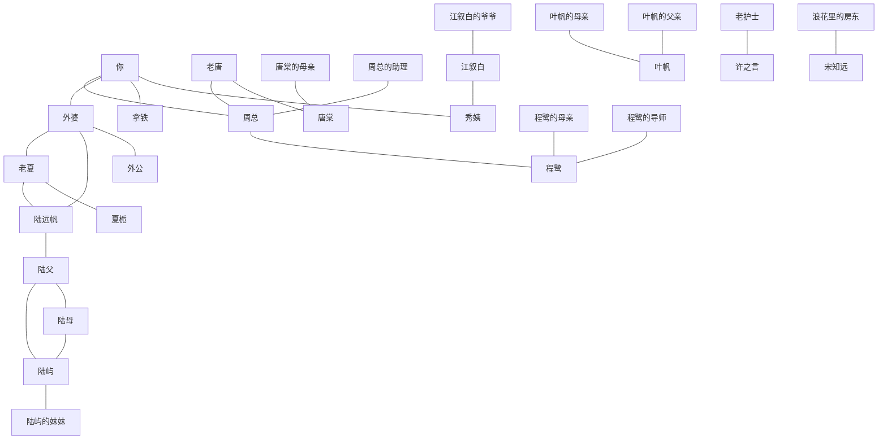

# 《汐湾咖啡馆》配角

> 状态：配角初稿
> 文档 8。不可攻略。不另加主线。日子以 [`timeline.md`](timeline.md) 为准，去向以 [`endings.md`](endings.md) 为准。

男女主都看得见共通场。标了「选到」或「只在某条线」的，没选到就不出现。可攻略的十个人不在这里。

## 第一次露面

「第一次」是玩家第一次见到这个人，或见到他留下的字、信、通知。人不在场的注明。

| 角色 | 天 | 第一次是什么 |
| --- | --- | --- |
| 外婆 | 1 | 信。人已经不在 |
| 秀姨 | 1 | 车站接你 |
| 拿铁 | 1 | 从柜台后面出来 |
| 外公 | 1 | 秀姨随口说他走得早。人已经不在 |
| 老夏 | 3 | 夏栀替他送回咖啡壶。人要到灯塔才见到 |
| 老唐 | 5 | 「潮汐」门口放下箱子 |
| 老护士 | 5 | 卫生所转交字条。没有名字 |
| 周总 | 10 | 上门谈收购 |
| 叶帆的父亲 | 12 | 登记簿。本人不在 |
| 陆远帆 | 12 | 登记簿上的名字。人已经不在 |
| 灯塔小学的学生 | 16 | 作文被带到店里，选到夏栀才看见。没有名字 |
| 陆父 | 25 | 开渔节被说起。人已经不在 |
| 周总的助理 | 26 | 庆功宴上低声说话，选到这场才看见。没有名字 |
| 陆屿的妹妹 | 27 | 录取通知书，选到陆屿才看见。本人没有写上场 |
| 江叙白的爷爷 | 27 | 旧速写，选到他才看见。人已经不在 |
| 叶帆的母亲 | 28 | 旧地址，选到叶帆才看见。人不在 |
| 外岛渔民 | 28 | 受伤，选到许之言才看见。没有名字 |
| 镇上老人 | 31 | 旧渔歌由苏念转述，选到她才听见。没有名字 |
| 老渔民 | 36 | 陆屿线的码头早市。没有名字 |
| 陆母 | 38 | 陆屿线里坐在礼堂最后一排。第 41 天人人看见她关门 |
| 浪花里的房东 | 52 | 宋知远线里租约到期。本人没有写上场 |
| 唐棠的母亲 | 无 | 早年去世，年份没有写 |
| 程鹭的母亲 | 无 | 只在人设背景里，玩家听到的日子没有写 |
| 程鹭的导师 | 无 | 去年退休，揭晓日没有写 |
| 夏栀的父母 | 无 | 在外地工作，这个夏天没有写他们回来 |

## 秀姨

老街杂货铺老板娘。把人串到一起，也是八卦的来源。第 1 天接站、交钥匙。你离开汐湾时，「潮汐」仍是你的，由她代为经营，每年夏天回来。你留下、店在你手里，不交由她代管。口碑低时杂货铺被收购，秋天她在「潮汐」留一小格货架。

说话爱闲聊，一句里带半个消息。文档原句：「最近倒一点不着急还了，怪事。」她看陆屿长大，说过「屿仔就是太倔」。

和你：第 1 天把钥匙交给你。和第 14 天好感都很低时，跟你和拿铁看烟花。和外婆：第 7 天送来旧拉花缸。和老唐：替他给唐棠物色相亲，第 20 天那场办在「唐记」。和江叙白：阁楼的房东；第 37 天只在他的线里，写生展上哭了。和沈若：先当成城里来抢人的，后来教她织毛线，日子没有单列。其余可攻略角色的闲话都挂在已经有的场上，不另开。

露面：第 1、4、7、10、20、36、37、59 天人人都有。第 14 天改看烟花，只在恋爱好感都低于百分之二十时。第 32 天没锁定主攻，由她牵头老街市集。第 20 天的相亲要选到唐棠。全结局都在。离开的结局里她代管店。口碑低的尾声里有那一格货架。

秘密：她第 20 天那句闲话，是反转一的伏笔。她不知道意向书的内容，第 36 天夜里才在街坊会上跟大家一起看见。

## 拿铁

「潮汐」的橘猫，不是一杯饮品。沈若后期点的那杯热拿铁是另一回事。

没有台词。第 1 天从柜台后面钻出来。第 14 天好感都很低时，和你、秀姨一起看烟花。全路线、全结局都在店里。不带秘密。

## 老唐

唐棠的父亲，「唐记」老板。唐家三代守排档。母亲早逝，女儿由他带大。嘴硬，催人，不当面服软。文档原句：「定金我慢慢还，地不卖了。」第 26 天被问到，只说「谈谈价钱」。

和你：第 5 天第一次见面，放下箱子就走。和唐棠：又爱又怕。第 20 天把相亲办在自己的排档。第 37 天后厨谈开欠债。第 47 天只在她的线里，尝她的亚军鱼汤。好结局在餐厅门口招呼熟客。和秀姨：托她介绍女婿。和周总：去年冬天为换冷库、修船借的钱，由周总垫付当定金，换了码头入口那块地的意向书。和陆屿：排档收他的渔获，日子没有单列。

露面：第 5、29、36、37、38、42 天人人都有。第 20 天相亲、第 26 天庆功宴要选到。第 35 天夜市、第 47 天鱼汤只在唐棠的线。好结局第 60 天在门口。普通结局和别的角色结局没有再写他。

秘密：意向书是反转一。第 36 天夜里揭开，第 38 天他自己撕掉。那块地没有卖掉。口碑中改建的旧冷库不是他的排档，也不是这块地。

## 周总

度假村的代表，不是纯坏人。说话先谈价钱，临走才漏一句私事。文档原句：「码头那边，已经有人松口了。」第 42 天自言自语：「我也有个女儿，不想让她看不起我。」第 38 天失神叫出「小鹭」。

和你：第 10 天上门，你没答应。第 48 天夜里自己来店，喝夏日特调，承认是程鹭的父亲。和程鹭：她十五岁起随母姓，多年不认他。研究站的匿名捐款是他出的，想用度假村的海洋馆把她留在身边。第 50 天父女谈开，他撤回游艇码头。和老唐：垫定金，第 42 天答应分期。和沈若：第 38 天她的计划书让他说可以再谈。和陆屿：你回镇前想收陆家老屋，被当面请出去，第 47 天由陆屿讲述，不当场再演。和许之言：视察时中暑，是他看的，第 43 天讲述，不当场再抢救。和苏念：第 43 天只在她的线里，请她写主题曲，被拒绝。和宋知远：民宿不在收购范围里，没有直接往来。

露面：第 10、29、36、38、42、48、50、55 天的结果人人都有。第 55 天只公布，他不出场宣布。第 26 天要选庆功宴。第 43 天的三件事分属三条线。全结局都受他这条线的结果影响。他没有留下「潮汐」：「潮汐」是你的，没有你的签字就不能收购。

秘密：他是程鹭的父亲，反转二，第 48 天揭开。匿名捐赠同一天对上。

## 老夏

夏栀的爷爷，灯塔守塔人。信里称老夏。陆远帆的旧识。记性差，别的都淡了，近年外婆托他的那一句记得死。文档原句：「不希望你也困在等待里，留下或离开都可以。」他自己还说「等了一辈子」。后一句是他说的，不在配方页上。

和你：第 44 天由夏栀带你上塔，他交出日志。和夏栀：她为他的慢性心肺病放弃读研，今年教书第三年。和外婆：外婆自己撕下配方页，托他夹进陆远帆的航海日志。和陆远帆：日志是陆远帆的，放在他的灯塔。和许之言：许之言是他的主治，第 22 天同一场抢救里能看见。

露面：第 3 天只被提起。第 6 到 8 天选灯塔，夏栀给他读报，人在塔下。第 22 天发病，人人都有，和抢救是一场。第 44 天人人都有。夏栀好结局的课堂在灯塔上，校舍是公家的，不在收购里，好结局不改。别的结局没有再写他。

秘密：他保管的是陆远帆的日志，不是一本无名航海笔记。外婆在等的人，由他在第 44 天点明是陆远帆，不是外公。

## 陆母

陆屿的母亲。话少，不对着窗口讲。第 46 天只补两句：孩子是亲戚带大的；外婆的葬礼，她没去。没有第三句。窗口发呆是陆屿第 43 天讲的，不进她的台词。

和你：第 41 天你和叶帆送信，她关上房门。第 46 天第一次走进「潮汐」，喝下特调。和陆屿：他退学后照顾她和妹妹。和陆父：夫妻。丈夫约五年前出海未归。和外婆：对「潮汐」有心结，葬礼没去。和许之言：高血压由他照看，日子没有单列。

露面：第 38 天只在陆屿的线，坐在礼堂最后一排。第 41、46 天人人都有。全结局都经过第 46 天这场和解。陆屿好结局和普通结局没有再给她单独的去向。

秘密：她知道孩子是亲戚带大的，这句话留到第 46 天。她不讲丈夫看窗口的事。

## 外婆

「潮汐」原店主，第 1 天之前已经去世。渔民巷 3 号是她的娘家老屋，1987 年改成老街 17 号。约三十年前在这栋房子里开店。店现在归你。没有你的签字就不能收购。

信里的原句：「店交给你了，想开就开，不想开也没关系。」配方页页尾是当年她写的「等你回来」。托老夏转的那句不在页上。

和你：第 1 天把店和信留下。和陆远帆：他出海前说回来就娶她，船没有回来。她后来嫁的是外公，窗边等的是陆远帆。和老夏：托他收日志。和陆母：葬礼她没去。和夏栀：从小喝店里的汽水，外婆叫她小栀子。和唐棠：夸过她手巧，每周订一箱海鲜，也订过特别海盐。和程鹭：每周给研究站送一次咖啡。和许之言：第一个常客病人，最后的病程是他陪着走完，日子没有单列。和陆屿：把他当半个孙子，留点心。和宋知远：上过他的浅水课；旧照片只在第 34 天他的线里。和叶帆：每年把生日卡寄到邮局，日子没有单列。和江叙白、苏念、沈若：没见过面，只剩速写、老照片和配方本里那句「慢慢煮，别着急」。

露面：第 1 天的信人人都读。之后是别人的回忆，不另开她的场。全结局都站在她留下的这栋房子上。

秘密：窗边那杯是在等陆远帆。小名对不上户口，所以信进了县城退件仓库。第 40 天找到。第 44 天讲明。

## 陆远帆

陆屿的爷爷，几十年前出海未归。年轻丧妻，独自带着还小的儿子。渔船「远帆号」以他命名。人已经不在，只留信和日志。

信里的原句：「等我回来，喝你的夏日特调。」又说日志在灯塔老夏那里。

和外婆：约定回来就娶她。和陆父：父子。儿子后来也出海未归。和陆屿：孙子从没见过他。和老夏：旧识。和叶帆：她靠登记簿和旧信认识他，两人没见过面。他不是江叙白的爷爷，也不是外公。

露面：第 12 天登记簿点出那封 1970 年代的信是他的，当天没有信纸。第 25 天陆屿说起爷爷也没回来。第 40 天找到信，人人都有。第 44 天日志对上。全路线都走到这里。

秘密：寄信人是他。海难的日子由第 19 天的病历、第 30 天的海况记录从旁对上，主线不靠这两条也能在第 40 天读到信。

## 只在背景里的家人

这些人不在这个夏天的场上。没有文档原句，不另补台词。

**外公。** 陆远帆没回来之后，外婆嫁给他。他在你出生前就走了，年份没有写。第 1 天秀姨随口说起，第 44 天夏爷爷点明外婆等的不是他。他不是江叙白的爷爷。全路线都听到这两次，没有单独结局。

**陆父。** 陆远帆的儿子，亲戚带大，约五年前出海失事。第 25 天被说起。对着「潮汐」窗口发呆只在陆屿第 43 天的线里。第 46 天陆母只说他是亲戚带大的。没有他的结局变体。

**陆屿的妹妹。** 还在读高中。第 27 天大学录取通知到店，选到陆屿才看见，他帮她算学费。文档没有写她本人进店，也没有名字。

**叶帆的父亲。** 上一任邮递员，约三年前调去县城分拣中心，把无人认领的旧信和登记簿留给她。第 12 天人人看见那本簿子。这个夏天他不上场。

**叶帆的母亲。** 叶帆童年离家，说会写信，一封也没有。第 28 天选到叶帆，才翻出旧地址。好结局里那张没有署名的明信片不是已经认定的她的信，寄件人没有写。

**江叙白的爷爷。** 二十多年前路过写生，住了半个月，画下窗口那杯。退休美术老师，把速写和一支油画笔留给孙子。第 27 天选到江叙白，或走友情，才看见。不是陆远帆，不是外公。人已经不在。

**唐棠的母亲。** 早年去世，年份没有写。父女关系从第 5 天就知道母亲不在。她不上场。

**程鹭的母亲。** 父母在程鹭十五岁时离婚，她随母姓。母亲希望她回城找稳定工作。玩家哪一天听到，没有写。

**程鹭的导师。** 去年退休，项目交给她，潜水表是他留下的。揭晓日没有写。这个夏天不上场。

**夏栀的父母。** 在外地工作，她从小跟爷爷住在灯塔下。这个夏天没有写他们回来。

**浪花里的房东。** 已经搬去城里的老人，租约夏末到期。子女要卖掉，和周总无关。第 52 天只在宋知远的线里，和关键选择一起压过来。本人没有写上场。好结局里你和他续租，或一起买下。普通结局房子卖掉，「浪花里」在更小的地方重新开张。

## 未具名

有功能，没有名字。不在这里补名。

**老护士。** 卫生所只有她和许之言。第 5 天转交他的字条，人人经过卫生所。第 19 天选到许之言，她翻出旧病历，对上几十年前的海难。没有台词原文。

**周总的助理。** 第 26 天庆功宴，唐棠撞见他和老唐低声说话。要选这场才看见。没有台词原文。

**灯塔小学的学生。** 第 16 天选到夏栀，作文《我长大想当灯塔》被带到店里。程鹭来上过一次课，学生叫她珊瑚姐姐，日子没有写。校舍是公家的，不在收购里。

**外岛渔民。** 第 28 天选到许之言，渔民受伤，他仍要出诊。没有名字，岛名也没有写。

**镇上老人。** 第 31 天选到苏念，她转述老人哼过的旧渔歌，歌词是「夏天结束就回来」。和码头上的老渔民是不是同一群人，没有写。

**老渔民。** 第 36 天只在陆屿的线，码头早市上被他说服站到老街这边。陆屿好结局里，「远帆号」交给镇上的渔民代管。没有单独的名字。

**县里和镇里的官员。** 第 38 天礼堂开会，第 55 天县里公布结果。公布是一条结果，不是再演一场有名字的人。没有镇长或县里发言人的名字。

## 和主线人物的关系

实线是这个夏天能对上的关系。已故的人同样画在图里。节点里不用括号。

## 待确认

1. 老护士、周总的助理、陆屿的妹妹、外岛渔民、灯塔小学的学生、浪花里的房东和子女、县里公布结果的官员，都没有名字。是一直用身份称呼，还是以后再起名，没有定。
2. 陆屿的妹妹第 27 天只有通知书。人在不在店里，没有写。
3. 程鹭的母亲、导师，唐棠的母亲，叶帆的父母，夏栀的父母，这个夏天本人上不上场，没有写。叶帆好结局那张没有署名的明信片，仍然不指定是母亲寄的。
4. 第 31 天哼旧渔歌的镇上老人，和第 36 天码头早市的老渔民，是不是同一群人，没有写。
5. 口碑低时唐棠的餐厅搬进「潮汐」。老唐第 60 天在门口招呼，写的是排档旧址那场。搬进去之后他还在不在，没有写。
6. 秀姨给夏栀介绍对象、教沈若织毛线、给程鹭带点心，日子仍挂在已有的场上。对白要不要写成固定的一句，没有定。
