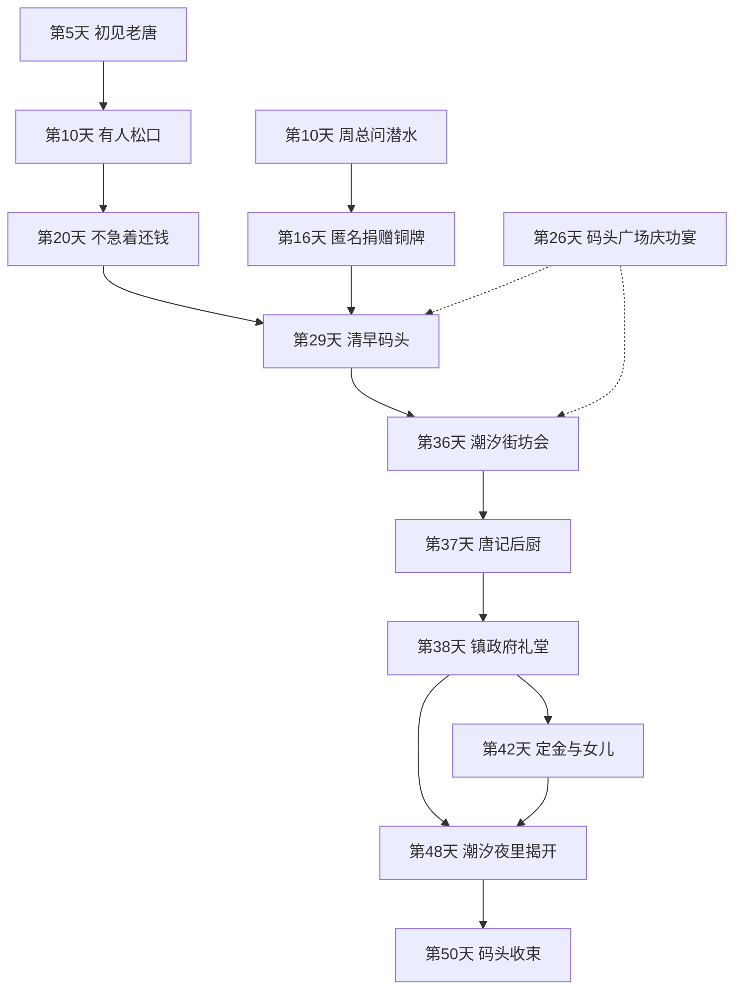
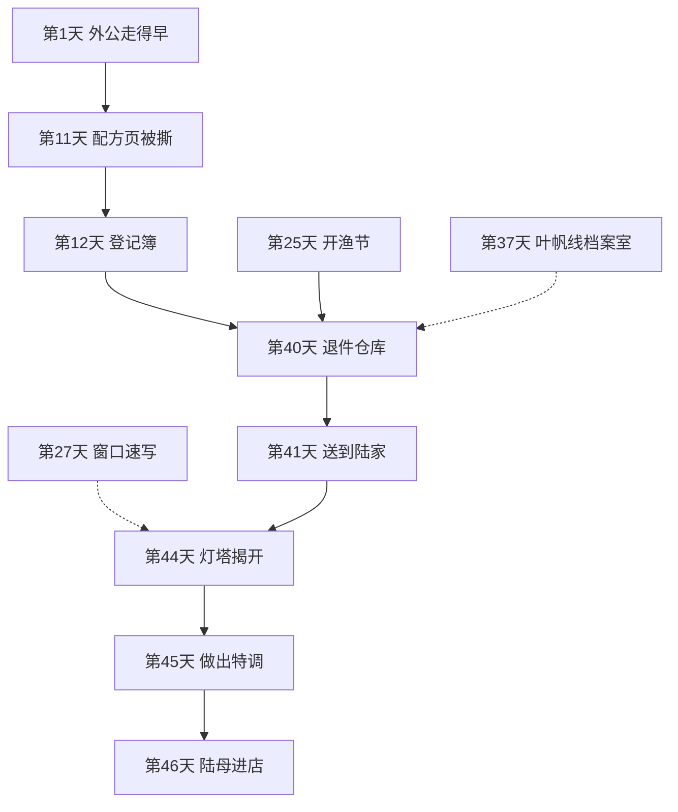

# 《汐湾咖啡馆》反转与伏笔清单

> 状态：反转与伏笔清单初稿，待 Grok Bot 审核

依据 [`story-outline.md`](story-outline.md)、[`story-flow.md`](story-flow.md)、[`timeline.md`](timeline.md)、[`world.md`](world.md)、[`relationships.md`](relationships.md) 和 [`characters/`](characters/README.md)。不另加主线。日子没写死的，不在这里补一天，放进文末待确认，或指到已有的待排期。

男女主看同一批共通场。自由场要当天选到才看见，两个性别都能选。性别只改恋爱和友情的对话，不改地图，也不改下面两个反转。常住人数和夏天的气温只写在 [`world.md`](world.md) 的策划里，不写成对白，也不当作伏笔。

核对用同一条：角色自己的动作，必须在这个人登场之后、揭开之前。别人嘴里的一句可以更早，但要写明这个人还不在场。

## 反转一：老唐偷签了意向书

### 真相

老唐去年冬天为了换冷库、修船借了钱。你回镇之前，他已经偷偷签了周总的收购意向书，签的是码头入口那块地。欠款由周总垫付，当作定金。女儿当时不知道。

### 伏笔

| 天 | 场 | 看见什么 | 依据 | 谁看见 |
| --- | --- | --- | --- | --- |
| 5 | 「潮汐」门口 | 老唐放下箱子，催唐棠回排档，说两句就走。没有秘密台词，看见的是这个人。这是你和他第一次见面 | story-flow.md、characters/tang-tang.md、timeline.md | 男女主都看 |
| 10 | 「潮汐」，周总上门 | 临走对秀姨说：「码头那边，已经有人松口了。」 | story-flow.md | 男女主都看 |
| 20 | 「潮汐」，秀姨闲聊 | 「最近倒一点不着急还了，怪事。」去年冬天换冷库借的钱 | story-flow.md、world.md | 男女主都看 |
| 26 | 码头广场庆功宴 | 唐棠看见老唐和周总的助理低声说话。老唐只说「谈谈价钱」。她跑到「潮汐」门口哭 | characters/tang-tang.md、story-flow.md | 选这场才看。和苏念摔门二选一。男女主都能选 |
| 29 | 码头清早 | 周总的车停在「唐记」门口，老唐把文件袋塞进抽屉 | story-flow.md、timeline.md | 男女主都看。写在这场清早戏里，不另占傍晚名额 |

第 26 天和第 29 天是同一场码头戏的两头：庆功宴是傍晚的可选项，清早的车和文件袋人人都看。程鹭在这两处离开，见反转二，不另开第三场。

### 揭开和后效

- 第 36 天夜里，街坊会开在「潮汐」。周总当众拿出签过字的意向书：码头入口那块地已经签了。男女主都看。依据 story-flow.md、world.md。
- 第 37 天，「唐记」后厨。父女吵到深夜，说出欠债。争吵人人都看；唐棠线把这场写完整。依据 story-flow.md。
- 第 38 天，镇政府礼堂。老唐当众撕掉意向书：「定金我慢慢还，地不卖了。」礼堂不是傍晚地点，只这一天开门。依据 story-flow.md、world.md。
- 第 42 天，周总答应定金分期。依据 story-flow.md。
- 第 55 天老街结果仍看口碑，不由这一场单独决定。

### 核对

老唐第 5 天登场，伏笔从这场开始，不早于登场。第 10 天是周总的话，老唐不在场，但人已经见过。唐棠第 5 天登场，第 26 天她自己看见助理，在登场之后、第 36 天揭开之前。第 20 天是秀姨在说，老唐不必出场。

## 反转二：程鹭是周总的女儿

### 真相

程鹭的父母在她 15 岁时离婚，她随母姓，多年不认父亲。父亲就是周总。研究站铜牌上的「启动经费：匿名捐赠」是他出的。他想在度假村里做海洋馆，把女儿留在身边。她自己早就知道父亲是谁，只是不肯让别人知道。玩家到第 48 天才从周总口中知道。

### 伏笔

按这个顺序，不能提前：

| 天 | 场 | 看见什么 | 依据 | 谁看见 |
| --- | --- | --- | --- | --- |
| 10 | 「潮汐」，周总上门 | 他望着海问：「研究站那边，还有人在潜水吗？」只有这一句。她尚未登场，不在场，也不提前离开 | story-flow.md、characters/cheng-lu.md | 男女主都看 |
| 16 | 海洋研究站 | 墙上铜牌：「启动经费：匿名捐赠」。她潜水上来，说「别踩」 | story-flow.md、characters/cheng-lu.md | 男女主都看。她这天登场 |
| 26 | 码头广场庆功宴 | 周总一露面，她就离开。和唐棠看见助理是同一场，不另占名额 | story-flow.md、characters/cheng-lu.md | 选庆功宴才看。男女主都能选 |
| 29 | 码头清早 | 周总露面，她又一次马上离开。和文件袋是同一场清早戏 | story-flow.md | 男女主都看 |
| 38 | 镇政府礼堂 | 她用数据说明游艇码头的代价时，周总失神叫出「小鹭」 | story-flow.md | 男女主都看。数据人人都看见 |
| 42 | 和老唐谈定金 | 走时说：「我也有个女儿，不想让她看不起我。」 | story-flow.md | 男女主都看 |

### 揭开和后效

- 第 48 天夜里，「潮汐」。周总对你说，不是和她当面。他承认自己是她父亲，捐款是他出的，海洋馆是想把她留下。男女主都看。依据 story-flow.md。
- 第 50 天，码头。父女谈开，他撤回游艇码头方案。男女主都看。老街保住多少仍看第 55 天的口碑。

她自己的危机是研究站经费被砍、年底要撤，见下文。身份揭开是共通剧情，不写进她的个人选择里。

### 核对

第 10 天不是她的动作，是周总的问话。她第 16 天才登场，铜牌、两次离开、「小鹭」都在登场之后、第 48 天之前。第 26 天她已经登场九天。不把第 10 天写成她提前离场。

## 夏日特调

### 真相

几十年前，陆远帆年轻丧妻，带着还小的儿子出海。那个孩子后来是陆父，由亲戚带大。出海前他对外婆说：这趟回来就娶你，夏天结束就回来。船遇上风暴，没有回来。信写着「等我回来，喝你的夏日特调」，又说日志在灯塔老夏那里。

同一段日子，外婆自己从配方本撕下这一页，请老夏夹进陆远帆的航海日志，收在灯塔。日志当时已经在老夏手里，所以这一页没有留在店里的配方本上。页尾是她当时写的「等你回来」。老夏是夏栀的爷爷，也是陆远帆的旧识。

近年，你回镇之前，外婆去过灯塔，对老夏说：「哪天孩子找来，替我说一句。」他记性差，别的都淡了，只记住这一句：「不希望你也困在等待里，留下或离开都可以。」这句话不在配方页上。她当年写不下给孙子的话。第 44 天由夏爷爷亲口转述，呼应第 1 天信里的「想开就开，不想开也没关系」。

信封写的是外婆的小名，跟户口对不上。投递时就被当成无法送达，送进县城的退件仓库。信上的门牌是渔民巷 3 号。1987 年改成老街 17 号，就是后来的「潮汐」，原来是外婆的娘家老屋。改门牌不是信送不出的原因。

陆远帆没回来之后，外婆嫁给了外公。外公在你出生前就走了，年份没有写。他不是江叙白的爷爷，也不是窗边那杯在等的人。约 30 年前她在这栋房子里开了「潮汐」，之后每个夏天在窗边放一杯没人喝的特调。

### 玩家怎么一点点看见

| 天 | 场 | 看见什么 | 依据 | 谁看见 |
| --- | --- | --- | --- | --- |
| 1 | 「潮汐」 | 秀姨随口说外公走得早。不解释他是谁，也不说外婆在等别人 | story-flow.md、timeline.md | 男女主都看 |
| 3 | 「潮汐」 | 翻出配方本，做出回来后的第一杯。夏栀把灯塔借去的旧咖啡壶送回来 | story-outline.md | 男女主都看 |
| 11 | 「潮汐」 | 最后一页「夏日特调」被撕掉。叶帆说：「邮局好像有一封写给外婆的旧信」 | story-flow.md | 男女主都看。叶帆这天登场 |
| 12 | 邮局 | 登记簿上有一封 1970 年代的无人认领信，就是陆远帆的。箱子里没有信纸 | story-flow.md、characters/ye-fan.md | 男女主都看 |
| 25 | 码头，开渔节 | 陆屿第一次说起父亲和爷爷都没从海上回来 | story-flow.md | 男女主都看。女主对话偏恋爱，男主是友情 |
| 27 | 自由 | 江叙白给你看爷爷的旧速写：窗口一杯没人动的饮料，角落写着这杯是留给一个回不来的人的。爷爷只是过客 | characters/jiang-xubai.md | 选到他才看。非攻略的友情支线也能看。主线不靠这张画 |
| 37 | 县城档案室 | 查到外婆的小名，以及渔民巷 3 号改成老街 17 号 | story-flow.md、characters/ye-fan.md | 只有叶帆线 |
| 40 | 县城退件仓库 | 找到信的实物。小名对不上户口，所以早进了仓库。信里指向灯塔老夏 | story-flow.md、world.md | 男女主都看。不走叶帆线的，她用一两句补上第 37 天查到的小名和旧门牌 |
| 41 | 陆家 | 信送到。陆屿接过，陆母关上房门 | story-flow.md | 男女主都看 |
| 44 | 镇北山嘴的灯塔 | 夏栀带路。日志是陆远帆的，配方页是外婆撕下、托老夏夹进去的，页尾是「等你回来」。夏爷爷说「等了一辈子」，并转述「不希望你也困在等待里，留下或离开都可以」。他讲明：她后来嫁的是外公，真正在等的是陆远帆 | story-flow.md、characters/xia-zhi.md | 男女主都看 |
| 45 | 「潮汐」 | 照配方做出夏日特调。配方猜谜的终局 | story-flow.md | 男女主都看 |
| 46 | 「潮汐」 | 陆母进店，喝下特调。只补两句：孩子是亲戚带大的；葬礼她没去 | story-flow.md、characters/lu-yu.md | 男女主都看。陆父对着窗口发呆不进这一天 |

第 44 天页上只有「等你回来」。「等了一辈子」是夏爷爷当天说的。后半句由他转述，不在页上。和「同一段日子就撕了页」不再打架。

### 核对

叶帆第 11 天登场，第 12 天带你看登记簿，在登场之后。第 37 天档案室只有她的线，仍在第 40 天找信之前；不走她的线，第 40 天用她的一两句补上，不把档案室改成人人都去。陆屿第 2 天登场，第 25 天说起爷爷，在登场之后。夏栀第 3 天登场，第 44 天由她带路。江叙白第 21 天登场，第 27 天的速写在登场之后，也在第 44 天揭开之前。外公的名字第 1 天就从秀姨嘴里出现，本人不登场。

陆父窗口发呆只在陆屿个人线，日子见待排期，不能拿来充当第 46 天的第三句。

## 各人自己的心事

这些不是上面两个反转。文档写明与周总无关的，这里不把它们接进收购。和周总有关、但日子没写的闲笔，只记一笔，不排进某一天。

### 夏栀

放弃城里读研，回灯塔小学，今年教书第三年。爷爷有慢性心肺病。灯塔关停归海事部门，与周总、度假村无关。

- 第 22 天，卫生所。爷爷发病，她在走廊说起放弃读研。男女主都看，和许之言的抢救是同一场。
- 第 29 天，灯塔。关停通知草案贴出来。选到才看。
- 关停结果公布日未写，见 timeline.md 待排期。
- 关键选择在第 51 到 54 天里的某一天：交不交在职读研的报名表。具体哪一天未写。

她第 3 天登场。第 22、29 天都在登场之后。第 44 天灯塔揭秘是她的线和主线交在一处，不是另一件个人秘密。

### 唐棠

她想做菜。老唐要她接手排档，也要她早点嫁人。意向书是反转一，不是她另外藏着的一份合同。

- 第 15 天借厨房试海鲜意面。选到才看。
- 第 20 天相亲在「唐记」。老唐故意办在自己的地盘。选到才看。
- 省城比赛的日子未写，见待排期。
- 关键选择：排档旧址开海边餐厅，和「潮汐」联营。咖啡馆本身不改造。日子落在第 51 到 54 天，没有再拆。

特别的海盐是配方旁证，没有单独的一天，见待确认。

### 叶帆

母亲当年离开，说会写信，一封也没有。邮局要并进邻镇。

- 第 23 天，撤并通知。她推着车走路。选到才看。
- 第 28 天，仓库里翻出母亲的旧地址。选到才看。
- 第 37 天档案室只在她的线，查的是外婆的小名和旧门牌，不是母亲的信。
- 第 40 天找陆远帆的信人人都有。不走她的线，她用一两句补上第 37 天。
- 没有署名的明信片，日子未写，见待排期。
- 关键选择：把剩下的旧信送完，还是劝她别再等。

她第 11 天登场。上面这些都在之后。

### 苏念

约半年前演出失声。手术后能说话，唱不了高音。这是她自己的危机，与周总无关。拒绝给度假村写主题曲写在人设里，没有单独的日子，不是这条危机。

- 第 23 天夜里，礁石滩。木吉他，她一发现有人就停下：「你听了多久？」男女主都看。
- 第 26 天，「潮汐」。哼歌破音，摔门，丝巾落下。和庆功宴二选一。
- 第 29 天，「浪花里」顶楼。诊断书，她说出嗓子的事。选到才看。她住顶楼。
- 第 31 天，厂牌来电，礁石滩弹了一夜。选到才看。
- 复查结果哪一天出来，未写，见待排期。
- 关键选择：唱现在的歌，还是按厂牌的要求。

她第 23 天登场。第 26 天的破音在登场之后。旧渔歌「夏天结束就回来」没有单独的一天，见待确认。

### 程鹭

研究站经费被砍，年底要撤。这是她自己的危机，叠在反转二外面，不代替身份揭开。

- 第 28 天，撤并通知，随后在码头喝完一杯双份浓缩。选到才看。
- 第 30 天，浮潜之后说这里可能明年就没了。选到才看。
- 第 48、50 天的父女身份是共通剧情。
- 关键选择里，父亲提出出钱让她去更好的地方。选的是研究站靠镇民计划留下，还是去城里。身份不在这个选择里再揭一次。

海况记录能对上陆远帆出海那天的风暴，没有单独的一天，见待确认。

### 沈若

公司要你回去，是为了让你接替她。她已经在优化名单上。与周总无关。到镇之后住在「浪花里」。

睡不够的两个月，是你离开公司前后，包含辞职前的交接，不是第 1 天之后再数的两个月。

- 第 3 天只有消息，第 6 天电话，第 18 天本人到「潮汐」门口。男女主都看。好感从第 6 天起算，归男主攻略；女主线里她仍是前同事。
- 第 24 天，老街低血糖晕倒，病床上还在回邮件。选到才看。人已经在第 18 天到了。
- 第 31 天，公司的最后期限：带你回去，否则升职作废。选到才看。玩家这时还不知道岗位是用来换她的。
- 人事邮件在第三章看见，日子没有钉死，落在第 41 到 60 天。关键选择仍在第 51 到 54 天里的某一天：为自己辞职，还是回公司。

### 陆屿

五年前父亲出海失事，他退学回来。爷爷陆远帆更早没回来。船叫「远帆号」。

- 第 25 天开渔节，两代人都没回来。这句也服务于夏日特调，男女主都看。
- 第 27 天，妹妹的录取通知，抽屉里有他自己的学生证。选到才看。
- 父亲对着窗口发呆，只在他的个人线，不进第 46 天。哪一天讲，见待排期。
- 关键选择：复学，还是留下。他曾把来收老屋的周总请出去，人设有，流程没有日子，见待排期。那不是他的隐藏真相。
- 回城的普通结局：他开船送到对岸渡口，你再坐汽车或大巴。镇上只有一座车站。

他第 2 天登场。第 25、27 天都在之后。

### 江叙白

画廊合同要他九月前交出十二幅旧风格海景，否则退预付款并赔违约金。这是他的危机，与周总无关。爷爷的速写是夏日特调的旁证，不是这份合同。

- 第 30 天，催稿，当着你撕了一张画。选到才看。
- 关键选择：画现在想画的，还是先交合同。日子在第 51 到 54 天里，没有再拆。
- 他住秀姨家杂货铺楼上的阁楼，秀姨是房东。你哪一天上楼，见待排期。不在这里另定。

他第 21 天登场。第 27 天速写、第 30 天撕画都在登场之后。

### 许之言

两年前在城里急诊没能救回一个病人。城里的信一封没拆。八月底前要答复。与周总无关。视察时给周总看过中暑，人设有，没有单独的日子，见待排期。

- 第 5 天只有字条，他人在外岛。这是前情，本人第 9 天才登场。
- 第 15 天，城里的信夹在病历本里，一封没拆。选到才看。在第 9 天之后。
- 第 33 天，专属线里说出两年前那次抢救。只看锁定他的玩家。
- 第 38 天听证会之后，他拆开第一封信。在礼堂这场的后半，不是另一件大事。
- 老病历和老护士的回忆能对上几十年前海难的日期，没有单独的一天，见待确认。

### 宋知远

民宿租约夏末到期，房东的子女要卖。城里还有品牌赞助。民宿不在老街收购范围里，这条危机与周总无关。他和苏念、沈若都住「浪花里」，沈若是到镇之后才住下。

- 第 20 天生日烧烤。墙上的旧比赛板从不下水。选到才看。
- 第 29 天大浪，他站在岸边，没有下水。选到才看。
- 第 33 天，专属线里给你看膝盖上的疤。
- 关键选择：靠自己比赛，还是接受品牌赞助。
- 翻修时的旧照片，年轻的外婆站在写着「远帆」的渔船旁。玩家哪一天看见，没有写，见待确认。

他第 17 天登场。第 20 天的冲浪板在登场之后。

## 按天排列

下面只收伏笔、揭开和各人心事里已经写明天数的场。同一天选一件的，标成可选项。没有写死的日子不插进这张表。

| 天 | 条目 | 种类 | 地点 | 谁看见 |
| --- | --- | --- | --- | --- |
| 1 | 秀姨说外公走得早 | 特调伏笔 | 「潮汐」 | 都看 |
| 3 | 配方本；旧咖啡壶从灯塔送回 | 特调伏笔 | 「潮汐」 | 都看 |
| 5 | 第一次见到老唐 | 反转一伏笔 | 「潮汐」门口 | 都看 |
| 10 | 「已经有人松口了」 | 反转一伏笔 | 「潮汐」 | 都看 |
| 10 | 「还有人在潜水吗」。程鹭不在场 | 反转二伏笔 | 「潮汐」 | 都看 |
| 11 | 配方页被撕；叶帆提起旧信 | 特调伏笔 | 「潮汐」 | 都看 |
| 12 | 登记簿写明那封信是陆远帆的，没有信纸 | 特调伏笔 | 邮局 | 都看 |
| 15 | 许之言的信一封没拆 | 许之言 | 「潮汐」 | 选到才看 |
| 16 | 匿名捐赠铜牌；程鹭登场 | 反转二伏笔 | 研究站 | 都看 |
| 18 | 沈若到镇，说是休假 | 沈若 | 「潮汐」 | 都看 |
| 20 | 秀姨说老唐不急着还钱 | 反转一伏笔 | 「潮汐」 | 都看 |
| 20 | 相亲，老唐办在自己的地盘 | 唐棠 | 「唐记」 | 选到才看 |
| 20 | 旧比赛板从不下水 | 宋知远 | 「浪花里」 | 选到才看 |
| 22 | 爷爷发病，她说起放弃读研 | 夏栀 | 卫生所 | 都看 |
| 23 | 琴声被打断 | 苏念 | 礁石滩 | 都看 |
| 23 | 邮局撤并通知 | 叶帆 | 镇上 | 选到才看 |
| 24 | 沈若低血糖，还在回邮件 | 沈若 | 老街，卫生所 | 选到才看 |
| 25 | 父亲和爷爷都没从海上回来 | 特调伏笔，也是陆屿 | 码头 | 都看 |
| 26 | 庆功宴：助理低声说话；程鹭一见周总就走 | 反转一、反转二 | 码头广场 | 选这场才看 |
| 26 | 苏念破音摔门 | 苏念 | 「潮汐」 | 和庆功宴二选一 |
| 27 | 妹妹的录取通知，他自己的学生证 | 陆屿 | 「潮汐」 | 选到才看 |
| 27 | 窗口速写。主线不依赖 | 特调旁证 | 未写出示地点 | 选到才看 |
| 28 | 母亲的旧地址 | 叶帆 | 邮局仓库 | 选到才看 |
| 28 | 研究站撤并通知 | 程鹭 | 研究站，随后在码头 | 选到才看 |
| 29 | 车停在「唐记」，文件袋；程鹭又离开 | 反转一、反转二 | 码头清早 | 都看 |
| 29 | 灯塔关停草案 | 夏栀 | 灯塔 | 选到才看 |
| 29 | 诊断书 | 苏念 | 「浪花里」 | 选到才看 |
| 29 | 大浪天不下水 | 宋知远 | 礁石滩 | 选到才看 |
| 30 | 当着你撕了一张画 | 江叙白 | 未单列房间 | 选到才看 |
| 31 | 厂牌来电 | 苏念 | 礁石滩 | 选到才看 |
| 31 | 带回你，否则升职作废。还不知道是要你接替她 | 沈若 | 未单列房间 | 选到才看 |
| 33 | 说出两年前没救回的病人 | 许之言 | 专属线 | 锁定他才看 |
| 33 | 膝盖上的疤 | 宋知远 | 专属线 | 锁定他才看 |
| 36 | 街坊会，意向书揭开 | 反转一揭开 | 「潮汐」 | 都看 |
| 37 | 父女谈开欠债 | 反转一后效 | 「唐记」后厨 | 都看。唐棠线写完整 |
| 37 | 小名和旧门牌 | 特调，叶帆线 | 县城档案室 | 只有叶帆线 |
| 38 | 撕掉意向书；叫出「小鹭」 | 反转一后效，反转二伏笔 | 镇政府礼堂 | 都看 |
| 38 | 会后拆开第一封信 | 许之言 | 礼堂这场之后 | 锁定他才有这段 |
| 40 | 退件仓库找到信。不走叶帆线，她补一两句 | 特调揭开信 | 县城退件仓库 | 都看 |
| 41 | 送到陆家，陆母关门 | 特调后效 | 陆家 | 都看 |
| 42 | 定金分期；「我也有个女儿」 | 反转一后效，反转二伏笔 | 未单列房间 | 都看 |
| 44 | 页尾「等你回来」；夏爷爷说「等了一辈子」，并转述留下或离开都可以 | 特调揭开 | 灯塔 | 都看 |
| 45 | 做出夏日特调 | 特调后效 | 「潮汐」 | 都看 |
| 46 | 陆母两句。没有窗口发呆 | 特调收束 | 「潮汐」 | 都看 |
| 48 | 周总对你承认是程鹭的父亲 | 反转二揭开 | 「潮汐」 | 都看 |
| 50 | 撤回游艇码头 | 反转二收束 | 码头 | 都看 |
| 51 到 54 | 十人的关键选择，没有再拆成某一天 | 各人后效 | 见各人设 | 只看锁定的一位 |

第 55 天的老街结果是口碑，不是再揭一次秘密。

## 两条线怎么叠在一起

第 26 天的庆功宴同时承担唐棠看见助理和程鹭离场。第 29 天清早同时承担文件袋和程鹭再次离开。图上用同一格，不拆成两场。虚线是选了才看见，或只有一条线才去。

夏日特调单独一条。第 27 天的速写、第 37 天的档案室都不是人人必经，所以用虚线。

## 已确认（Grok Bot）

- 配方页页尾是当年写的「等你回来」。「等了一辈子」是第 44 天夏爷爷说的。「不希望你也困在等待里，留下或离开都可以」不在页上，是近年外婆到灯塔时托他转的一句。他别的都淡了，只记住这一句。它呼应第 1 天信里的「想开就开，不想开也没关系」。

## 待确认

1. 下面这些旁证文档里有，没有单独的一天。不在本文排期：唐棠记得的特别海盐；苏念听见的旧渔歌「夏天结束就回来」；程鹭用海况记录对上风暴日期；宋知远翻修时那张外婆和「远帆」的旧照片；许之言和老护士的病历对上的海难日期。
2. 已经收在 [`timeline.md`](timeline.md) 和 [`relationships.md`](relationships.md) 待排期、这里不再另定的：十人关键选择落在第 51 到 54 天的哪一天；灯塔关停公布日；唐棠的比赛日；叶帆无署名明信片；苏念的复查结果；陆屿哪一天讲父亲对着窗口发呆；你哪一天去杂货铺阁楼；陆屿把周总请出老屋；许之言给周总看中暑；苏念拒绝主题曲。沈若看见人事邮件的具体一天，人设只写在第 41 到 60 天，也还没钉死。
