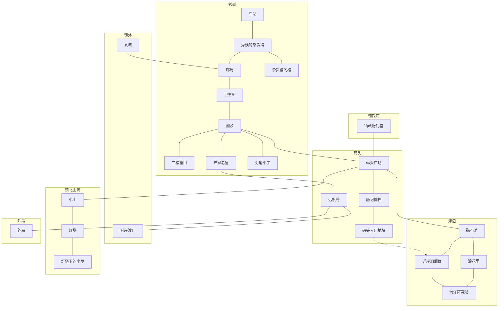

# 《汐湾咖啡馆》世界观与地点

> 状态：世界观与地点初稿，待 Grok Bot 审核

依据 [`story-outline.md`](story-outline.md)、[`story-flow.md`](story-flow.md)、[`timeline.md`](timeline.md)、[`relationships.md`](relationships.md) 和 [`characters/`](characters/README.md)。不另加主线事实。某地长什么样，只补文档里已经有的物件和光线。原先没写死的场地和顺序，已按 Grok Bot 审核写在文末。个人线的日子见 [`routes/`](routes/README.md)。

这个夏天从 7 月初到 8 月底，共 60 天。宋知远的生日是 7 月 20 日，人设写在第 20 天，所以第 1 天约为 7 月 1 日。

## 汐湾

### 地理

汐湾是南方海边的小渔镇，常住大约 2000 人。这个人数只写在策划里，不写进游戏对白。镇上有码头、灯塔、礁石滩、老街、卫生所、邮局、灯塔小学和一家冲浪民宿。老街从车站这一头往里走，顺序是秀姨的杂货铺、邮局、卫生所、「潮汐」，街的尽头是灯塔小学。「潮汐」二楼能看到海，陆家渔屋贴着店的隔壁。灯塔坐落在镇北山嘴尽头的一座小山上。

镇上只有一座车站。第 1 天秀姨在这座车站接你，夏栀的普通结局也是在这里送你。县城在镇外，叶帆的父亲在县城分拣中心，第 37 天的档案室和第 40 天的退件仓库都在县城。陆屿的结局里没有第二座车站：他开船送你到对岸的渡口，你再从渡口坐汽车或大巴离开。

外岛不在镇区里，要从码头坐船。许之言会去外岛出诊。

### 夏天的气候

夏天大约 30℃。这个数字只写在策划里，不写进游戏对白。游戏里只出现这个夏天实际发生的天气。

7 月初就能热到在店里中暑（第 5 天）。第 9 天有台风预警，大家来「潮汐」钉窗；第 28 天还剩台风尾声，外岛渔民受伤，船仍要出。第 17 天傍晚礁石滩涨潮，人会被困在滩上。宋知远说这里的浪很温柔，所以他把冲浪课放在这片海。第 13 到 14 天是小镇夏日祭，第 14 天夜里放烟花。第 25 天开渔节，船队从码头出海。

### 人和生计

写进游戏的是：年轻人大多外出打工，夏天会来一些游客和写生的人。常住大约 2000 人只留在上面那一节，对白里不报这个数。

镇上还在运转的生计，就是这一个夏天里你会走进去的那些：码头打鱼（陆家的「远帆号」、开渔节）、「唐记」海鲜排档、老街 17 号的咖啡馆、秀姨的杂货铺、镇卫生所、业务越来越少的邮局、灯塔小学、海洋研究站的珊瑚项目，以及海边的冲浪民宿。老街和码头是同一圈生意。度假村想买下整条老街，咖啡馆是最后几家还没签字的店之一。

### 和游戏调子的关系

基调是治愈、慢节奏，带一点成年人的迷茫和遗憾。玩法以剧情阅读和选择为主，穿插轻松小游戏（手冲、拉花、配方猜谜）。

地图也按这个调子用：白天守店，傍晚只选一个地方，看一个已经登场的人。遗憾放在具体的物件上，不另开一条地图探险。窗边那杯没人喝的特调、灯塔里夹着的配方页、县城退件仓库里几十年没送出的信、从不下水的比赛冲浪板、研究站墙上不写名字的铜牌，都是这一带的事。

## 地图

实线是文档写明、这个夏天走得到的联系。虚线是还没建的度假村方案，不是已经有的路。

### 给设计的平面说明

老街从车站往里是一条线：秀姨的杂货铺、邮局、卫生所、「潮汐」，尽头是灯塔小学。陆家老屋贴着「潮汐」的墙，不插进这条顺序里。二楼窗口正对海。江叙白住在杂货铺楼上的阁楼，房东是秀姨。

顺「潮汐」走到海边是码头广场。「唐记」在码头上，渔船「远帆号」从这里出海，也能开到对岸渡口。周总意向书签下的，是码头入口那块地，不是整条街的中段。夏日祭和第 26 天的庆功宴都在码头广场。

礁石滩、「浪花里」和海洋研究站都在海边这一侧，三处互相走动不超过十分钟，从码头或「潮汐」走过去也在这十分钟里。滩上能抓螃蟹，傍晚会涨潮，也是冲浪的地方。民宿不在老街收购范围里。滩外是近岸珊瑚群，研究站对着这片珊瑚。

灯塔在镇北山嘴尽头的小山上，小屋在灯塔下面。这条路和第 6 到 8 天的码头、礁石滩分开选。

镇政府礼堂靠近码头广场，不是傍晚自由行动的地点，只在第 38 天听证会开一次门。外岛从码头坐船，不和镇区连着路。县城在镇外，去档案室和退件仓库要出镇。

## 地点

下面「开放」写两件事：这个地点从哪一天起出现在傍晚的固定地图上，以及剧情第一次把你带进去是哪一天。开放之后，它每天都画在那张图上。当天有事件的地点会标出来；没有事件时走进去，只有一两句镇上的日常，不加好感。

同一天若有几件自由事件或专属事件，玩家只看其中一件。下面仍把每件可能发生的事记在它所在的地点上。

### 「潮汐」咖啡馆

渔民巷 3 号原来是外婆的娘家老屋。1987 年改成老街 17 号。约 30 年前，她在这栋房子里开了「潮汐」，开了三十年。二楼能看到海。第 1 天你推开门时，店里落满灰，橘猫拿铁从柜台后面钻出来。店里有漏水的水管（第 2 天陆屿来修）、外婆的配方本、借给灯塔又送回来的旧咖啡壶、秀姨送来的旧拉花缸。墙上有外婆和渔民合唱的老照片。窗边每年夏天放一杯没人喝的特调；第 59 天送夏会，窗边第一次放了两杯。

离开汐湾的结局里（角色好结局里离开、普通结局里回城、通用结局「回到城市」），店交给秀姨，你每年夏天回来。人留下、店还在你手里的结局不交店。唐棠好结局的餐厅开在排档旧址，和「潮汐」联营，咖啡馆本身不改造。沈若好结局是在城里开第二家「潮汐」。

- **相关的人**：外婆（原店主）、你（第 1 天接手）、拿铁、秀姨（交钥匙，也是离开后的代管）、陆屿（隔壁，常坐门口台阶）、到店的街坊和全部可攻略角色。
- **开放**：第 1 天拿到钥匙。这里是据点，不是傍晚要解锁的地点。
- **白天**：营业。试营业、推荐饮品、手冲和拉花都在店里。快进的日子用一屏带过营业额和口碑。
- **傍晚和夜里**：收店后你出门。店本身仍会有夜戏：台风钉窗、陆母和第 48 天的周总都是夜里进门。

| 天 | 在这里发生的事 | 谁能看到 |
| --- | --- | --- |
| 1 | 秀姨交钥匙，读外婆的信，拿铁出来。秀姨随口说外公走得早 | 共通 |
| 2 | 打扫；陆屿搬东西、修水管 | 共通。女主偏心动，男主是好友重逢 |
| 3 | 夏栀送回旧咖啡壶，留下擦窗；做出回来后的第一杯咖啡。晚上沈若发来消息 | 共通 |
| 4 | 试营业，秀姨和老街街坊是第一批客人 | 分支一：推荐饮品，影响口碑，以及陆屿、夏栀的好感 |
| 5 | 你在店里中暑。唐棠送来海鲜，老唐在门口放下箱子，说两句就走 | 共通。男主是唐棠线初遇，女主是码头姐妹 |
| 6 | 白天营业。沈若打电话来 | 电话两边都有。好感从这天起算，她归男主攻略 |
| 7 | 秀姨送来旧拉花缸 | 拉花解锁 |
| 9 | 台风预警，在店里钉窗。许之言、陆屿、夏栀、唐棠都到 | 分支二：留谁避雨。女主恋爱选项陆屿、许之言，友情选项夏栀、唐棠。男主相反 |
| 10 | 周总第一次上门谈收购，你没答应 | 共通。伏笔：码头有人松口；他问研究站还有没有人潜水 |
| 11 | 收拾台风后的店，发现配方本最后一页被撕掉。叶帆送来积压的信 | 共通。主线一开启 |
| 13 | 夏日祭筹备，「潮汐」受邀去码头广场摆摊 | 分支三：五人里选一个一起摆摊。女主恋爱选项仍是陆屿、许之言 |
| 15 | 客人变多。唐棠来借厨房试海鲜意面；许之言每天下午三点来买咖啡，城里的信一封没拆 | 自由多选一 |
| 16 | 夏栀放学后在店里批作业 | 自由，可看可不看 |
| 18 | 沈若拖着行李箱出现在门口 | 共通。回城线开启 |
| 20 | 秀姨闲聊老唐去年冬天借了钱，最近却不急着还 | 共通伏笔。另有自由：唐棠被安排相亲，她拉你去「唐记」救场。老唐故意把相亲办在自己的地盘 |
| 21 | 江叙白进店，借二楼窗口 | 共通。推荐的饮品影响初始好感 |
| 22 | 深夜夏栀敲门，要从这里出发送爷爷去卫生所 | 共通 |
| 24 | 苏念白天来店，推荐的饮品影响初始好感 | 白天这场是共通。同天另有自由事件在别处 |
| 26 | 苏念在店里哼歌破音，摔门离开，丝巾落在店里 | 自由，和唐棠的庆功宴二选一 |
| 27 | 陆屿在店里帮妹妹算学费，抽屉里有他自己的学生证 | 自由多选一。同天还有沈若的码头日出，以及江叙白在杂货铺阁楼出示旧速写 |
| 33 | 唐棠的海边简餐在店里试营业。叶帆的旧信与老照片展在二楼开展 | 只看锁定的那一位 |
| 34 | 陆屿生日，你在店里做外婆的橘子汽水 | 陆屿线 |
| 36 | 白天老街活动的一部分会用到店；深夜街坊会就开在「潮汐」 | 街坊会人人都看 |
| 37 | 江叙白写生展在「潮汐」开幕 | 江叙白线。同天父女争吵在唐记 |
| 39 | 听证会视频传开，店门口排起长队。苏念线里音乐会视频也在这天走红 | 排队是共通快进；视频只有苏念线 |
| 45 | 照配方做出夏日特调 | 共通。配方猜谜终局 |
| 46 | 陆母第一次进店，喝下特调。她只补两句：孩子是亲戚带大的；外婆的葬礼她没去 | 共通 |
| 48 | 周总深夜一个人来，喝了夏日特调，承认自己是程鹭的父亲，匿名捐款是他出的 | 共通。揭开反转二 |
| 59 | 秀姨办送夏会，已经登场的人都来 | 共通 |

第 32 天若没有人达标，秀姨牵头办老街市集，角色以朋友身份来帮忙，市集用老街和这家店，不另开新地图。第 4 天起的口碑会累到第 55 天的老街结果。

### 二楼窗口

「潮汐」的二楼窗口，正对海。下午的光会打在杯沿上。二十多年前，江叙白的爷爷画的就是这个窗口：一杯没人动的饮料，角落写着这杯是留给一个回不来的人的。他只是过客，不认识陆远帆，也不是外婆后来嫁的外公。

- **相关的人**：外婆（每年夏天往窗边放一杯）、江叙白和他的爷爷、陆父（对着这个窗口发呆只在陆屿个人线里讲，第 43 天，不进第 46 天）。
- **开放**：店在第 1 天就进得去。当作画画的位置，是第 21 天江叙白来借。
- **白天**：营业时的楼上光线，江叙白可以在这里坐一下午。
- **傍晚**：收店后窗口还在。沈若人设写她后期会在这个窗边说出羡慕，流程没有单独的日子。

| 天 | 在这里发生的事 | 谁能看到 |
| --- | --- | --- |
| 21 | 江叙白借窗口画海 | 共通 |
| 27 | 他在杂货铺阁楼给你看爷爷的旧速写，画的就是这个窗口 | 自由，选到他才看见。非攻略时友情支线也能看到。主线不靠这张画 |
| 33 | 叶帆的旧信与老照片展在二楼开展 | 叶帆线 |

### 秀姨的杂货铺

秀姨是老街杂货铺老板娘，小镇消息的来源，也负责把人串到一起。沈若后来换上的碎花裙和人字拖，是在这家铺子买的，流程没有写是哪一天。

她大多数戏在「潮汐」和街上，不在铺面里面：第 1 天车站接你，第 4 天来做第一批客人，第 7 天送拉花缸，第 20 天讲老唐的债，第 36 天夜里在「潮汐」召集街坊会，第 37 天和你收联名信，第 59 天办送夏会。铺子楼上的阁楼租给江叙白，房东是她。

- **相关的人**：秀姨。和叶帆是「情报双璧」：她知道八卦，叶帆知道地址。江叙白是阁楼的房客。
- **开放**：铺面第 1 天就在，但不是傍晚要选的地点，她的戏多半在「潮汐」。阁楼等江叙白第 21 天登场之后才解锁。你第 27、30、43 天上楼，见 [`routes/jiang-xubai.md`](routes/jiang-xubai.md)。解锁之后，阁楼留在固定地图上。
- **白天**：老街店铺开着，她人多半在店里或来串门。
- **傍晚**：没有单独的铺子夜戏。

### 「唐记」排档

码头上的海鲜排档，唐家三代守着。老唐是老板，唐棠是帮工，围裙上印着「唐记」。后厨、冷库都在这儿。去年冬天老唐为了换冷库、修船借了钱，在你回镇之前偷偷签了收购意向书，欠款由周总垫付，当作定金。女儿当时不知道。

外婆生前每周向唐家订一箱海鲜。排档也收陆屿的渔获，给「浪花里」供海鲜。

- **相关的人**：老唐、唐棠、陆屿（供货）、宋知远（民宿海鲜）、周总（意向书和定金）。
- **开放**：人在第 5 天就和你见过面。当作傍晚地点，从第 6 天起算在码头这一路里。
- **白天**：排档营业，旺季最忙。第 29 天清早你去码头时，周总的车停在门口。
- **傍晚**：后厨可以练刀。第 20 天相亲办在这里。第 37 天父女吵到深夜。

| 天 | 在这里发生的事 | 谁能看到 |
| --- | --- | --- |
| 5 | 老唐催唐棠回排档。人是在「潮汐」门口见到的，排档是他要她回去的地方 | 共通。反转一的第一面 |
| 6 到 8 | 她在排档后厨偷偷练刀工 | 傍晚选码头才可能遇到，和陆屿修网二选一 |
| 20 | 秀姨安排的相亲。老唐故意办在自己的排档上，唐棠拉你来救场 | 自由，选到她才看见 |
| 29 | 周总的车停在门口，老唐把文件袋塞进抽屉。周总露面时，程鹭马上离开 | 共通，清早。和反转一是同一场 |
| 35 | 海边夜市，她掌勺，老唐在人群后面偷看 | 唐棠线 |
| 37 | 父女在后厨吵到深夜，说出欠债 | 争吵是共通。唐棠线把这场写完整 |

第 26 天庆功宴在码头广场，不在排档后厨。周总一露面，程鹭就离开。同一场里唐棠撞见老唐和周总助理低声说话，然后跑到「潮汐」门口。这和苏念在店里摔门是二选一，不另加一场。

### 码头与码头广场

老街靠海的这一头是码头，码头边上是一块广场。渔船从这里出海，开渔节的仪式在这里，第 13 到 14 天的夏日祭和第 26 天的庆功宴也在广场上。周总后来在码头和程鹭谈开。陆屿出海前会来看一眼「潮汐」的门锁；天没亮的咖啡送到码头。

- **相关的人**：陆屿、陆母（听证会上才坐到老街的公开场合）、唐棠和老唐、程鹭（第 28 天在码头喝完一杯浓缩）、老渔民。
- **开放**：第 6 到 8 天傍晚自由行动的三个地点之一。
- **白天**：出海、卸货、排档营业。第 17 天的送咖啡是天亮前，不是傍晚。
- **傍晚**：修网，或看唐棠练刀。第 27 天可以来看日出，那是夜里留到天亮。

| 天 | 在这里发生的事 | 谁能看到 |
| --- | --- | --- |
| 6 到 8 | 陆屿修网，教你打渔人结 | 傍晚选码头，和唐棠练刀二选一 |
| 13 到 14 | 夏日祭在码头广场摆摊，第 14 天夜里放烟花 | 共通。第 13 天选一位搭档摆摊 |
| 17 | 天亮前给陆屿送冰黑咖啡。第二天码头多一个空杯子 | 自由 |
| 25 | 开渔节。船队出海后，陆屿第一次说起父亲和爷爷都没从海上回来 | 共通。女主对话偏恋爱，男主是友情 |
| 26 | 庆功宴在码头广场。周总一露面，程鹭就离开；唐棠看见老唐和助理 | 自由，和苏念在「潮汐」摔门二选一 |
| 27 | 沈若关掉手机，来看日出 | 自由 |
| 28 | 程鹭接到撤并通知后，在码头喝完一杯双份浓缩 | 自由，选到她才看见。通知本身属于研究站 |
| 29 | 你送咖啡时看见「唐记」门口的车和文件袋。周总露面，程鹭又一次离开 | 共通。写在这场清早戏里 |
| 36 | 陆屿办码头早市，说服老渔民站到老街这边 | 陆屿线。同天夜里街坊会在「潮汐」，人人都看 |
| 50 | 程鹭和周总谈开。周总撤回游艇码头方案 | 共通 |

### 陆家与「远帆号」

陆家世代打鱼，老屋在「潮汐」隔壁。渔船叫「远帆号」，用的是爷爷陆远帆的名字。五年前陆父出海失事，陆屿退学回来接手这条船，照顾母亲和当时还在读高中的妹妹。

周总想收这栋老屋做码头，被陆屿当面请出去。这件事写在人设里，流程没有日子。

- **相关的人**：陆屿、陆母、陆父、陆远帆、妹妹（录取通知在第 27 天，人没有单独登场写名字）。
- **开放**：隔壁从第 2 天就在。走进陆家屋里送信，是第 41 天。
- **白天**：人多半在船上或码头。
- **傍晚**：收网后，陆屿会坐在「潮汐」门口台阶上，不一定在屋里。

| 天 | 在这里发生的事 | 谁能看到 |
| --- | --- | --- |
| 41 | 你和叶帆把陆远帆的信送到陆家。陆屿接过信，陆母关上房门 | 共通 |
| 46 | 和解不在家里，在「潮汐」 | 见咖啡馆 |

### 灯塔与灯下小屋

灯塔在镇北山嘴尽头的小山上，已经改成自动导航。海事部门在评估还要不要人工值守、要不要拆改。这件事归海事部门，和周总、度假村无关。夏栀的爷爷老夏是守塔人，陆远帆的旧识。陆远帆的航海日志收在这座灯塔里，外婆撕下的配方页夹在日志中。爷爷记性差。别的都淡了，只记得两样：日志里替「潮汐」的老板娘收着东西；近年外婆托他转的那一句。第 44 天页尾仍是当年的「等你回来」，那一句由他说出来。

夏栀父母在外地，她从小住在灯塔下的小屋，包上挂着灯塔铜钥匙。

- **相关的人**：夏栀、老夏、叶帆（每周送信会在灯塔歇脚，流程没有单独的日子）、陆屿（出海靠灯塔认方向）。
- **开放**：第 6 到 8 天傍晚就能来灯下。进塔找到日志，是第 44 天由夏栀带路。
- **白天**：爷爷在塔上或小屋。夏栀白天在小学。
- **傍晚**：她给爷爷读报。关停草案贴出之后，她会一个人坐到塔顶很晚。

| 天 | 在这里发生的事 | 谁能看到 |
| --- | --- | --- |
| 3 | 旧咖啡壶是从灯塔送回店的，人到的是「潮汐」 | 共通 |
| 6 到 8 | 夏栀在灯塔下给爷爷读报 | 傍晚选灯塔 |
| 29 | 关停通知草案贴出来，她坐在塔顶 | 自由，你可以选择上去陪她 |
| 33 | 和她一起整理灯塔资料，准备保留灯塔的申请 | 夏栀线 |
| 35 | 灯塔开放夜。学生和家长来了，爷爷坐在轮椅上看灯亮起 | 夏栀线 |
| 44 | 日志、配方页、夏爷爷讲旧事：外婆后来嫁的是外公，她真正在等的是陆远帆 | 共通 |

关停的建议在第 54 天公布，只在夏栀的线里，见 [`routes/xia-zhi.md`](routes/xia-zhi.md)。

### 邮局

汐湾邮局。叶帆的父亲送了二十多年信，三年前调去县城，把无人认领的旧信留给她。仓库里有一箱按规定早该销毁、却一直留着的信，还有父亲的登记本。镇上业务越来越少，县里在讨论并入邻镇。

叶帆骑绿色二八单车送信，能背出全镇门牌。外婆那封信上撕掉的旧门牌，就是「渔民巷 3 号改成老街 17 号」，也就是现在的「潮汐」。渔民巷 3 号原来是外婆的娘家老屋，后来才开成咖啡馆。信上写的是外婆的小名，跟户口对不上，所以在 1987 年改门牌之前就已经被当成无法投递，送进了县城的退件仓库。第 40 天在那里找到实物。

- **相关的人**：叶帆、她的父亲、秀姨。
- **开放**：第 11 天她登场，邮局作为自由行动地点从这天起开放。第 6 到 8 天去不了。
- **白天**：她在路上送信。台风过后第 11 天邮路才恢复。
- **傍晚**：仓库和登记本要跟她进去才看得到。

| 天 | 在这里发生的事 | 谁能看到 |
| --- | --- | --- |
| 11 | 她把信送到「潮汐」，说邮局有一封写给外婆的旧信 | 人到的是店。邮局当天起开放 |
| 12 | 登记簿上记着一封 1970 年代的无人认领信，就是陆远帆的信。箱子里没有实物，信纸第 40 天才找到 | 共通 |
| 19 | 和她送出第一封旧信，收信人的女儿在自己家里哭 | 自由。地点是收信人家，不是邮局柜台 |
| 23 | 撤并通知传来。她没骑车，推着车走路 | 自由 |
| 28 | 在仓库翻出母亲的旧地址 | 自由 |
| 37 | 雨夜去县城档案室，查到外婆的小名，以及渔民巷 3 号改成老街 17 号 | 只有叶帆线。地点在县城。不走她的线，这场不去 |
| 40 | 在县城退件仓库找到陆远帆的信。信上是外婆的小名，所以进了退件仓库 | 章末共通。不走叶帆线的玩家，由她用一两句补上第 37 天查到的小名和旧门牌 |

### 卫生所

镇上唯一的卫生所。只有许之言和一名老护士。他住在卫生所二楼，随叫随到。外婆是他在镇上的第一个常客病人。秀姨常来「量血压」，其实是打听消息，流程没有写是哪几天。

- **相关的人**：许之言、老护士、夏栀的爷爷（他的病人）、陆母（高血压，人设里他照看）、苏念（复查）、宋知远（旧伤复健）、程鹭（潜水后的耳压）。
- **开放**：第 5 天你被送进去，但许之言人不在。傍晚能在台阶上遇到他，是第 10 到 14 天。
- **白天**：出诊或在所里。第 5 天、第 28 天他在外岛。
- **傍晚**：台阶上吃泡面。夜里会有急诊。

| 天 | 在这里发生的事 | 谁能看到 |
| --- | --- | --- |
| 5 | 你中暑被送来。只有老护士转交的字条 | 共通 |
| 10 到 14 | 他在台阶上一个人吃泡面 | 傍晚路过可触发 |
| 22 | 夏栀爷爷发病，连夜抢救。她在走廊说起放弃读研 | 同一场，共通 |
| 24 | 沈若在老街低血糖晕倒，你送她来。她还在回邮件 | 自由 |
| 35 | 夏日义诊办在「潮汐」，不在卫生所 | 许之言线 |

第 38 天他在镇政府礼堂的听证会上为老人的就医发言，会后才拆开第一封城里来信。礼堂不是卫生所，也不是傍晚能去的地方。

### 海洋研究站

程鹭的工作地点，珊瑚生态。这片海有一片少见的近岸珊瑚群。她在汐湾第四年。去年导师退休，项目交给她。启动经费的铜牌写着「匿名捐赠」，不写名字；第 48 天才对上是周总出的。今年经费被砍，年底要撤。

外婆生前每周给研究站送一次咖啡。你第 16 天送的是外卖咖啡。

- **相关的人**：程鹭、导师（人设里，流程没有出场日）、周总（捐款，人不在站里办公）。
- **开放**：第 16 天剧情把你带去。不在第 6 到 8 天的傍晚菜单里。
- **白天**：潜水、实验室。墙上有那块铜牌。
- **傍晚**：文档没有把研究站写成固定的傍晚地点。浮潜在第 30 天，珊瑚夜潜的照片在第 36 天给镇上的人看。

| 天 | 在这里发生的事 | 谁能看到 |
| --- | --- | --- |
| 16 | 程鹭潜水上来，提醒你别踩珊瑚。你看见匿名捐赠的铜牌 | 共通。她登场。伏笔反转二 |
| 19 | 实验室里，她对着白化的珊瑚样本发呆 | 自由 |
| 28 | 撤并通知下来 | 自由。她随后在码头喝完那杯咖啡 |
| 30 | 她带你第一次浮潜，看近岸珊瑚 | 自由 |
| 34 | 她把数据给你看，做成镇民看得懂的展板 | 程鹭线。展板后来用于听证会 |
| 36 | 珊瑚夜潜、海洋科普夜。孩子和老人第一次看到荧光珊瑚的照片 | 程鹭线 |

研究站的海况记录能帮你查陆远帆出海那天的风暴。文档没有把这次查阅单独写成某一天。

### 礁石滩

老街外面的滩。童年你和陆屿在这里抓螃蟹。傍晚来看海，第 6 到 8 天还没有事件。第 17 天涨潮会把人困住。苏念夜里在这里弹木吉他。江叙白也会在这里支画架。宋知远的冲浪在这片浪上，程鹭会把人从珊瑚礁边赶开。

- **相关的人**：宋知远、苏念、江叙白、程鹭、陆屿（童年）。
- **开放**：第 6 天起就是傍晚三个地点之一，但要到第 17 天才有人在滩上接你。
- **白天**：能冲浪、画画。大浪天宋知远站在岸边不下水。
- **傍晚和夜里**：散步、听琴、涨潮。

| 天 | 在这里发生的事 | 谁能看到 |
| --- | --- | --- |
| 6 到 8 | 看海，无事件 | 傍晚可选 |
| 17 | 涨潮把你困住，宋知远用冲浪板送你回岸 | 共通。他登场 |
| 23 | 收店后听见琴声，苏念立刻停下 | 共通。同天叶帆的撤并通知是另一件自由事件 |
| 24 | 江叙白画了一整天，傍晚画布仍是空白 | 自由 |
| 24 | 宋知远的冲浪体验课 | 自由，和上面那件、以及沈若晕倒，三选一 |
| 29 | 大浪天，宋知远站在岸边，没有下水 | 自由 |
| 31 | 苏念在滩上弹了一夜木吉他，旧渔歌里有「夏天结束就回来」 | 自由 |

### 冲浪民宿「浪花里」

宋知远三年前租下的旧房子，他自己起的名字。房东是已经搬去城里的老人，租约夏末到期，子女要卖掉，和周总无关。民宿不在老街收购范围里，和礁石滩、研究站一样在海边这一侧，走过去不超过十分钟。墙上挂着一块从不下水的旧比赛冲浪板。苏念住顶楼。沈若到镇之后也住在这里。苏念住顶楼这件事人设写明了，流程没有单独的揭晓日。翻修时他找到一张旧码头照片：年轻的外婆站在写着「远帆」的渔船旁。玩家第 34 天才看见，而且只在他的线里，见 [`routes/song-zhiyuan.md`](routes/song-zhiyuan.md)。好结局里「浪花里」和「潮汐」联名，你和他一起租下或买下这栋房子，回去比赛也不会丢掉民宿。

- **相关的人**：宋知远、苏念（房客，顶楼）、沈若（到镇后住在这里）、外婆（来过他的浅水课）、秀姨（帮他拉客）、唐棠（海鲜供货）。
- **开放**：第 17 天人在礁石滩登场。第一次进民宿，是第 20 天的生日烧烤。
- **白天**：体验课多半在滩上，不在屋里。
- **傍晚**：烧烤、送东西上楼。

| 天 | 在这里发生的事 | 谁能看到 |
| --- | --- | --- |
| 20 | 生日烧烤。你发现那块旧冲浪板从来没有下过水 | 自由 |
| 29 | 你把丝巾送到顶楼，看见诊断书，苏念说出嗓子的事 | 自由 |
| 37 | 冲浪节，他在众人面前冲了一道中等的浪 | 宋知远线。人在海上，节是老街活动之一 |

### 灯塔小学

镇上的小学就是灯塔小学，在老街尽头，夏栀教书的第三年。程鹭来上过一次海洋科普课，学生叫她珊瑚姐姐。学校画在镇上的图里，但不是傍晚自由行动的地点：你不去上课。

- **相关的人**：夏栀、她的学生、程鹭（一次课，没有日子）。
- **开放**：你不去上课。夏栀第 16 天放学后到的是「潮汐」。
- **白天**：她在学校。第 16 天一个学生的作文《我长大想当灯塔》，是她带到咖啡馆来看的。
- **傍晚**：她不在教室，在店里或灯塔。

### 外岛

镇区外面的岛，渔民住在那里。文档没有写岛名。许之言出诊要坐船。

- **相关的人**：许之言、外岛渔民。
- **开放**：不是常驻地图。第 5 天他在岛上，你在卫生所。第 28 天你可以选择陪他去。
- **白天**：出诊。
- **傍晚**：第 28 天的天气是台风残余，不是普通傍晚散步。

| 天 | 在这里发生的事 | 谁能看到 |
| --- | --- | --- |
| 5 | 他在外岛，所以卫生所只有字条 | 你本人不去 |
| 28 | 渔民受伤，他坚持坐船出诊 | 自由，可以选择陪他 |

### 车站

镇上只有这一座。第 1 天秀姨在这里接你。夏栀的普通结局里，她来这座车站送你，把灯塔铜钥匙的复制件给你。陆屿送人离开时不去车站：他开船到对岸渡口，你再坐汽车或大巴走。

车站在老街这一头，从这里往里才是杂货铺。它不是傍晚自由行动的地点。

### 对岸渡口

陆屿的普通结局里，他开船把你送到这里，只说船票替你留着。你从渡口换乘汽车或大巴离开。这里不是车站，也不在汐湾的傍晚地图上。

### 县城

镇外。叶帆的父亲在分拣中心。只有走叶帆线，第 37 天雨夜才去档案室，查外婆的小名和「渔民巷 3 号改成老街 17 号」。第 40 天在退件仓库找到陆远帆的信，这场人人都有；不走她的线，她用一两句告诉你第 37 天查到了什么。县城不是汐湾傍晚地图上的日常地点。

### 镇政府礼堂

老街听证会的会场，靠近码头广场。不是傍晚自由行动的地点，平日不开放，只在第 38 天开一次门。老唐在这里撕掉意向书，程鹭用数据说明游艇码头的代价，周总失神叫出「小鹭」。主攻角色的额外发言也在同一场里。

### 杂货铺阁楼

江叙白七月下旬到镇，住在秀姨家杂货铺楼上的阁楼。秀姨是房东。你第 27、30、43 天上楼。他的戏仍在「潮汐」、礁石滩和写生展。

### 码头入口地块与度假村方案

这不是一座已经建好的楼。度假村要收购整条老街，游艇码头会碰到近岸珊瑚。意向书签下的是码头入口那块地，周总垫了定金。陆家老屋也被看中过，见陆家一节。第 48 天周总说，他想用度假村里的海洋馆把女儿留在身边。方案第 50 天撤回游艇码头这一部分，改过之后再交给县里。

第 55 天按口碑公布：高，老街保住；中，码头一角改建，老街主体留下；低，老街被收购，周总只留「潮汐」这一栋。

## 小镇历史

年份没写死的，算法和 [`timeline.md`](timeline.md) 一样，从今年夏天往前数。

几十年前，陆远帆年轻丧妻，带着还小的儿子出海。他对外婆说，这趟回来就娶她，夏天结束就回来。船遇上风暴，没有回来。信写着「等我回来，喝你的夏日特调」，又说日志在灯塔老夏那里。信封写的是外婆的小名，跟户口对不上，投递时就被当成无法送达，送进县城的退件仓库。信上的门牌是渔民巷 3 号，1987 年才改成老街 17 号，也就是后来的「潮汐」；改号不是信送不出的原因。同一段日子，外婆自己撕下配方页，托老夏夹进那本日志。

陆父由亲戚带大，后来自己也出海。陆远帆没回来之后，外婆嫁给了外公。外公在你出生前就走了，具体年份没有写。第 1 天秀姨才随口说起。外公不是江叙白的爷爷。

渔民巷 3 号是外婆的娘家老屋。1987 年改成老街 17 号。约 30 年前，她在这栋房子里开了「潮汐」。之后每个夏天，她都在窗边放一杯特调。二十多年前，店刚开没几年，江叙白的爷爷来写生，住了半个月，画下那个窗口。

你、陆屿、夏栀的童年在礁石滩和这家店里。你上初中后去了城里。唐家三代守着码头排档。约五年前陆父失事，陆屿退学回来。约四年前研究站的珊瑚项目在这里，程鹭跟着导师来了，启动经费里有一笔不写名字的捐款。约三年前，夏栀回到灯塔小学，叶帆接过邮路，宋知远租下旧房子开了「浪花里」。约两年前许之言支援期满后留下。去年导师退休；去年冬天老唐借钱换冷库、修船，并在你回来之前签了意向书。

信因为写着外婆的小名、对不上户口，早进了县城退件仓库。第 37 天只有叶帆线会去档案室，对上小名和「渔民巷 3 号改成老街 17 号」。第 40 天找信人人都有；不走她的线，她当天用一两句把档案室的结果告诉你。

### 度假村和听证会

周总代表度假村来谈收购，不是纯坏人。第 10 天第一次上门，价开得很高，你没答应。他告诉秀姨码头已经有人松口，又问研究站还有没有人潜水。程鹭这天还没登场，不会在这里提前离开。第 16 天才能看见研究站的匿名捐赠铜牌。第 20 天秀姨说老唐忽然不急着还钱。第 26 天码头广场的庆功宴上，他一露面，程鹭就离开，和唐棠看见助理是同一场。第 29 天清早，他的车停在「唐记」门口，程鹭又离开一次。第 33 天开发商加价，邻居开始动摇。你用店里的活动把人留住：灯塔开放夜、海边夜市、旧信展、音乐会、写生展、冲浪节、珊瑚夜潜、码头早市、夏日义诊、线上传播。没有主攻角色时，改成秀姨牵头的老街市集。

第 36 天白天是老街活动，深夜街坊会开在「潮汐」。周总拿出老唐签过字的意向书，码头入口那块地已经签了。第 37 天唐棠和老唐在「唐记」后厨谈开欠债，你和秀姨去收联名信。第 38 天听证会在镇政府礼堂：老唐当众撕掉意向书，说定金慢慢还，地不卖了；程鹭用数据说明游艇码头的代价；周总失神叫出「小鹭」。县里说补充材料，八月底再公布。主攻角色在同一场听证会上各有一段，不算另一件大事。礼堂这一天之外不开门。

第 42 天周总答应定金分期，走时说自己也有个女儿。第 48 天他在「潮汐」承认自己是程鹭的父亲。第 50 天两人在码头谈开，他撤回游艇码头方案。第 55 天县里按口碑公布老街结果，三种结局见上一节。老街结果是结局里的附加演出，不单独算一个结局。

## 白天营业和傍晚自由行动

- 白天守「潮汐」：营业、小游戏、上门的剧情。没有剧情节点的日子按周快进，一屏带过营业额、口碑和一两句镇上的小事。
- 傍晚自由行动：选一个地点，触发一位已经登场的角色的个人事件。同一天列出好几件时，只能看一件。没登场的人不会出现在这份选择里。
- 第 6 到 8 天写明的地点只有三个：码头（陆屿修网，或唐棠练刀）、灯塔（夏栀给爷爷读报）、礁石滩（看海，无事件）。邮局要到第 11 天才开放。
- 许之言第 9 天才本人登场。第 10 到 14 天傍晚，路过卫生所可以看见他吃泡面。
- 固定地图：已经解锁的地点，之后每一天都画在同一张图上。当天有事件的地点做标记。走进一个当天没有事件的地点，只给一两句镇上的日常，不加好感。Efe 做地图界面时按这一条。
- 解锁日照旧。邮局第 11 天，研究站第 16 天，「浪花里」第 20 天。解锁之后就留在图上，不是只在有事件的那天出现。外岛只有第 28 天可以选择陪诊。县城只有第 37 天（叶帆线）和第 40 天的找信，不进日常傍晚地图。镇政府礼堂不是傍晚地点，只在第 38 天开放。
- 第 32 天只做主攻判定，不另开一场新戏，也不新开地点。男主在 6 位女性里锁，女主在 4 位男性里锁。两位同时达标且分数相同，锁定自由行动里最近选过的那一位。没达标就走老街市集。
- 性别不改地图。同一处地点，恋爱演出和友情演出用不同对话，不加错边的恋爱好感。
- 序章第 1 天不出现可攻略角色。车站、店、秀姨、拿铁之外，没有傍晚地图。

## 已确认（Grok Bot）

- 常住大约 2000 人，夏天大约 30℃。两处都只写在策划里，不写进游戏对白。游戏里仍只出现中暑、台风、涨潮和「浪很温柔」。
- 灯塔在镇北山嘴尽头的小山上，小屋在灯下。地图上要画出这座山。
- 老街从车站往里：杂货铺、邮局、卫生所、「潮汐」，尽头是灯塔小学。陆家贴着「潮汐」，不插进这条顺序。礁石滩、「浪花里」、海洋研究站都在海边一侧，互相以及离码头都不超过十分钟。
- 镇上只有一座车站。第 1 天秀姨在这里接你。陆屿的结局改为：开船送到对岸渡口，你再坐汽车或大巴离开。没有对岸车站。
- 镇上的小学就是灯塔小学。不再写「暂作同一所」。
- 夏日祭在码头广场。第 36 天夜里的街坊会在「潮汐」。第 38 天听证会在镇政府礼堂；礼堂不是傍晚自由行动地点，只在这一天开门。第 20 天相亲在「唐记」，老唐故意办在自己的地盘。第 26 天庆功宴在码头广场。
- 每个已解锁的地点每天都出现在固定地图上。当天有事件的地点做标记。没有事件的地点只给一两句日常，不加好感。每天傍晚仍只选一个地点。
- 沈若住在「浪花里」。江叙白住秀姨家杂货铺楼上的阁楼，秀姨是房东。上楼是第 27、30、43 天。
- 外婆信上撕掉的旧门牌，就是「渔民巷 3 号改成老街 17 号」，即现在的「潮汐」。渔民巷 3 号原来是外婆的娘家老屋。信没送到，是因为信封写的是她的小名，跟户口对不上，进了县城的退件仓库；不是因为 1987 年改了门牌。第 40 天在退件仓库找到信。
- 第 37 天去县城档案室查小名和旧门牌，只有叶帆线。第 40 天找信人人都有。不走叶帆线的玩家，第 40 天由她用一两句说清第 37 天查到了什么。
