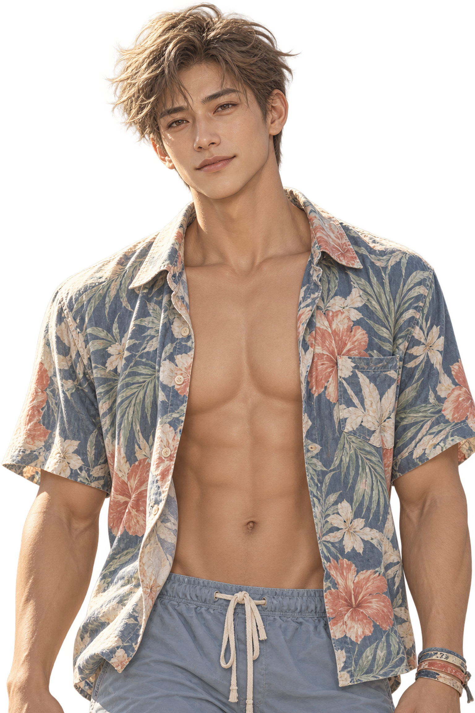

# 宋知远 song-zhiyuan



现有母版：[song-zhiyuan_normal.png](../../assets/portraits/song-zhiyuan/song-zhiyuan_normal.png)

审核以这一版为准：[基准立绘审核 `fe9c128`](https://github.com/GmhLovEDM/grok-prototype/blob/fe9c1282fde5f5a4ebc439432c782a48db51d274/projects/seaside-cafe/assets/portraits/_reviews/portrait-masters-review.md)

## 重画要点

无必须改。通过，可以按现有母版派生。本人第 17 天才登场，不在序章和第一章。

可选，不挡住定稿。原文在审核报告：手环上的号码保持磨掉、看不清。不要改成一组能读出来的新数字。底边沙滩裤上半截留着，不重画。

```text
Use case: precise-object-edit. Optional. 宋知远: keep the wristbands faded so any numbers are worn away, not newly legible. Leave the short waistband or upper-shorts strip. Preserve everything else, including real alpha transparency. Output 1536×2304 PNG.
```

左膝的长手术疤在腰以上不一定看见。不要为了疤把构图拉到膝盖。

## 规格

1536×2304，PNG，真实透明。腰以上。沙滩裤上沿可以露一点。冲浪板不画。墨镜不画。项链不画。

固定身份：28 岁，宽肩窄腰，肌肉清楚，皮肤古铜色。浅棕微卷短发，发梢晒浅，有点乱。浅褐、圆而下垂的眼睛。花衬衫敞着扣，里面没有打底。一只手腕上有一串褪色布手环，号码磨掉。平常是闭着嘴的一点笑，眼角细纹留到大笑那张。

共同负向：冲浪板，风景，棋盘格，照片，3D，Q 版，水印，清晰号码，新数字，项链，墨镜，多指，全身，膝盖，别人的脸。

## 表情

默认花衬衫。参考 `song-zhiyuan_normal.png`。手环号码保持看不清。

### song-zhiyuan_smile.png

笑是他最常见的脸。眼角可以有细纹。

```text
Use case: precise-object-edit. Same 宋知远 master. Expression only: his usual open friendly smile, fine lines at the eyes allowed. Keep faded unreadable wristband, open floral shirt, tan, alpha. Output 1536×2304 PNG.
```

### song-zhiyuan_serious.png

沉是大浪那天没下水，以及后来给看膝盖上的疤。不开玩笑。疤不必入画。

```text
Use case: precise-object-edit. Same master. Expression only: serious, joke put away, mouth closed. Do not extend the frame to the knee. Keep the faded wristband. Output 1536×2304 PNG.
```

### song-zhiyuan_sad.png

难过留在疤和退役那一场，不另做哭。

```text
Use case: precise-object-edit. Same master. Expression only: quiet sadness, no crying. Keep shirt, faded wristband, alpha. Output 1536×2304 PNG.
```

## 服装

### song-zhiyuan_wetsuit_normal.png

防寒泳衣半褪到腰间。上身是泳衣，腰际可以看见褪下的那一截，不要画到膝盖，也就不要为了左膝的疤拉长构图。手环还在。平常可以是一点笑，这一张按清单是平常。

清单写 `wetsuit` 只要平常和笑。平常用闭着嘴的一点笑即可，大笑留给下一张。

```text
Use case: precise-object-edit. Same 宋知远 identity. A springsuit peeled down to the waist, torso bare or in the suit top as a half-removed wetsuit, no surfboard. Waist-up; do not show the knee or the knee scar. Faded unreadable wristband stays. Mild closed-mouth expression. Real alpha. Output 1536×2304 PNG.
```

### song-zhiyuan_wetsuit_smile.png

同一套防寒泳衣，笑是常见的那张。

```text
Use case: precise-object-edit. Wetsuit variant above. Expression only: his usual friendly smile. No surfboard, no knee, wristband numbers unreadable. Output 1536×2304 PNG.
```
